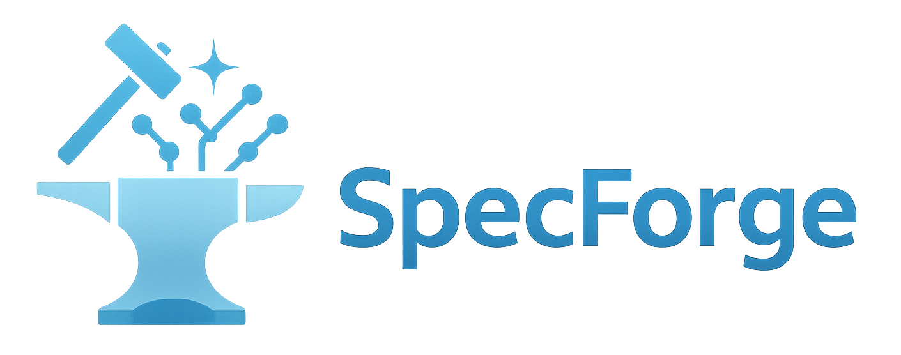

<div align="center" id="sglangtop">
</img>

[](https://docs.sglang.io/SpecForge/)
[](https://huggingface.co/collections/lmsys/specbundle)
[![DeepWiki](https://img.shields.io/badge/DeepWiki-SpecForge-blue.svg?logo=data:image/png;base64,iVBORw0KGgoAAAANSUhEUgAAACwAAAAyCAYAAAAnWDnqAAAAAXNSR0IArs4c6QAAA05JREFUaEPtmUtyEzEQhtWTQyQLHNak2AB7ZnyXZMEjXMGeK/AIi+QuHrMnbChYY7MIh8g01fJoopFb0uhhEqqcbWTp06/uv1saEDv4O3n3dV60RfP947Mm9/SQc0ICFQgzfc4CYZoTPAswgSJCCUJUnAAoRHOAUOcATwbmVLWdGoH//PB8mnKqScAhsD0kYP3j/Yt5LPQe2KvcXmGvRHcDnpxfL2zOYJ1mFwrryWTz0advv1Ut4CJgf5uhDuDj5eUcAUoahrdY/56ebRWeraTjMt/00Sh3UDtjgHtQNHwcRGOC98BJEAEymycmYcWwOprTgcB6VZ5JK5TAJ+fXGLBm3FDAmn6oPPjR4rKCAoJCal2eAiQp2x0vxTPB3ALO2CRkwmDy5WohzBDwSEFKRwPbknEggCPB/imwrycgxX2NzoMCHhPkDwqYMr9tRcP5qNrMZHkVnOjRMWwLCcr8ohBVb1OMjxLwGCvjTikrsBOiA6fNyCrm8V1rP93iVPpwaE+gO0SsWmPiXB+jikdf6SizrT5qKasx5j8ABbHpFTx+vFXp9EnYQmLx02h1QTTrl6eDqxLnGjporxl3NL3agEvXdT0WmEost648sQOYAeJS9Q7bfUVoMGnjo4AZdUMQku50McDcMWcBPvr0SzbTAFDfvJqwLzgxwATnCgnp4wDl6Aa+Ax283gghmj+vj7feE2KBBRMW3FzOpLOADl0Isb5587h/U4gGvkt5v60Z1VLG8BhYjbzRwyQZemwAd6cCR5/XFWLYZRIMpX39AR0tjaGGiGzLVyhse5C9RKC6ai42ppWPKiBagOvaYk8lO7DajerabOZP46Lby5wKjw1HCRx7p9sVMOWGzb/vA1hwiWc6jm3MvQDTogQkiqIhJV0nBQBTU+3okKCFDy9WwferkHjtxib7t3xIUQtHxnIwtx4mpg26/HfwVNVDb4oI9RHmx5WGelRVlrtiw43zboCLaxv46AZeB3IlTkwouebTr1y2NjSpHz68WNFjHvupy3q8TFn3Hos2IAk4Ju5dCo8B3wP7VPr/FGaKiG+T+v+TQqIrOqMTL1VdWV1DdmcbO8KXBz6esmYWYKPwDL5b5FA1a0hwapHiom0r/cKaoqr+27/XcrS5UwSMbQAAAABJRU5ErkJggg==)](https://deepwiki.com/sgl-project/SpecForge)

[](https://lmsys.org/blog/2025-07-25-spec-forge/)
[](https://sgl-fru7574.slack.com/archives/C09784E3EN6)
[](./LICENSE)

[English](./README.md) | **简体中文**

</div>

## 📍 项目概览 (Overview)

SpecForge 是由 SGLang 团队研发的生态项目。它是一个专为训练投机解码（Speculative Decoding）草稿模型（Draft Models）而打造的训练框架，让您可以将训练好的模型无缝迁移部署至 SGLang 推理服务框架中，从而大幅加速大模型在线推理。

目前社区中虽然已有不少投机解码相关的开源项目，但大多缺乏持续维护，或无法与 SGLang 直接兼容。我们构建本项目的初衷，正是希望让开源社区能够享受到一个兼具以下特性的投机解码框架：

- **由 SpecForge 团队定期维护**：代码开箱即用，持续迭代演进
- **与 SGLang 原生无缝兼容**：训练产出的权重无需任何额外转换或移植工作即可直接部署
- **统一的运行时架构**：支持在单一运行时中执行在线分离式训练（Online Disaggregated Training）以及同节点共置（Colocated）或分离式（Disaggregated）离线训练，并全面支持数据并行（DP）、张量并行（TP）与序列并行（SP）等多种并行拓扑

欢迎查阅[**我们的官方文档**](https://docs.sglang.io/SpecForge/)快速开始使用。


## 🔧 支持的算法与方法 (Supported Methods)

所有算法均采用统一的强类型训练入口命令：

```bash
specforge train --config examples/configs/online/disaggregated/external/qwen3-8b-eagle3.yaml
```

`examples/configs` 下的配置路径明确标识了特征模式、部署拓扑以及在线服务的归属方式。上述命令使用的是 `external`（外部托管）配置方案：SpecForge 在单个训练节点上负责监管数据生产者与消费者，而用户或集群调度器负责管理 Mooncake 与 SGLang 服务；若使用 `managed-local` 目录下的配置方案，则会在本地宿主机上一并自动启动这些服务。在线目标模型（Target Model）的并行策略由 SGLang 管理，而 `deployment.trainer` 则负责管理训练器的数据并行（DP）以及离线 EAGLE3 的 USP 进程组。无需为不同算法分别编写特定的 Python 训练入口脚本。

| 算法 / 方法 | 说明 | 示例配置 (Example config) | 优化技术 (Optimization) |
| --- | --- | --- | --- |
| **[EAGLE3](https://arxiv.org/abs/2503.01840)** | 基于特征的自回归草稿生成（Feature-based autoregressive drafting） | [在线外部托管 (Online external)](./examples/configs/online/disaggregated/external/qwen3-8b-eagle3.yaml) / [离线共置 (Offline colocated)](./examples/configs/offline/colocated/qwen3-8b-eagle3.yaml) / [离线分离 (Offline disaggregated)](./examples/configs/offline/disaggregated/qwen3-8b-eagle3.yaml) | [LK loss](https://arxiv.org/pdf/2602.23881) |
| **[P-EAGLE](https://arxiv.org/abs/2602.01469)** | 并行 EAGLE（Parallel EAGLE） | [在线外部托管 (Online external)](./examples/configs/online/disaggregated/external/qwen3-8b-peagle.yaml) | — |
| **EAGLE3.1** | 带注意力漂移建模的基于特征自回归草稿生成 | [在线外部托管 (Online external)](./examples/configs/online/disaggregated/external/qwen3-30b-a3b-eagle3.1.yaml) | — |
| **[DFlash](https://arxiv.org/abs/2602.06036)** | 块并行草稿生成（Block-parallel drafting） | [在线外部托管 (Online external)](./examples/configs/online/disaggregated/external/qwen3-8b-dflash.yaml) / [离线共置 (Offline colocated)](./examples/configs/offline/colocated/qwen3-8b-dflash.yaml) / [在线本地托管 (Online managed-local)](./examples/configs/online/disaggregated/managed-local/qwen3-8b-dflash-1server-dp7.yaml) | [D-PACE](https://arxiv.org/abs/2605.18810) |
| **[DFlash2](https://inco.ai/blog/dflash2/)** | 结合分组动态卷积与 Top-K 路径选择的增强版 DFlash | [在线本地托管 (Online managed-local)](./examples/configs/online/disaggregated/managed-local/qwen3.6-27b-dflash2.yaml) | [D-PACE](https://arxiv.org/abs/2605.18810)|
| **[Domino](https://arxiv.org/html/2605.29707v1)** | 带 GRU Logit 校正机制的 DFlash | [在线外部托管 (Online external)](./examples/configs/online/disaggregated/external/qwen3-8b-domino.yaml) / [离线共置 (Offline colocated)](./examples/configs/offline/colocated/qwen3-8b-domino.yaml) / [在线本地托管 (Online managed-local)](./examples/configs/online/disaggregated/managed-local/qwen3-8b-domino-2server-dp2.yaml) | — |
| **[DSpark](https://arxiv.org/abs/2607.05147)** | 置信度调度的半自回归生成（Confidence-Scheduled Semi-Autoregressive Generation） | [在线外部托管 (Online external)](./examples/configs/online/disaggregated/external/qwen3-4b-dspark.yaml) / [离线共置 (Offline colocated)](./examples/configs/offline/colocated/qwen3-4b-dspark.yaml) | — |

有关受支持的算法/拓扑兼容矩阵，请参阅[训练指南](./docs/sections/basic_usage/training.md)；有关在线/离线启动工作流的详细说明，请参阅[分离式训练指南](./docs/sections/basic_usage/disaggregated_training.md)。不受支持的组合会在配置校验或运行组装阶段直接报错拦截，而不会静默回退至旧版训练器。


## 🚀 使用 SpecBundle 加速推理

SpecBundle 是由 SpecForge 团队联合行业合作伙伴共同发布的一系列生产级投机解码模型集合。与现有的开源权重相比，它们在广泛的应用领域中均展现出了更高的接受率（Acceptance Rate）。搭配 SGLang 使用时，您最高可获得达 **4 倍**的推理加速比。欢迎访问以下资源了解详情：


| 资源项 | 链接 |
| --- | --- |
| 📝 官方文档 | [查看链接](https://docs.sglang.io/SpecForge/specbundle.html) |
| 📊 性能看板 (Performance Dashboard) | [查看链接](https://docs.sglang.io/SpecForge/specbundle.html#performance-dashboard) |
| 🤗 Hugging Face 模型合集 | [查看链接](https://huggingface.co/collections/lmsys/specbundle) |


## 🎉 最新动态 (News)
- [2026-08] 🔥 新增面向 DFlash 草稿模型的 DFlash2 在线训练支持。
- [2026-08] 🎉 正式发布 SpecBundle（第二期）与 SpecForge v0.3.0。欢迎阅读我们在 [LMSYS.org](https://www.lmsys.org/blog/2026-08-04-specforge-v0-3) 发布的技术博客。
- [2026-07] 🚀 首日（Day-0）同步支持两款旗舰级 DSpark 草稿模型：[Inkling](https://huggingface.co/RadixArk/Inkling-DSpark-Preview) 与 [Kimi-K3](https://huggingface.co/RadixArk/Kimi-K3-DSpark)。
- [2026-07] 🔥 在线训练全面支持训练与推理的彻底解耦分离（Full Disaggregation）。
- [2026-07] 🔥 新增面向 DFlash 草稿模型的 DSpark 在线训练支持。
- [2026-06] 🔥 新增 D-PACE 作为 DFlash 训练的可选损失函数。
- [2026-06] 🔥 新增面向 DFlash 草稿模型的 Domino 在线训练支持。
- [2026-01] 🔥 新增搭配 SGLang 推理服务端支持的 DFlash 块并行在线训练功能。
- [2025-12] 🎉 正式发布 SpecBundle（第一期）与 SpecForge v0.2.0。欢迎阅读我们在 [LMSYS.org](https://lmsys.org/blog/2025-12-23-spec-bundle-phase-1/) 发布的技术博客。
- [2025-08] 🔔 SpecForge 被正式列为 LMSYS 的[旗舰项目 (Flagship Project)](https://lmsys.org/about/)，热烈祝贺 SpecForge 团队！
- [2025-08] 🔥 SpecForge 赋能训练了面向 GPT-OSS 的 EAGLE3 草稿模型。欢迎阅读 [LMSYS.org](https://lmsys.org/blog/2025-08-27-gpt-oss/) 上的技术博客。
- [2025-07] 🔥 SpecForge 携 Llama4-Eagle3 预训练权重正式开源发布！欢迎阅读我们在 [LMSYS.org](https://lmsys.org/blog/2025-07-25-spec-forge/) 上的发布博客。

## ✨ 致谢 (Acknowledgements)

</img>

我们向官方 EAGLE 团队（特别是 Hongyang Zhang 与 Yuhui Li）致以最诚挚的谢意，感谢他们宝贵的贡献与大力支持。同时，我们也衷心感谢 NVIDIA 团队（特别是 Avery H 与 Izzy Putterman）以及 Google 团队（特别是 Ying Wang）在整个项目推进过程中提供的深刻见解与慷慨协助。

我们还要特别感谢美团（Meituan）对本项目的鼎力支持与重要贡献，这对于推动项目的快速演进起到了至关重要的作用。

此外，本项目还受到了大语言模型开源社区中诸多优秀项目的启发，包括 [EAGLE](https://github.com/SafeAILab/EAGLE)、[BaldEagle](https://github.com/NickL77/BaldEagle) 以及 [TensorRT-Model-Optimizer](https://github.com/NVIDIA/TensorRT-Model-Optimizer) 等。他们的开源成果与知识共享使我们的工作受益匪浅。

## 💡 特别鸣谢 Voltage Park

我们向官方基础设施合作伙伴 [Voltage Park](https://www.voltagepark.com/) 致以诚挚的感谢。作为与 SGLang 团队正式合作的一部分，Voltage Park 提供了关键的 GPU 算力资源，赋能我们高效、可靠地训练并评测大规模投机解码模型。这一合作伙伴关系对于 SpecForge 的诞生起到了不可或缺的作用。我们由衷赞赏 Voltage Park 致力于让前沿 AI 基础设施更加触手可及的使命，并期待在不断突破开源大模型推理服务与优化边界的过程中继续深入合作。

## 📃 引用 (Citation)

```bibtex
@article{li2026specforge,
  title={{SpecForge}: A flexible and efficient open-source training framework for speculative decoding},
  author={Li, Shenggui and Wang, Chao and Zhu, Yikai and Wang, Yubo and Yin, Fan and Shi, Shuai and Chen, Yefei and Dong, Xiaomin and Chen, Qiaoling and Pan, Jin and others},
  journal={arXiv preprint arXiv:2603.18567},
  year={2026}
}

@misc{specforge2025,
  title={SpecForge: Train speculative decoding models effortlessly},
  author={Shenggui Li, Yikai Zhu, Chao Wang, Fan Yin, Shuai Shi, Yubo Wang, Yi Zhang, Yingyi Huang, Haoshuai Zheng, Yineng Zhang},
  year={2025},
  publisher={GitHub},
  howpublished={\url{https://github.com/sgl-project/specforge}},
}
```

---

> _注：本简体中文文档由社区志愿者翻译维护。若与英文原版存在差异，请以 [README.md](README.md) 为准。_
