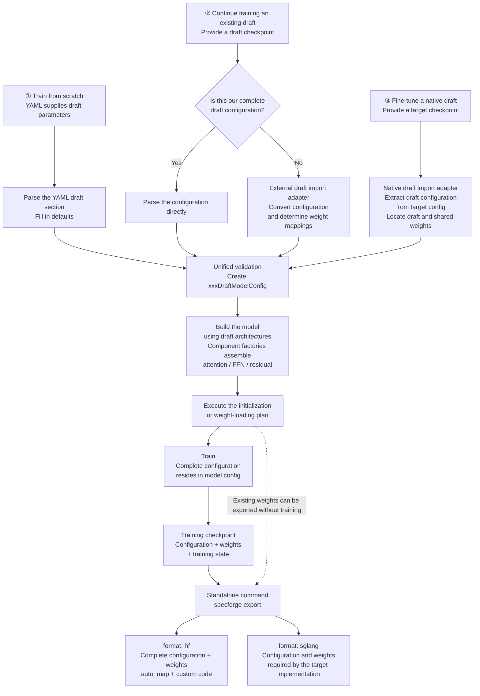
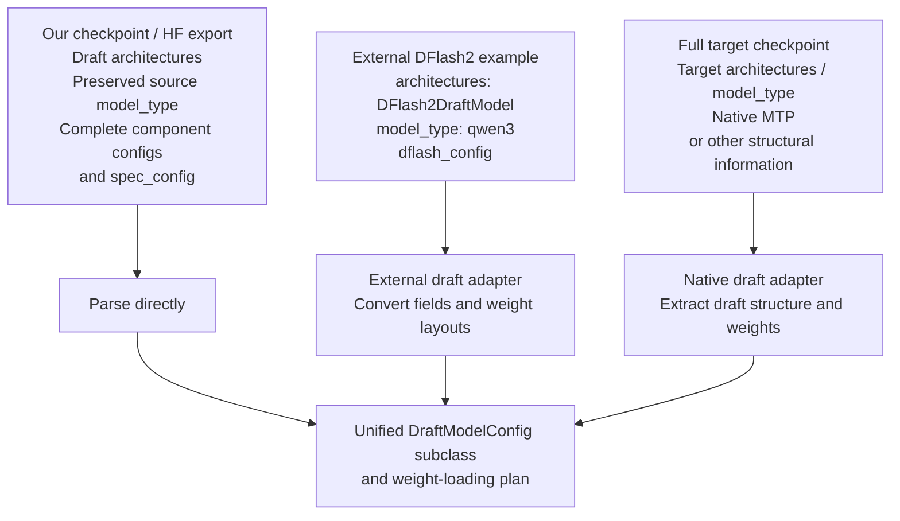
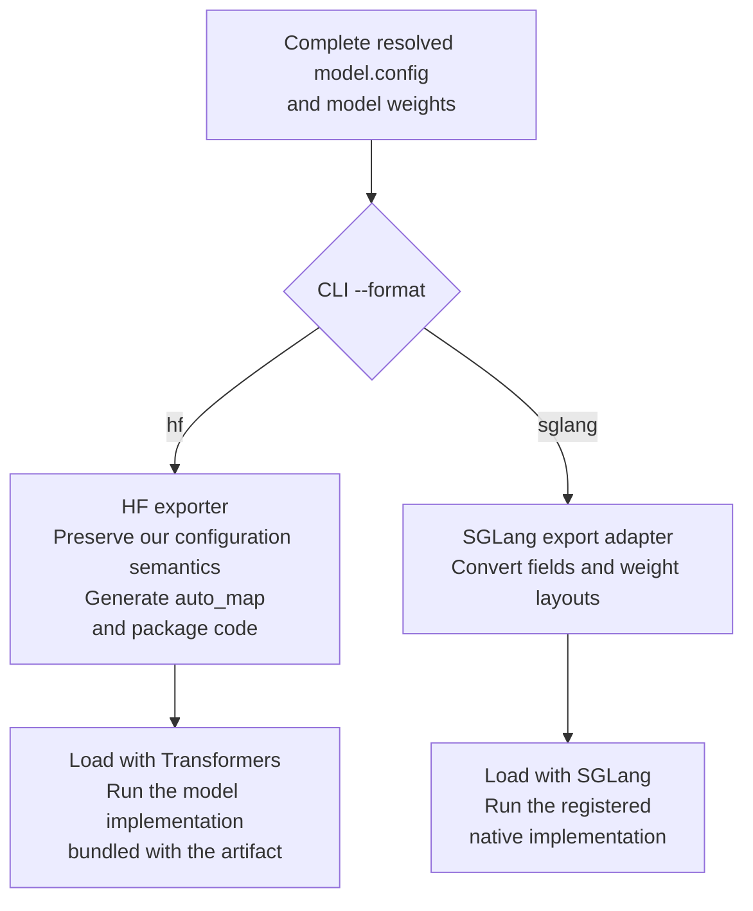

# Draft Configuration: Training, Continued Training, and Export

This document describes the target design for the entire configuration refactor, beyond the scope of the current PR. Class names and interfaces are illustrative, not claims of existing implementation. It follows the latest conventions: training YAML is the configuration entry point for training from scratch, `architectures` selects the draft implementation, and an existing checkpoint supplies the structure when loading a model.

## 1. Overall Flow

All three entry paths produce the same configuration object hierarchy. Once the model is built, `model.config` is the configuration source for saving and exporting.



The three entry paths require different inputs:

| Scenario | Source of the draft structure | Required YAML inputs | Parameter initialization |
|---|---|---|---|
| Train from scratch | YAML `draft` section, with defaults supplied by the configuration class | Draft architecture, structural parameters, training settings, and target source when needed | Initialize new parameters according to module rules; explicitly reuse target embeddings, heads, etc. |
| Continue training an existing draft | Complete checkpoint configuration, or an adapted external configuration | Checkpoint source, training settings, and target source when needed | Load draft weights and resolve declared external dependencies |
| Fine-tune a native draft | Target config converted by a native import adapter | Target checkpoint source and training settings | Extract native draft weights and handle parameters shared with the target |

Continued training does not require users to repeat draft structural parameters. If source information is insufficient to determine the structure, report an error. Allow an explicit import adapter when necessary, but never silently guess missing parameters.

### Infer the training mode from YAML

Users do not specify `source.kind` or `initialization.mode`. The program selects the entry path from path fields; the following names illustrate the target interface:

| YAML condition | Internal behavior |
|---|---|
| Neither `initialization.checkpoint` nor `resume` is provided | Train from scratch using the YAML draft parameters |
| `initialization.checkpoint` is provided | Read the source config; use adapters to identify a standalone or native draft; load weights and create new training state |
| `resume` is provided | Read the training checkpoint and restore the model, optimizer, scheduler, step count, and other state |
| Both paths are provided | Report an error rather than applying implicit precedence |

```yaml
# Continue training from weights; the source config identifies a standalone or native draft.
initialization:
  checkpoint: /path/to/checkpoint
```

```yaml
# Restore a complete training checkpoint.
resume: /path/to/training-checkpoint
```

Providing only a target path does not trigger native draft loading: training from scratch may also require a target. A draft is loaded only when an initialization checkpoint is explicitly provided. Request an adapter selection only if the source configuration cannot uniquely identify one. If `resume` lacks required training state, report an error instead of falling back to loading weights only.

## 2. Responsibilities of Configuration Fields

| Field | Responsibility | Source |
|---|---|---|
| `architectures` | Select the concrete draft model class and its configuration class, such as `DFlashDraftModel` | Selected by the user for training from scratch; read from the checkpoint or generated by an adapter for continued training |
| `model_type` | Preserve the source model's compatibility type; it does not select the draft implementation | Preserve the source value when loading; use an explicit value when training from scratch; otherwise default to the target config value |
| Common structural fields | Hidden size, layer count, vocabulary, head counts, RoPE, normalization, etc. | YAML or checkpoint; keep only one definition for synonymous parameters |
| `attention_config` | Attention type and its specific parameters | Model configuration |
| `ffn_config` | Dense / MoE type and its specific parameters | Model configuration |
| `residual_config` | Residual type, such as standard or mHC, and its specific parameters | Model configuration |
| `spec_config` | Algorithm parameters such as block size, target feature layers, mask token, and selector settings | Model configuration; do not duplicate `algorithm` |
| `auto_map` | Code entry points for custom HF configuration and model classes | Generated by the HF exporter |
| Initialization and training settings | Weight sources, parameter reuse or freezing, learning rate, data paths, state restoration, etc. | Training YAML, separate from model structure config |

A draft configuration selects one concrete `architectures` entry, retaining HF's list representation. SpecForge looks up that entry in its registry; it does not treat the string as an arbitrary Python import path.

### Rules for resolving model_type

1. When loading a checkpoint, preserve `model_type` from the source config rather than replacing it with an algorithm name such as `dflash2` or `dspark`.
2. When training from scratch, use `draft.model_type` if explicitly provided in YAML.
3. If the relevant input omits the field, default to the target config's `model_type`. If that value is unavailable, report an error and request the necessary configuration.

When loading an existing checkpoint, YAML does not override its existing `model_type`. The value will therefore often match the target, but source or explicit values take precedence; equality is not mandatory.

SpecForge first reads the raw configuration dictionary and selects its configuration and model classes using `architectures`, rather than selecting the draft through AutoConfig's `model_type` mapping. Configuration subclasses must preserve the input value across saving and reloading; class-level defaults must not overwrite it. HF exports use `auto_map` to reference our configuration and model classes.

### Input YAML and saved JSON

The following example illustrates field organization and omits other required parameters:

```yaml
draft:
  architectures: [DFlashDraftModel]
  hidden_size: 4096
  intermediate_size: 14336
  num_hidden_layers: 4
  num_attention_heads: 32
  num_key_value_heads: 8
  attention_config:
    type: gqa
  ffn_config:
    type: dense
  residual_config:
    type: standard
  spec_config:
    block_size: 16
```

During parsing, the configuration class fills in defaults, validates values, and produces the effective `model.config`. The saved `config.json` records the complete effective structure, rather than copying only the fields supplied by the user. Resolve `model_type` according to the rules above. Keep `initialization` and training hyperparameters outside model config. Training YAML contains no export configuration.

## 3. Importing External Configurations

Being hosted on Hugging Face Hub does not imply that a configuration uses our semantics. Our HF exports can be parsed directly; drafts from other projects and SGLang-compatible artifacts may require adaptation.



Example conversion for an external DFlash2 model:

| Source field | Internal handling |
|---|---|
| `architectures: [DFlash2DraftModel]` | Select the corresponding draft implementation and configuration class |
| `model_type: qwen3` | Preserve it as a compatibility field; use `architectures` to select `DFlash2DraftModelConfig` and the model class, without constructing a standard Qwen3 model |
| `hidden_size`, RoPE, `sliding_window`, etc. | Preserve common fields with matching semantics |
| `dflash_config.block_size`, selector settings, etc. | Convert to the corresponding `spec_config` fields |
| Attention, convolution, scaling, softcap, and other settings | Preserve them through explicit mappings; do not discard options that affect computation |
| Fixed behavior not explicitly described by the source configuration | Fill it in based on the supported source implementation; reject the import if it cannot be determined |

A native target's `architectures` usually describes the entire language model. The adapter uses it to identify the source implementation, then generates the internal draft architecture name. Do not construct the draft using the target class or reuse the target layer count as the draft layer count.

## 4. Exporting to HF and SGLang

Training saves only the unified checkpoint. Export runs through a standalone `specforge export` command, without reading training YAML or requiring further training. The same checkpoint can be exported to both formats. The target command interface is:

```bash
specforge export \
  --checkpoint /path/to/checkpoint \
  --format sglang \
  --output-dir /path/to/sglang-model

specforge export \
  --checkpoint /path/to/checkpoint \
  --format hf \
  --output-dir /path/to/hf-model
```

`--checkpoint`, `--format`, and `--output-dir` are export command arguments. Model structure comes from the checkpoint config. If external shared weights are missing, the export command's `--target-model` argument can supply the target source.

Both formats can use `config.json` and safetensors. Their difference lies in the contract between configuration, weights, and execution code.



| Item | HF | SGLang |
|---|---|---|
| `architectures` | Our model class name | Registered name of the SGLang target implementation; the names may match |
| `model_type` | Preserve the final value in `model.config`; locate the configuration class through `auto_map` | Preserve the same value and verify that the target configuration loader handles it correctly |
| Algorithm and component fields | Save the complete internal configuration | Convert to the layout read by the target implementation, such as `dflash_config` |
| Model code | Bundled with the artifact and located through `auto_map` | Use SGLang's native implementation |
| Weight layout | Matches our model implementation | Map to the layout required by the target loader as needed |
| Configuration code | Bundled with the artifact | If a custom configuration class is retained, its loading must also be handled; the architecture name alone is insufficient |

`--format` accepts only `hf` and `sglang`. Select the adapter automatically based on the architecture and component configuration.

Reusing the target's `model_type` does not guarantee SGLang compatibility: its configuration class may require additional fields or trigger model-specific handling. The exporter must validate configuration parsing and execution semantics. Report incompatibilities rather than silently replacing `model_type`.

During design, export contracts may assume that target implementations such as `DSpineDraftModel` exist in SGLang. Actual export support still requires loading and numerical validation against the corresponding version.

If a SGLang export cannot preserve all source information, also save the complete source draft configuration to support reimporting. Define import and export mappings separately; do not assume they are inverses. Export must not modify the original `model.config`.

## 5. Code Organization

Separate configuration definitions, model implementations, checkpoint adaptation, and training orchestration:

```text
examples/configs/                 # User-editable training YAML
specforge/
├── config/
│   ├── training.py              # Training, initialization, and resume configuration
│   └── draft/
│       ├── base.py              # DraftModelConfig(PretrainedConfig)
│       ├── dflash.py            # DFlashDraftModelConfig
│       ├── dflash2.py           # DFlash2DraftModelConfig
│       ├── dspark.py            # DSparkDraftModelConfig
│       └── components/         # Attention / FFN / residual configuration definitions
├── modeling/
│   ├── auto.py                         # Public loading entry point
│   └── draft/
│       ├── registry.py                 # Architecture, constraints, algorithm compatibility, adapters
│       └── models/
│           ├── base.py                 # Optional common base, depending only on PreTrainedModel
│           ├── eagle3.py               # General-purpose architectures below
│           ├── dflash.py
│           ├── dspark.py
│           ├── dflash2.py
│           ├── domino.py
│           ├── dspine.py
│           ├── peagle.py
│           ├── layers/
│           │   ├── ffn/               # Dense and MoE variants
│           │   ├── residual/          # Standard, GR, and mHC
│           │   └── attention/
│           │       ├── gqa.py         # Attention structures and computation below
│           │       ├── mla.py
│           │       ├── dsa.py
│           │       ├── qsa.py
│           │       ├── kda.py
│           │       ├── masks.py       # Shared visibility descriptions and validation
│           │       ├── backends/
│           │       │   ├── eager.py
│           │       │   ├── sdpa.py
│           │       │   ├── flash.py
│           │       │   └── flex.py    # FlexAttention backend adapter
│           │       └── parallel/
│           │           └── ring.py    # Ring Attention execution adapter
│           └── specialized/
│               ├── qwen3_8_mtp/
│               │   ├── model.py      # Explicit MTP connections, forward, and constraints
│               │   └── adapter.py    # Source config conversion, weight extraction, and export
│               └── deepseek_v4_1_flash_dspark/
│                   ├── model.py      # Specialized draft structure reusing common components
│                   └── adapter.py    # Model-specific configuration and weight adaptation
└── checkpoint/
    ├── load.py                 # Unified orchestration for the three entry paths
    ├── save.py                 # Save complete configuration, weights, and training state
    ├── adapters/
    │   ├── registry.py         # Source format detection and import/export adapter registration
    │   ├── external_draft.py   # External draft configuration and weight mappings
    │   └── native_draft.py     # Dispatch to native draft adapters in specialized
    └── export/
        ├── cli.py             # Standalone export command arguments and orchestration
        ├── hf.py              # Package HF configuration, code, and weights
        └── sglang.py          # SGLang adapter selection and export
```

Configuration definitions live in `specforge/config/draft/`; models and computation components remain in `specforge/modeling/draft/`. The dependency direction is `modeling → config`: configuration classes do not import model implementations. The registry linking configuration classes and model classes lives in `modeling/draft/registry.py` to avoid circular dependencies.

The rest of the `modeling/draft/` layout follows `design.md`: algorithm model skeletons live in `models/`, common components in `models/layers/`, and specialized models with their configuration and weight adapters in `models/specialized/<model>/model.py` and `adapter.py`. `checkpoint/` handles file reading and orchestration, calling these adapters through registry entries rather than duplicating native model mappings.

Model computation components do not depend on checkpoint export workflows. Configuration classes do not download weights or start training.

### 5.1 Model registry: associate architectures with implementations

Register each architecture's configuration class, model class, and algorithm protocol. For example:

```python
# Illustrative interface
register_draft(
    architecture="DFlash2DraftModel",
    config_class=DFlash2DraftModelConfig,
    model_class=DFlash2DraftModel,
    training_protocol=dflash2_protocol,
)
```

Different architectures can reuse the same algorithm protocol and basic components. There is no need to repeat `algorithm` in YAML or accumulate model-name conditionals in the unified loader.

### 5.2 Configuration classes: define parameter semantics

- `DraftModelConfig` manages common fields and serialization conventions, preserving the instance's `model_type`; algorithm configuration subclasses must not overwrite it with a fixed algorithm name.
- Algorithm configuration subclasses own their parameters, defaults, and derived calculations, inheriting only definitions with matching semantics.
- Component configurations own their types, parameters, and local constraints.
- Unified validation checks cross-component dimensions, algorithm interfaces, shared-parameter constraints, and architecture compatibility.

Parsing produces one effective configuration. Generate any read-only options from that configuration rather than maintaining another independently mutable source. Once the model has been built, structural changes require rebuilding it.

### 5.3 Import adapters: convert configuration and produce loading plans

An adapter receives source configuration and checkpoint metadata, then produces two outputs:

1. **Normalized draft configuration** for the corresponding configuration class to parse.
2. **A weight-loading plan** specifying source-to-destination key mappings, required tensor transformations, shared-parameter sources, and parameters explicitly allowed to be newly initialized.

Adapter detection uses source configuration fields and supported format rules, not directory names. Report an error when no adapter matches or when multiple matches cannot be distinguished; request an explicit selection when necessary.

The loader executes the plan and reports missing or unexpected parameters, shape mismatches, and shared-parameter handling. Exclude non-draft parameters from a native target according to explicit rules. Do not randomly initialize unexplained missing weights and continue training.

### 5.4 Loading entry point: orchestration only

```python
# Illustrative logic, not an existing API.
# Check that initialization checkpoint and resume are mutually exclusive,
# then infer the internal classification from the paths.
source = resolve_training_source(training_config)
# source.kind is an internal result, not a YAML field.
if source.kind == "scratch":
    draft_values = training_config.draft
    weight_plan = make_initialization_plan(training_config.initialization)
else:
    source_config = read_checkpoint_config(source)
    draft_values, weight_plan = import_checkpoint(source, source_config)

draft_values = resolve_model_type(
    draft_values, target_config=target_config
)  # Preserve an existing value; otherwise fill it from the target config.
entry = draft_registry.resolve(draft_values["architectures"])
config = entry.config_class.from_resolved_values(draft_values)
validate_draft_config(config)

model = entry.model_class(config)
apply_weight_plan(model, weight_plan)
# Training, saving, and export all use model.config from this point onward.
# Create training state only when training; resume also restores the full state.
training_state = create_training_state(model, training_config)
if source.kind == "resume":
    restore_training_state(training_state, source)
```

Models and components implement basic initialization during construction. Do not reinitialize the entire model after loading source weights. Training from scratch with reused target parameters also uses an explicit loading plan; initialization and training policies determine whether those parameters are frozen.

### 5.5 Saving and exporting: generate artifacts from complete effective configuration

A training checkpoint must contain at least a complete `config.json` and draft weights. Resuming an interrupted run additionally requires optimizer, scheduler, step count, random state, and other necessary state. External shared parameters need explicit saving or rebinding rules.

HF export generates `auto_map`, collects required custom code and dependency instructions, and validates loading and draft forward computation in an environment without SpecForge installed.

SGLang export converts configuration and weights for the target implementation, validating fields, tensor layouts, and computation semantics. Changing `architectures` alone does not complete a conversion. Both export formats require output checks; successful model construction does not establish conversion correctness.

### 5.6 Separate continued training from checkpoint resumption

| Operation | Model structure and weights | Optimizer / scheduler / step count |
|---|---|---|
| Continue training from existing weights | Restore from the checkpoint | Create new state |
| Resume an interrupted training run exactly | Restore from the training checkpoint | Restore alongside the model |
| Export only | Read configuration and required weights | Not required |

Replacing attention, FFN, or residual structures while reusing only some weights is a structural migration. It requires explicit mappings and initialization rules and is not ordinary continued training.
