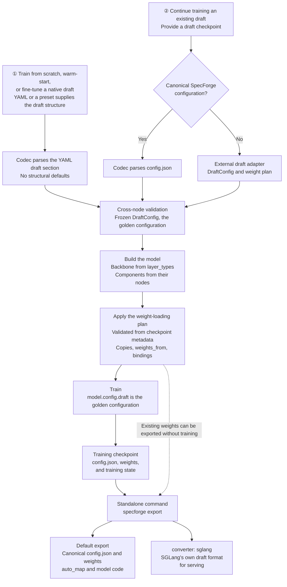
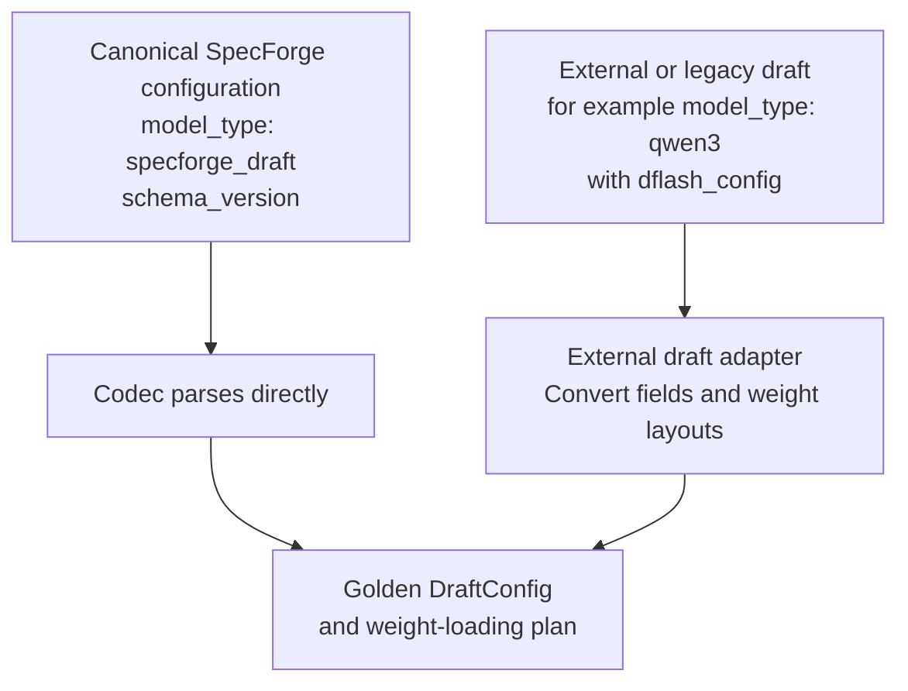

# Draft Configuration: Training, Continued Training, and Export

This document describes the target workflow for draft configuration across training, continued training, resumption, import, and export. It goes beyond the scope of any single PR. Class names and interfaces are illustrative, not claims of existing implementation. The [design document](design-eng.md) defines the configuration structure, components, and code boundaries.

Conventions used throughout:

- Training YAML supplies the draft structure unless a draft checkpoint is loaded as the starting point: training from scratch, warm-starting a new structure, and fine-tuning a native draft. With `initialization.weights_from`, the source checkpoint supplies weights only. A checkpoint loaded through `initialization.checkpoint` or `resume` supplies the structure.
- Parsing produces one golden `DraftConfig` (design document, Section 8). `model.config` is the HF configuration shell `SpecForgeDraftConfig`, and `model.config.draft` is the golden configuration. Every artifact is derived from it.
- Canonical configurations use `model_type: specforge_draft`, and `architectures` selects the draft structure.
- Architecture names in examples, such as `SpecForgeDFlash`, are placeholders until the naming question is settled (Section 7).

## 1. Overall Flow

All entry paths produce the same golden configuration. Once the model is built, `model.config.draft` is the only structural configuration used for training, saving, and export.



The scenarios require different inputs:

| Scenario | Source of the draft structure | Required YAML inputs | Parameter initialization |
|---|---|---|---|
| Train from scratch | The YAML `draft` section. Structural fields are required, including `target_layer_ids` and `mask_token_id`; the one value derived from the target, `target_logit_transform`, follows a documented rule and is stored as a concrete value | Draft architecture and structure, training settings, and the target source when needed | Initialize new parameters according to module rules; copy target parameters, such as decoder layers, only through a hand-written `initialization.from_target` mapping |
| Warm-start with a new structure | The YAML `draft` section, as when training from scratch | Draft structure, the source draft checkpoint and weight mapping (`initialization.weights_from`), training settings | Load mapped weights from the source draft; initialize only parameters listed as new |
| Fine-tune a native draft | The native preset for the target, referenced through the YAML `draft` section | The preset, the target source, training settings, and the recipe's `initialization.from_target` mapping | Copy the target's native draft weights like any other copy; bound embeddings and LM head come from the target |
| Continue training an existing draft | The checkpoint's canonical configuration, or the output of an external draft adapter | Checkpoint source, training settings, and the target source when needed | Load draft weights and resolve declared external dependencies |

Continued training does not require users to repeat draft structural parameters. If source information is insufficient to determine the structure, report an error. Allow an explicit import adapter when necessary, but never silently guess missing parameters.

### Infer the training mode from YAML

Users do not specify `source.kind` or `initialization.mode`. The program selects the entry path from path fields; the following names illustrate the target interface:

| YAML condition | Internal behavior |
|---|---|
| None of `initialization.checkpoint`, `initialization.weights_from`, and `resume` is provided | Train from scratch using the YAML draft structure |
| `initialization.checkpoint` is provided | Read the source configuration; use adapters to identify a canonical or external draft; load weights and create new training state |
| `initialization.weights_from` is provided | Build the YAML draft structure, then load weights from another draft checkpoint through an explicit weight plan |
| `resume` is provided | Read the training checkpoint and restore the model, optimizer, scheduler, step count, and other state |
| More than one of these paths is provided | Report an error rather than applying implicit precedence |
| `initialization.from_target` is provided | Allowed when training from scratch or with `initialization.weights_from`; its draft prefixes must be disjoint from the `weights_from` mapping and `allow_new`. With `initialization.checkpoint` or `resume` it is an error, because it would overwrite loaded weights |
| A `draft` section is provided together with `initialization.checkpoint` or `resume` | The section must match the loaded structure exactly; otherwise report an error. Fields are never merged |

```yaml
# Continue training from weights; the source config identifies a canonical or external draft.
initialization:
  checkpoint: /path/to/checkpoint
```

```yaml
# Restore a complete training checkpoint.
resume: /path/to/training-checkpoint
```

```yaml
# Warm-start a new structure from another draft's weights: for example, DSpark from DFlash,
# or the same architecture with a different block size or causality.
draft:                                  # The YAML is the structural source (Section 2.2).
  architectures: [SpecForgeDSpark]
  # Remaining structure omitted.
initialization:
  weights_from:
    checkpoint: /path/to/dflash-checkpoint
    mapping: {"layers.*": "layers.*", "fc": "fc"}      # Draft path -> source path; omitted = match by name.
    allow_new: ["markov_head.*", "confidence_head.*"]
```

Every draft parameter must match a source parameter of the same shape or be listed in `allow_new`, and source parameters left unused are reported. This is the only way to change structure while reusing weights, so nobody edits a checkpoint's `config.json` by hand.

Providing only a target path does not trigger native draft loading: training from scratch may also require a target. Existing weights are loaded only when `initialization.checkpoint`, `initialization.weights_from`, or `initialization.from_target` is explicitly provided. Request an adapter selection only if the source configuration cannot uniquely identify one. If `resume` lacks required training state, report an error instead of falling back to loading weights only.

## 2. Configuration Fields

| Field | Responsibility | Source |
|---|---|---|
| `model_type` | Always `specforge_draft` in canonical configurations; selects SpecForge's single HF configuration class | Written by the codec; never copied from the target |
| `architectures` | Exactly one registered draft architecture; selects the model class and the `spec_config` schema | YAML when training from scratch; otherwise the checkpoint or adapter |
| `schema_version` | Version of the canonical layout | Written by the codec |
| Model-level fields | `hidden_size`, `vocab_size`, `draft_vocab_size`, `norm_config`, `max_position_embeddings`, default `rope_parameters` | YAML or checkpoint |
| `attention_configs`, `mlp_configs`, `conv_configs` | Named component definitions, each with a `type` and that type's parameters | YAML or checkpoint |
| `layer_configs` | Named `LayerSpec` definitions referencing attention, MLP, and optional convolution; no layer-level `type` | YAML or checkpoint |
| `layer_types` | The layer definition used by each decoder layer | YAML or checkpoint |
| `num_hidden_layers` | Equal to `len(layer_types)`; kept for HF tooling | Written by the codec and verified on read |
| `residual_config` | Model-level residual-stream type and parameters | YAML or checkpoint |
| `spec_config` | Algorithm protocol, target feature layers, mask token, input fusion, and heads | YAML or checkpoint |
| `target_bindings` | Which of `embed_tokens` and `lm_head` the draft takes from the target: frozen, not saved with the draft, and supplied by the target at serving time | YAML or checkpoint |
| `target_logit_transform` | How the bound `lm_head` turns hidden states into logits, such as a muP multiplier; required only when `lm_head` is bound | Derived from the target configuration at parse time through a closed table, then saved; rechecked against the target on load |
| `extensions` | Loading prerequisite, not part of `DraftConfig`: the extensions whose kinds the configuration uses, read before decoding | Written by the codec from the kinds the configuration uses and verified on read; listed in YAML when training from scratch with extension kinds |
| HF metadata | `auto_map`, `transformers_version`, `dtype`, and similar fields that Transformers writes; not part of `DraftConfig` | Written by Transformers and the HF exporter |
| Artifact metadata | Format of a written directory, plus the converter and target SGLang versions for an SGLang directory; not part of `DraftConfig` | Written by `checkpoint` and the exporters |
| Training settings | Objective (`training.objective`), weight sources (`initialization.checkpoint`, `initialization.weights_from`), copies from the target (`initialization.from_target`), freezing, learning rate, data paths, objective weights, schedules, and resume state | Training YAML; never structural fields |

### 2.1 `model_type`, `architectures`, and the training objective

- A canonical configuration always has `model_type: specforge_draft`, registered with SpecForge's single HF configuration class. The target's `model_type` is never copied. Target configuration classes can reject draft fields, substitute default `text_config` dimensions, or inject MLA defaults, and some require the target's remote code.
- The `model_type` of an external draft, such as `qwen3` in an existing DFlash checkpoint, is input to its import adapter only. The SGLang converter writes whatever value SGLang's format requires.
- `architectures` holds exactly one registered name, which selects the model class and the `spec_config` schema. It is the only structural selector: there is no separate algorithm field, and the model family is derived from it. SpecForge resolves the name through its own registries, not as a Python import path.
- Serving engines such as SGLang also select the model class from `architectures`. Transformers works differently: AutoModel selects the model class from the configuration class and uses `architectures` only to choose among several classes registered for it, and remote code goes through `auto_map`. An exported HF package therefore names its concrete model class in `auto_map`. Because `save_pretrained` writes the model's class name into `architectures`, each model class is named after its registered architecture.
- The training objective is a separate choice, not a second structural selector. `training.objective` defaults to the objective registered for the architecture. Another objective can be selected when the model provides the inputs and outputs it requires and every module the architecture uses at serving time is trained by the objective, bound to the target, or listed as frozen (design document, Section 9.2).
- Canonical architecture names must not be names that released SGLang versions register. Otherwise SGLang, run with `--trust-remote-code` on a canonical directory, would load the canonical configuration class from `auto_map`, select its own model class by name, and serve the draft with default block settings (Section 4.1).

### 2.2 Input YAML and saved JSON

The YAML `draft` section uses the same structure as the canonical JSON. A draft whose layers are all identical may give a single `attention` and `mlp` entry together with `num_hidden_layers` instead of named definitions:

```yaml
draft:
  architectures: [SpecForgeDFlash]
  hidden_size: 4096
  vocab_size: 151936
  num_hidden_layers: 4
  norm_config: {type: rms, eps: 1.0e-6, weight_offset: 0}
  max_position_embeddings: 40960
  tie_word_embeddings: false
  rope_parameters: {rope_type: default, rope_theta: 1000000}
  attention:
    type: gqa
    num_attention_heads: 32
    num_key_value_heads: 8
    head_dim: 128
    qk_norm: true
    attention_bias: false
    output_gate: false
    sliding_window: null
    is_causal: false
  mlp: {type: dense, intermediate_size: 14336, hidden_act: silu}
  residual_config: {type: standard}
  target_bindings: [embed_tokens, lm_head]
  spec_config: {block_size: 16, mask_token_id: 151669, target_layer_ids: [1, 12, 22, 33]}
```

The shorthand exists only in YAML, and it cannot be mixed with named definitions: a `draft` section that gives `attention` or `mlp` together with `attention_configs`, `mlp_configs`, `layer_configs`, or `layer_types` is an error. A single `sublayer_conv` node may be given the same way. The `draft` section may instead name a configuration file, canonical or legacy, which the codec decodes like any other source. The codec expands the shorthand, and the saved `config.json` always records the complete effective structure:

```json
{
  "architectures": ["SpecForgeDFlash"],
  "model_type": "specforge_draft",
  "schema_version": 1,
  "hidden_size": 4096,
  "vocab_size": 151936,
  "draft_vocab_size": 151936,
  "num_hidden_layers": 4,
  "norm_config": {"type": "rms", "eps": 1e-06, "weight_offset": 0},
  "max_position_embeddings": 40960,
  "initializer_range": 0.02,
  "tie_word_embeddings": false,
  "rope_parameters": {"rope_type": "default", "rope_theta": 1000000},
  "attention_configs": {
    "default": {
      "type": "gqa",
      "num_attention_heads": 32,
      "num_key_value_heads": 8,
      "head_dim": 128,
      "qk_norm": true,
      "attention_bias": false,
      "output_gate": false,
      "sliding_window": null,
      "is_causal": false
    }
  },
  "mlp_configs": {
    "default": {"type": "dense", "intermediate_size": 14336, "hidden_act": "silu"}
  },
  "layer_configs": {
    "default": {"attention": "default", "mlp": "default"}
  },
  "layer_types": ["default", "default", "default", "default"],
  "residual_config": {"type": "standard"},
  "target_bindings": ["embed_tokens", "lm_head"],
  "target_logit_transform": {"type": "none"},
  "extensions": [],
  "spec_config": {"block_size": 16, "mask_token_id": 151669, "target_layer_ids": [1, 12, 22, 33]},
  "transformers_version": "5.12.1",
  "specforge_artifact": {"format": "specforge"}
}
```

The last two keys are HF and artifact metadata. They are not part of `DraftConfig`, and the codec does not read them as structure.

With named definitions, the YAML gives `layer_types`, and `num_hidden_layers`, if present, must match its length.

Structural fields have no defaults. `target_layer_ids`, including EAGLE auxiliary layers, and `mask_token_id` are written explicitly and checked against the target configuration. Only `target_logit_transform` is derived: from the target's logit settings, by a documented rule with the target configuration as an explicit input, and the result is saved (design document, G3). `draft_vocab_size` equals `vocab_size` unless a draft vocabulary mapping is configured. Non-structural values with documented defaults, such as `initializer_range`, are written into the saved file, so the file is complete without SpecForge's defaults. Keep `initialization` and training hyperparameters outside the model configuration. Training YAML contains no export configuration.

A preset is a YAML configuration file under `config/draft/presets/`, referenced through `draft` like any user configuration file. File names and directories do not select implementations; only configuration contents do. Presets require no registration. Checkpoints save the expanded configuration and do not depend on the source file. A native preset describes a target's native draft structure, but selecting it does not load target weights or choose a training objective. Weight loading and objective selection remain separate.

### 2.3 Drafts built from parts of the target

A draft is assembled from SpecForge components and reuses target weights in two ways (design document, Section 7.3):

- **Copy.** `initialization.from_target` in training YAML copies target parameters bit for bit into draft parameters before training. The copies are draft weights: trained or frozen as training configuration says, and saved with the draft. This is the only way to reuse target decoder layers, and it is also how a native draft's weights are loaded.
- **Shared embeddings and LM head.** `target_bindings` lists which of `embed_tokens` and `lm_head` the draft takes from the target. They are frozen, are not saved with the draft, and are supplied by the target at serving time. No other module can be bound.

For example, an MTP-style draft can define nodes that reproduce a target decoder layer and start from a copy of the target's last layer. The nodes are written by hand; nothing derives them from the target. The architecture name is illustrative:

```yaml
draft:
  architectures: [SpecForgeMTP]
  layer_configs:
    mtp: {attention: mtp, mlp: mtp}
  layer_types: [mtp]
  # Component definitions, model-level fields, and spec_config omitted.

initialization:
  from_target:
    layers.0: model.layers.35  # Copy the target's last decoder layer, then train it.
```

Where tensor names under the prefix differ between the target and the draft's components, the entry lists renames:

```yaml
initialization:
  from_target:
    layers.0:
      from: model.layers.47
      rename: {mlp.shared_expert: mlp.shared_experts}  # Target name -> draft name.
```

SpecForge reads the copied tensors from the target's checkpoint files, never from the target server, and SGLang never sees `initialization`. Before training, the weight-loading plan checks, from the safetensors headers alone, that every element of every draft parameter under `layers.0` receives one target element, every target tensor under the mapped prefix is used, and shapes match after any layout operation that a component kind with fused parameters declares, such as stacking per-expert tensors into a fused expert tensor. It applies no value transforms, rejects quantized tensors and narrowing casts by name, and prints the full mapping. Every rank builds the same plan and reads only the slices it holds. Names and shapes cannot show that the nodes compute what the target layer computes, for example `norm_config.weight_offset` 1 against 0. Bundled presets that copy target weights are checked for that in CI; in a user configuration, the node definitions are the user's responsibility.

A native draft is not a special case: a native preset plus an ordinary copy from the target's native draft tensors (design document, Section 7.2). The bundled recipe for a target provides both:

```yaml
draft: specforge/config/draft/presets/native/qwen3_5_mtp.yaml
initialization:
  from_target:
    "": mtp.  # Every draft module except the bound ones <- the same name under mtp.
```

## 3. Importing External Configurations

Being hosted on Hugging Face Hub does not imply that a configuration uses SpecForge semantics. Canonical SpecForge configurations, including HF exports, are parsed directly. Drafts from other projects go through adapters. SGLang directories that SpecForge writes are serving artifacts and are never imported. Native drafts inside target checkpoints are not imported: their structure is a native preset and their weights are copied (Section 2.3).



Example conversion for an external DFlash2 checkpoint in the legacy layout:

| Source field | Canonical result |
|---|---|
| `architectures: [DFlash2DraftModel]` | Selects the adapter for this format; the canonical `architectures` value is SpecForge's DFlash2 architecture name |
| `model_type: qwen3` | Adapter input only; the canonical configuration writes `specforge_draft` |
| `hidden_size`, `vocab_size`, `rms_norm_eps`, RoPE fields | Model-level fields; `rms_norm_eps` becomes `norm_config` with the source implementation's `weight_offset` |
| `num_attention_heads`, `num_key_value_heads`, `head_dim`, `sliding_window`, `layer_types`, `is_causal` | One attention definition per distinct layer type, with an explicit `is_causal` value; layer definitions and `layer_types` |
| `intermediate_size`, `hidden_act` | A dense MLP definition |
| `dflash_config.block_size`, `target_layer_ids`, `mask_token_id`, selector settings | `spec_config` |
| `dflash_config` convolution settings | A `conv_configs` entry referenced through `sublayer_conv` |
| Scaling, softcap, and other settings that affect computation | Explicit mappings; never dropped |
| Fixed behavior not described by the source configuration | Filled in from the supported source implementation; the import fails if it cannot be determined |

The legacy codec owns these field mappings. The adapter detects the format, calls the codec for the configuration, and owns the weight mapping. The same codec backs a command that rewrites a legacy configuration file as canonical YAML, so a recipe migrates without hand-editing.

A native draft inside a target checkpoint has no import adapter. Its structure is the native preset for that target, written from SpecForge components; its weights are copied by an ordinary `from_target` mapping; and the preset lists `target_bindings` when the native draft shares the target's embeddings and LM head. No code derives draft nodes from the target's configuration, so the target's layer count never becomes the draft's.

## 4. Standalone, Native, and Serving Exports

Training saves a canonical checkpoint. The public export command selects a mode independently of the draft architecture:

```bash
# Standalone canonical draft (the default).
specforge export --checkpoint CHECKPOINT_PATH --output-dir MODEL

# Standalone serving artifact, when the pinned converter supports the structure.
specforge export --converter sglang --checkpoint CHECKPOINT_PATH --output-dir SERVING

# Native merge-back, when an adapter supports this target/architecture pair.
specforge export --export-mode native --checkpoint CHECKPOINT_PATH \
  --target-model TARGET --output-dir MERGED_TARGET
```

Native mode takes no `--converter`; it preserves the target format and does not imply engine support. Standalone and native are available to any architecture through the relevant implementation; neither the architecture name nor a preset chooses the mode. Missing adapters and unsupported serving structures fail explicitly.

| Item | Standalone | Standalone + SGLang converter | Native |
|---|---|---|---|
| Configuration | Canonical config plus HF metadata | Pinned SGLang format | Target config, validated without draft-derived structural defaults |
| Weights | SpecForge layout | SGLang loader layout | Native draft tensors replaced in target shards |
| Bound token tables | Omitted; bind from target on load | Target modules supplied by serving | Copied where required by the native adapter |
| Artifact metadata | `format: specforge` | `format: sglang`, converter version and engine revision | `format: native` |
| Target source | Needed for legacy import when target metadata is missing | Same import requirements | Required through `--target-model` |

Native export removes stale draft tensors from rewritten shards and links unaffected shards. `--copy-target` is native-only and copies those shards instead. Continue draft training from the canonical checkpoint, not the merged target artifact.

During migration, legacy `--to hf|sglang` remains available, including external vocabulary-map import for old EAGLE3 checkpoints. Those options cannot be combined with the new export modes or converter. The historical Qwen3.5 MTP command with `--converter sglang` and no explicit mode retains implicit native export with a deprecation warning; replace it with `--export-mode native`. This exception is fixed to that old command and does not extend to newly registered families.

SGLang directories are one-way serving artifacts. SpecForge never reads them back, so the converter has no inverse to maintain; continued training and re-export start from the canonical checkpoint or the HF export. Export never modifies `model.config`.

### 4.1 The SGLang boundary

Standalone SGLang artifacts are produced with `--converter sglang`; native artifacts use the target format and require separate engine compatibility validation. SGLang imports no SpecForge code and never reads canonical configurations, and SpecForge depends only on the draft format that the pinned SGLang version reads (design document, G8):

1. SGLang owns its draft format: the fields it reads, their defaults, and the weight names its loader expects. The SGLang converter in `checkpoint/formats/sglang/` is the one place that translates a `DraftConfig` into that format, with one converter function per architecture and shared helper functions for common nodes.
2. The converter writes every field that SGLang reads and that affects computation: per-layer values where SGLang's format has them, such as layer types; and values that SGLang holds once for all layers, such as KV heads, head size, window, biases, and partial rotation. Per-layer differences fail export unless the serving format can represent them, including the verified causality encoding below. SGLang reads many fields with a fallback default, so a CI check records the fields SGLang reads while it builds the draft and fails on any the converter did not write, apart from a versioned list, kept with the converter, of fields that do not affect computation. For mixed causal sliding and bidirectional full-attention layers, the converter writes `is_causal: null` and explicit `layer_types` after verifying that exact combination. This selects the pinned engine's documented per-layer rule; other mixed patterns fail export. Canonical attention nodes remain explicit booleans. Tests check resolved per-layer causality and reference outputs, so this exception does not permit arbitrary serving defaults.
3. A structure, or a `target_bindings` set, that SGLang's format cannot express fails the export, naming it; this includes an extension kind the converter does not support. Supporting a new structure is an SGLang change to its own format, made with the serving implementation the structure needs anyway; the converter then maps to the new fields.
4. Native preset validation separates real checkpoint metadata, exact copy/export round-trips, independent decoder references, and pinned serving fixtures. These checks do not constitute a full real-preset copy → export → serving execution test.
5. The artifact metadata records the converter version and the SGLang version whose format it targets. CI loads an export of each architecture's fixture in that SGLang version and compares draft outputs with SpecForge's on reference inputs (below).

SGLang must reject a canonical directory instead of serving it with default settings. Three barriers stop it:

- Without `--trust-remote-code`, `model_type: specforge_draft` stops it at configuration loading.
- With `--trust-remote-code`, an HF export's `auto_map` supplies the configuration class, so model selection must stop it. A canonical architecture name that SGLang registers natively would select SGLang's model class, which reads none of the canonical fields and serves with default block settings. Canonical names therefore never reuse those names (Section 2.1).
- For any other name, SGLang falls back to its generic Transformers backend through `auto_map`, unless the model class reports `is_backend_compatible()` as false. `DraftPreTrainedModel` sets `_supports_attention_backend = False`, so loading fails with an error naming the architecture. Only an explicit `--model-impl transformers` proceeds, with a warning.

A test loads an HF export, including its `auto_map`, in the current SGLang release with `--trust-remote-code` and the default model implementation, and expects the load to fail.

Both export formats require output checks; successful model construction does not establish conversion correctness. These checks run in CI on a fixture per architecture: an HF export is loaded and run in an environment without SpecForge installed, and an SGLang export is loaded and checked numerically in the pinned SGLang version. HF exports are also re-imported, and their weights and forward outputs must match the source. `specforge export` itself runs only static checks, such as representability, the written fields, and weight coverage, so exporting needs neither a GPU nor SGLang.

## 5. Code Organization

Configuration definitions, model implementations, training objectives, checkpoint formats, file loading, and orchestration are separate packages:

```text
examples/configs/                     # User-editable training YAML
specforge/
├── config/
│   ├── training.py                   # Training, objective, initialization, and resume settings; no structural fields
│   └── draft/                        # Frozen configuration nodes; imports neither torch nor transformers
│       ├── model.py                  # DraftConfig: model-level fields, component groups, layer_types, residual, spec
│       ├── presets/                  # Maintained YAML configurations; loaded like user files
│       │   └── native/               # One configuration per supported target with a native draft
│       ├── attention.py              # GQA, MLA, DSA, QSA, and KDA nodes, dispatched by type
│       ├── mlp.py                    # Dense and MoE nodes
│       ├── norm.py                   # norm_config node: type, eps, weight_offset
│       ├── conv.py                   # Sublayer convolution nodes
│       ├── layer.py                  # LayerSpec: fixed schema of component references
│       ├── residual.py               # Standard, GR, and mHC nodes
│       ├── spec/                     # One algorithm spec per file, owning its derivations; composed, never inherited
│       ├── validate.py               # Cross-node validation and algorithm contracts
│       ├── registry.py               # Architecture name -> spec class; component schemas
│       ├── extensions.py             # Reads `extensions` before decoding; loads them via the specforge.extensions entry points
│       └── codec/
│           ├── v1.py                 # Canonical schema v1 <-> DraftConfig; strict
│           └── legacy.py             # Legacy fields (dflash_config, eagle_config, ...) <-> DraftConfig
├── loading.py                        # Public entry point for reading drafts: read a directory, build, apply weights
├── modeling/
│   ├── auto.py                       # Compatibility façade over loading.py during migration
│   └── draft/                        # No file I/O
│       ├── hf_config.py              # SpecForgeDraftConfig(PreTrainedConfig): model.config, holding DraftConfig as draft
│       ├── base.py                   # DraftPreTrainedModel, depending only on PreTrainedModel; _supports_attention_backend = False
│       ├── build.py                  # build_draft_model(config)
│       ├── backbone.py               # DraftBackbone: begin / run_next_layer / finalize, final norm, rotary
│       ├── registry.py               # Architecture name -> model class of the same name
│       ├── models/
│       │   ├── eagle3.py  peagle.py  dflash.py  dflash2.py
│       │   └── dspark.py  domino.py  dmtp.py  dspine.py
│       ├── heads/                    # Selector, Markov, confidence, GRU, and inter-layer injection modules
│       └── layers/
│           ├── decoder.py            # DecoderLayer: wiring from a decoder layer node
│           ├── registry.py           # (kind, type) -> builder, plus a checkpoint layout for fused parameters
│           ├── norm.py               # RMSNorm with weight_offset 0 or 1
│           ├── attention/
│           │   ├── gqa.py  mla.py  dsa.py  qsa.py  kda.py
│           │   ├── rotary.py  masks.py
│           │   ├── backends/         # eager.py  sdpa.py  flash.py  flex.py
│           │   └── parallel/         # ring.py
│           ├── mlp/                  # dense.py  moe.py
│           ├── conv/                 # grouped_causal.py
│           └── residual/             # standard.py  gr.py  mhc.py
├── algorithms/
│   ├── registry.py                   # Objective name -> objective, the model inputs and target tensors it needs, and the modules it trains; default per architecture
│   └── <algorithm>/objective.py      # Training objective; shared pieces are functions, not base classes
├── checkpoint/
│   ├── draft_dir.py                  # Read and write a draft directory: config.json, weights, artifact metadata
│   ├── weight_plan.py                # Built from checkpoint metadata: key mappings, external layout conversions, bit-preserving copies from the target, shared embeddings and LM head, allowed new parameters
│   ├── resolve.py                    # Detect the source format from fields and artifact metadata; ambiguity is an error
│   └── formats/                      # One module per format, containing both read and write
│       ├── specforge.py              # Canonical directories
│       ├── hf.py                     # HF export: canonical config, auto_map, bundled code
│       ├── sglang.py                 # Converter to SGLang's draft format: one function per architecture
│       └── external/                 # Drafts from other projects
└── training/
    ├── model_loading.py              # Orchestrates the entry paths
    └── checkpoint.py                 # Training state: optimizer, scheduler, step count, random state
```

Dependencies point one way. `modeling` depends only on `config.draft` and performs no file I/O. `checkpoint` depends on `config.draft` and `modeling`, `loading` depends on `checkpoint` and `modeling`, `algorithms` depends on `modeling`, and `training` uses `loading` and `algorithms`. The existing `specforge.modeling.auto` entry point stays only as a façade that imports `loading` inside its functions, and it is removed once callers move. Configuration classes do not import model implementations, download weights, or start training. Model components do not depend on checkpoint or export workflows. The design document (Section 9) lists the rules and the tests that enforce them.

Models own their execution order. DFlash, DFlash2, and DMTP use the backbone's sequential forward; DSpine calls `begin`, `run_next_layer`, and `finalize` to interleave injection and collect typed intermediate outputs. Both paths reuse the same decoder modules and common execution mechanisms. The [design document, Section 1.3](design-eng.md#13-module-interfaces) defines the boundary and shows example forwards.

DMTP's trainable input fusion and DSpine's injection parameters belong to the draft model and are saved with its weights. Frozen MTP feature production stays in the feature provider, input preparation aligns features and tokens, and objectives own supervision and replacement schedules. Serving owns candidate sampling, verification, and cache updates. Training and serving call the same learned model computations and use the spec's token-alignment and block-count rules; the backbone receives neither training schedules nor algorithm-specific callbacks.

### 5.1 Registries

Each package registers what it owns:

```python
# Illustrative interfaces
register_spec("SpecForgeDFlash2", DFlash2Spec)               # specforge/config/draft/registry.py
register_model(SpecForgeDFlash2)                              # specforge/modeling/draft/registry.py; key = class name
register_objective("dflash2", DFlash2Objective,               # specforge/algorithms/registry.py
                   default_for=["SpecForgeDFlash2"])
register_converter("SpecForgeDFlash2", dflash2_to_sglang)     # specforge/checkpoint/formats/sglang.py
register_component(("mlp", "moe"), MoE, layout=moe_layout)    # specforge/modeling/draft/layers/registry.py; layout only for fused parameters
```

Presets are YAML files, not registered implementations. Presets select registered architecture and component types and supply their parameters. Adding a preset that uses existing types requires no registration; a new implementation requires registration at the architecture or component level it extends. Preset definitions live under `config/draft/presets/`, with `native/` for targets that ship a native draft.

A consistency test checks that every architecture has the entries it needs, that each model class is named after its architecture, and that each default objective is compatible. Objectives declare the model inputs and outputs they require, so a compatible objective can train another architecture without a new registration. Components register schemas and builders in the same way. Extensions outside the repository call the same functions, and a configuration lists the extensions it needs in `extensions`. The unified loader contains no model-name conditionals.

### 5.2 Configuration classes

- `DraftConfig` and its nodes are frozen and hashable. Each node owns its fields, local validation, and derivation formulas, and it rejects unknown fields.
- `validate.py` performs all cross-node validation: references, layer counts, dimensions shared between components, and algorithm contracts.
- The codec owns serialization and migration rules, including legacy aliases, which it normalizes once and rejects when they conflict. Checkpoint adapters call the codec and the spec nodes and own only weight mappings.
- `SpecForgeDraftConfig` is `model.config`. It holds the `DraftConfig` as `draft`, declares no structural fields or defaults, and keeps the HF metadata and runtime fields that Transformers writes.

Parsing produces one golden configuration. Once the model has been built, a structural change requires a new configuration and a new model.

### 5.3 Import adapters: convert configuration and produce loading plans

An adapter receives source configuration and checkpoint metadata, then produces two outputs:

1. **A `DraftConfig`**, built through the codec.
2. **A weight-loading plan** specifying source-to-destination key mappings, layout conversions for external formats, bit-preserving copies from the target, the shared embeddings and LM head, and parameters explicitly allowed to be newly initialized.

Adapter detection uses source configuration fields, artifact metadata, and supported format rules, not directory names. Report an error when no adapter matches or when multiple matches cannot be distinguished; request an explicit selection when necessary.

The loader validates the plan from checkpoint metadata, the tensor names, shapes, and dtypes in the safetensors headers, before reading any tensor, and reports missing or unexpected parameters, shape mismatches, and shared-parameter handling. Every rank builds the same plan from the same inputs, so validation fails on all ranks together, and each rank then reads only the slices of the parameters it holds. Copies read only the mapped prefixes of a target checkpoint. Do not randomly initialize unexplained missing weights and continue training.

### 5.4 Loading entry point: orchestration only

Orchestration lives in `training/model_loading.py`. `loading` and `checkpoint` read files and never touch training state:

```python
# Illustrative logic, not an existing API.
# initialization.checkpoint, initialization.weights_from, and resume are mutually exclusive.
source = resolve_training_source(run_config)
if source.kind in ("scratch", "weights_from"):
    draft = codec.parse(run_config.draft, target=target_config)
    # Copies from the target, and the weights_from mapping.
    weight_plan = make_initialization_plan(run_config.initialization, draft)
else:
    require_no_from_target(run_config.initialization)  # Would overwrite loaded weights.
    draft, weight_plan = loading.read_draft(source.path, target=target_config)
    if run_config.draft is not None:
        require_identical(
            draft, codec.parse(run_config.draft, target=target_config)
        )
validate(draft)  # Cross-node checks and algorithm contracts.

model = modeling.build_draft_model(draft)  # model.config.draft is draft.
loading.apply_weight_plan(model, weight_plan)  # Source weights, copies, and bindings.
objective = algorithms.build_objective(run_config.training, draft)  # training.objective or the default.
training_state = create_training_state(model, objective, run_config.training)
if source.kind == "resume":
    restore_training_state(training_state, source.path)
```

Outside training, `loading.load_draft(path)` combines the same steps for export, evaluation, and inference: read the directory, build the model, and apply the weight plan.

Models and components implement basic initialization during construction. Do not reinitialize the entire model after loading source weights. Training from scratch with reused target parameters also uses an explicit loading plan; training settings determine whether those parameters are frozen.

### 5.5 Saving and exporting: generate artifacts from the golden configuration

`checkpoint/draft_dir.py` writes the model artifact: `config.json` with the canonical configuration and HF metadata, the draft weights, and artifact metadata recording the format. The bound embeddings and LM head are not written; `target_bindings` records them, and loading restores them from the target. `training/checkpoint.py` writes the state needed to resume an interrupted run: optimizer, scheduler, step count, random state, and other necessary state.

HF export generates `auto_map` naming the concrete model and configuration classes and collects required custom code and dependency instructions. The SGLang converter writes every computation-affecting field and the tensor layout SGLang expects; CI checks both formats against their loaders (Section 4.1). Changing `architectures` alone does not complete a conversion.

### 5.6 Separate continued training from checkpoint resumption

| Operation | Model structure and weights | Optimizer / scheduler / step count |
|---|---|---|
| Continue training from existing weights | Restore from the checkpoint | Create new state |
| Warm-start a new structure (`initialization.weights_from`) | Structure from YAML; mapped weights from another draft checkpoint | Create new state |
| Resume an interrupted training run exactly | Restore from the training checkpoint | Restore alongside the model |
| Export only | Read configuration and required weights | Not required |

Replacing attention, MLP, or residual structures, changing the architecture, or changing protocol values such as `block_size` while reusing weights is a structural migration. It is declared with `initialization.weights_from` and an explicit mapping (Section 1), never by editing a checkpoint's configuration.

### 5.7 One configuration across the pipeline

- Training YAML forbids structural fields. Values such as `block_size` or `mask_token_id` cannot be given in training settings.
- `mask_token_id` and `target_layer_ids` are written explicitly and checked against the target while parsing, and `target_logit_transform` is resolved there, before the model is built. Nothing writes to `model.config.draft` afterwards; Transformers may still update runtime fields on the shell.
- Training objectives, data dispatch, and launch code receive the spec, or the node they need, from `model.config.draft`. They keep no copies or defaults of their own.
- Logged and exported metadata are derived from the golden configuration when they are written.

## 6. Changes for Existing Users

These are the user-visible changes compared with SpecForge main. The design document's implementation steps 1 to 5 change none of them. Step 6 makes the artifact and export changes in one PR, so users meet them once. Native MTP fine-tuning moves in step 7 together with the copies it is built on, and the training-configuration changes come with the cutover in step 8. The table is meant to be complete: a user-visible change that is missing from it is treated as a regression.

| Area | Today | After the change | Kind | Who is affected and how to migrate |
|---|---|---|---|---|
| Serving DFlash-family drafts on released SGLang | Legacy exports may be served directly | Default standalone export is canonical; `--converter sglang` writes supported serving formats | Intentional | Use the converter; unsupported architectures fail explicitly |
| Export command flags | Legacy `--to`, separate config and optional vocabulary mapping | Default standalone, optional `--converter sglang`, or `--export-mode native` with `--target-model` | Staged migration | Legacy commands remain for compatibility; do not mix their flags with new modes |
| Draft structure in training checkpoints | `training_state.pt` holds weights and training state; the draft configuration is supplied separately | The checkpoint also holds the canonical `config.json` | Improvement | Checkpoints written before the change carry no configuration; export and continued training accept the legacy draft configuration file for them, decoded by the legacy codec |
| HF export contents | For EAGLE-family drafts, self-contained: the frozen target embedding is copied in, so `from_pretrained` finds no missing keys. DFlash-family drafts own no embedding | The bound embedding and LM head are not saved; `target_bindings` records them, and loading takes them from the target | Breaking, intentional | Users who load an HF export without its target model |
| Draft configuration files and recipes | Legacy JSON files under `configs/`, referenced by recipes | Bundled configurations are YAML presets under `config/draft/presets/`. The `draft` section may still name a user's legacy file, which the legacy codec decodes with the target configuration, and a command rewrites such a file as canonical YAML; saving writes the canonical form | Intentional (step 8) | Recipes that name `configs/*.json` point at the presets instead. A user's own legacy file keeps working |
| Published legacy drafts | Loaded through their legacy fields | Imported through the external draft adapter; serving on released SGLang is unchanged | Unchanged | None |
| `num_hidden_layers` | An independent input | Equal to `len(layer_types)`; written for HF tooling and checked on read | Intentional | Canonical configurations only; legacy files decode as before |
| Normalization and attention fields | `rms_norm_eps`; query and key norms, projection biases, and output gates implied by the model family class | `norm_config` and explicit attention fields | Intentional | Canonical configurations only; the legacy codec fills them from the supported source implementation |
| Native MTP fine-tuning (step 7) | Family-specific model and merge script | Component preset, ordinary `from_target` mapping, and registered native adapter | Intentional | Use `--export-mode native`; required target settings must match and are never filled from the draft |
| Missing structural fields, unknown fields, and conflicting aliases | Accepted: HF configuration classes fill missing fields with family defaults and keep unknown fields | From step 6, rejected before construction in canonical configurations, with the field named. The legacy codec ignores a closed list of HF metadata keys and rejects any other unknown key | Intentional | Configurations that relied on a silent default or a typo; legacy files decode as before unless they carry a key outside the ignore list |
| Training configuration keys (step 8) | Draft settings under `model.draft_*`, `training.strategy`, and per-algorithm loss options directly under `training` | `draft`, `initialization`, `training.objective`, and `training.objective_options` | Breaking, intentional | Every training recipe. Each retired key fails with an error naming its replacement, and the training guide carries the full old-to-new table |
| Offline feature preparation (step 8) | The preparation script selects the algorithm with a strategy flag and a legacy draft configuration | It takes the same `draft` source and objective as training | Breaking, intentional | Scripts that prepare offline features; old flags fail naming the replacement. Whether feature files written on main stay readable is stated with the change |
| Resuming a run started on main (step 8) | `resume` restores the model, optimizer, and scheduler | Not supported across the cutover: parameter names and the objective implementation change, so the saved optimizer state no longer matches the model. The weights continue through `initialization.checkpoint` with the legacy draft configuration, and the resume error says so | Breaking, intentional | Runs in flight at the cutover; finish them on the previous release or continue from weights |
| Numerics | — | Unchanged, with one declared exception: RoPE frequencies, angles, and tables remain FP32; rotation casts once to the Q/K dtype. Linear scaling divides positions and dynamic NTK uses a fixed scaled context length (design document, Section 4.2). This follows SGLang's base rotary embedding; SGLang's multi-axis embedding, and head sizes other than 64, 128, 256, and 512, round the cosine/sine cache to the activation dtype. Base-class replacement, component extraction, and objectives are checked against main (design document, Section 10, checks 1, 2, 16, and 17) | Intentional (numerics) | BF16 training runs, including continued training of a draft trained on main. The effect on acceptance length is measured before the cutover |

## 7. Open Questions

1. **Canonical architecture names.** Canonical names are model class names (Section 2.1), and they must not collide with the names that released SGLang versions register. The affected model classes therefore need new names. The naming scheme is open; the `SpecForge` prefix in this document's examples is a placeholder. The name is written into every canonical `config.json`, so it has to be settled before the first step that writes one (design step 6, or earlier if training checkpoints gain a canonical configuration first). Until it is, SGLang's rejection of a canonical directory depends on which attribute its own class happens to read first.
2. **RoPE precision.** The design computes RoPE frequencies in FP32 (design document, Section 4.2). This follows SGLang's base rotary embedding and removes a train-serve difference, though multi-axis RoPE and uncommon head sizes still differ by SGLang's cache rounding. It changes BF16 training numerics relative to main. It is adopted here pending the end-to-end measurement (check 17); if the measurement shows a loss, the choice is revisited as a numerics decision of its own.
