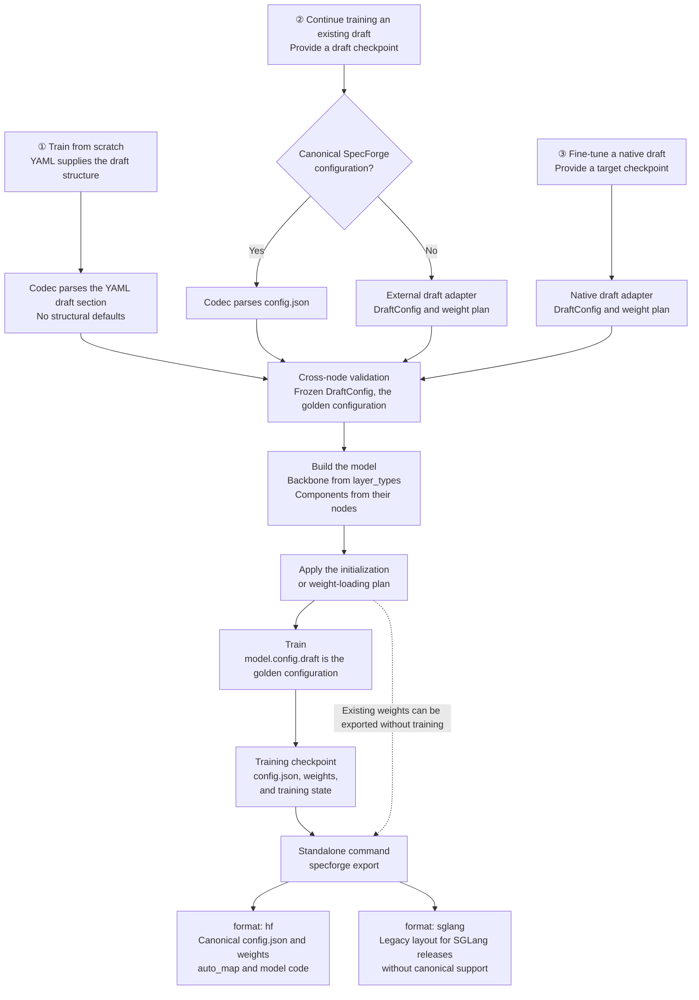
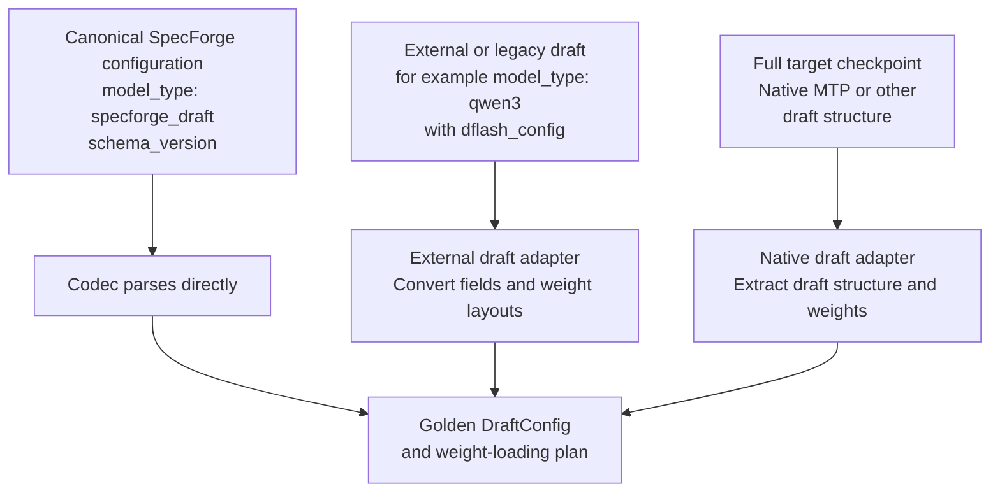

# Draft Configuration: Training, Continued Training, and Export

This document describes the target workflow for draft configuration across training, continued training, resumption, import, and export. It goes beyond the scope of any single PR. Class names and interfaces are illustrative, not claims of existing implementation. The [design document](design-eng.md) defines the configuration structure, components, and code boundaries.

Conventions used throughout:

- Training YAML supplies the draft structure only when training from scratch. An existing checkpoint supplies the structure whenever one is loaded.
- Parsing produces one golden `DraftConfig` (design document, Section 8). `model.config` is the HF configuration shell `SpecForgeDraftConfig`, and `model.config.draft` is the golden configuration. Every artifact is derived from it.
- Canonical configurations use `model_type: specforge_draft`, and `architectures` selects the draft structure.

## 1. Overall Flow

All entry paths produce the same golden configuration. Once the model is built, `model.config.draft` is the only structural configuration used for training, saving, and export.



The three entry paths require different inputs:

| Scenario | Source of the draft structure | Required YAML inputs | Parameter initialization |
|---|---|---|---|
| Train from scratch | The YAML `draft` section. Structural fields are required; values derived from the target follow documented rules and are stored as concrete values | Draft architecture and structure, training settings, and the target source when needed | Initialize new parameters according to module rules; copy target parameters, such as embeddings, heads, or layers, only through an explicit loading plan (`initialization.from_target`) |
| Continue training an existing draft | The checkpoint's canonical configuration, or the output of an external draft adapter | Checkpoint source, training settings, and the target source when needed | Load draft weights and resolve declared external dependencies |
| Fine-tune a native draft | The output of a native draft adapter applied to the target checkpoint | Target checkpoint source and training settings | Extract native draft weights and handle parameters shared with the target |

Continued training does not require users to repeat draft structural parameters. If source information is insufficient to determine the structure, report an error. Allow an explicit import adapter when necessary, but never silently guess missing parameters.

### Infer the training mode from YAML

Users do not specify `source.kind` or `initialization.mode`. The program selects the entry path from path fields; the following names illustrate the target interface:

| YAML condition | Internal behavior |
|---|---|
| Neither `initialization.checkpoint` nor `resume` is provided | Train from scratch using the YAML draft structure |
| `initialization.checkpoint` is provided | Read the source configuration; use adapters to identify a standalone or native draft; load weights and create new training state |
| `resume` is provided | Read the training checkpoint and restore the model, optimizer, scheduler, step count, and other state |
| Both paths are provided | Report an error rather than applying implicit precedence |
| A `draft` section is provided together with either path | The section must match the loaded structure exactly; otherwise report an error. Fields are never merged |

```yaml
# Continue training from weights; the source config identifies a standalone or native draft.
initialization:
  checkpoint: /path/to/checkpoint
```

```yaml
# Restore a complete training checkpoint.
resume: /path/to/training-checkpoint
```

Providing only a target path does not trigger native draft loading: training from scratch may also require a target. A draft is loaded only when an initialization checkpoint is explicitly provided. Request an adapter selection only if the source configuration cannot uniquely identify one. If `resume` lacks required training state, report an error instead of falling back to loading weights only.

## 2. Configuration Fields

| Field | Responsibility | Source |
|---|---|---|
| `model_type` | Always `specforge_draft` in canonical configurations; selects SpecForge's single HF configuration class | Written by the codec; never copied from the target |
| `architectures` | Exactly one registered draft architecture; selects the model class and the `spec_config` schema | YAML when training from scratch; otherwise the checkpoint or adapter |
| `schema_version` | Version of the canonical layout | Written by the codec |
| Model-level fields | `hidden_size`, `vocab_size`, `draft_vocab_size`, `rms_norm_eps`, `max_position_embeddings`, default `rope_parameters` | YAML or checkpoint |
| `attention_configs`, `mlp_configs`, `conv_configs` | Named component definitions, each with a `type` and that type's parameters | YAML or checkpoint |
| `layer_configs` | Named layer definitions, each with a `type`; `decoder` layers reference components | YAML or checkpoint |
| `layer_types` | The layer definition used by each decoder layer | YAML or checkpoint |
| `num_hidden_layers` | Equal to `len(layer_types)`; kept for HF tooling | Written by the codec and verified on read |
| `residual_config` | Model-level residual-stream type and parameters | YAML or checkpoint |
| `spec_config` | Algorithm protocol, target feature layers, mask token, input fusion, and heads | YAML or checkpoint |
| `target_bindings` | Draft modules that are the target's own modules: frozen, not saved with the draft, and supplied by the target at serving time | YAML or checkpoint; derived from the target configuration when the draft is created from a target |
| `extensions` | Registered extensions that the configuration needs | Written by the codec from the kinds the configuration uses |
| HF metadata | `auto_map`, `transformers_version`, `dtype`, and similar fields that Transformers writes; not part of `DraftConfig` | Written by Transformers and the HF exporter |
| Artifact metadata | Format, weight layout, and converter version of a written directory; not part of `DraftConfig` | Written by `checkpoint` and the exporters |
| Training settings | Objective (`training.objective`), weight sources, copies from the target (`initialization.from_target`), freezing, learning rate, data paths, objective weights, schedules, and resume state | Training YAML; never structural fields |

### 2.1 `model_type`, `architectures`, and the training objective

- A canonical configuration always has `model_type: specforge_draft`, registered with SpecForge's single HF configuration class. The target's `model_type` is never copied. Target configuration classes can reject draft fields, substitute default `text_config` dimensions, or inject MLA defaults, and some require the target's remote code.
- The `model_type` of an external draft, such as `qwen3` in an existing DFlash checkpoint, is input to its import adapter only. The SGLang converter writes whatever legacy value its output requires.
- `architectures` holds exactly one registered name, which selects the model class and the `spec_config` schema. It is the only structural selector: there is no separate algorithm field, and the model family is derived from it. SpecForge resolves the name through its own registries, not as a Python import path.
- Serving engines such as SGLang also select the model class from `architectures`. Transformers works differently: AutoModel selects the model class from the configuration class and uses `architectures` only to choose among several classes registered for it, and remote code goes through `auto_map`. An exported HF package therefore names its concrete model class in `auto_map`. Because `save_pretrained` writes the model's class name into `architectures`, each model class is named after its registered architecture.
- The training objective is a separate choice, not a second structural selector. `training.objective` defaults to the objective registered for the architecture, and another objective can be selected when the model provides the inputs and outputs it requires.
- Canonical architecture names must not be names that released SGLang versions map to the legacy layout. Otherwise an SGLang release without canonical support, run with `--trust-remote-code`, could load a canonical directory and serve it with default block settings (Section 6).

### 2.2 Input YAML and saved JSON

The YAML `draft` section uses the same structure as the canonical JSON. A draft whose layers are all identical may give a single `attention` and `mlp` entry together with `num_hidden_layers` instead of named definitions:

```yaml
draft:
  architectures: [DFlashDraftModel]
  hidden_size: 4096
  vocab_size: 151936
  num_hidden_layers: 4
  rms_norm_eps: 1.0e-6
  max_position_embeddings: 40960
  rope_parameters: {rope_type: default, rope_theta: 1000000}
  attention: {type: gqa, num_attention_heads: 32, num_key_value_heads: 8, head_dim: 128, is_causal: false}
  mlp: {type: dense, intermediate_size: 14336, hidden_act: silu}
  residual_config: {type: standard}
  spec_config: {block_size: 16, mask_token_id: 151669, target_layer_ids: [1, 12, 22, 33]}
```

The shorthand exists only in YAML. The codec expands it, and the saved `config.json` always records the complete effective structure:

```json
{
  "architectures": ["DFlashDraftModel"],
  "model_type": "specforge_draft",
  "schema_version": 1,
  "hidden_size": 4096,
  "vocab_size": 151936,
  "draft_vocab_size": 151936,
  "num_hidden_layers": 4,
  "rms_norm_eps": 1e-06,
  "max_position_embeddings": 40960,
  "initializer_range": 0.02,
  "tie_word_embeddings": false,
  "rope_parameters": {"rope_type": "default", "rope_theta": 1000000},
  "attention_configs": {
    "default": {
      "type": "gqa",
      "num_attention_heads": 32,
      "num_key_value_heads": 8,
      "head_dim": 128,
      "is_causal": false
    }
  },
  "mlp_configs": {
    "default": {"type": "dense", "intermediate_size": 14336, "hidden_act": "silu"}
  },
  "layer_configs": {
    "default": {"type": "decoder", "attention": "default", "mlp": "default"}
  },
  "layer_types": ["default", "default", "default", "default"],
  "residual_config": {"type": "standard"},
  "target_bindings": {"embed_tokens": "model.embed_tokens", "lm_head": "lm_head"},
  "extensions": [],
  "spec_config": {"block_size": 16, "mask_token_id": 151669, "target_layer_ids": [1, 12, 22, 33]},
  "transformers_version": "5.12.1",
  "specforge_artifact": {"format": "specforge", "weight_layout": "specforge-v1"}
}
```

The last two keys are HF and artifact metadata. They are not part of `DraftConfig`, and the codec does not read them as structure.

With named definitions, the YAML gives `layer_types`, and `num_hidden_layers`, if present, must match its length.

Structural fields have no defaults. A value that can be derived from the target is derived only by a documented rule with the target configuration as an explicit input, and the result is saved. Examples are `target_layer_ids` from the target layer count and the target module paths in `target_bindings`. `draft_vocab_size` equals `vocab_size` unless a draft vocabulary mapping is configured. Non-structural values with documented defaults, such as `initializer_range`, are written into the saved file, so the file is complete without SpecForge's defaults. Keep `initialization` and training hyperparameters outside the model configuration. Training YAML contains no export configuration.

### 2.3 Drafts built from parts of the target

A draft can reuse its target in three ways (design document, Section 7):

- **Implementation.** A `target` node builds an attention, MLP, or decoder layer with the target family's own code.
- **Copy.** `initialization.from_target` in training YAML copies target parameters into draft parameters before training. The copies are trained and saved with the draft.
- **Binding.** `target_bindings` in the draft structure makes a draft module the target's module. Bound modules are frozen, are not saved with the draft, and are supplied by the target at serving time.

For example, an MTP-style draft can use the target family's decoder layer and start from a copy of the target's last layer. The architecture name is illustrative:

```yaml
draft:
  architectures: [MTPDraftModel]
  layer_configs:
    mtp: {type: target, family: qwen3, module: decoder_layer, config: from_target}
  layer_types: [mtp]
  # Model-level fields and spec_config omitted.

initialization:
  from_target:
    layers.0: model.layers.35  # Copy the target's last decoder layer, then train it.
```

`config: from_target` asks the codec to fill the fragment from the target configuration, and the saved configuration contains the concrete fields. The codec also derives the `target_bindings` for the embeddings and LM head. The weight-loading plan checks that every copied or bound pair has identical structure before loading.

## 3. Importing External Configurations

Being hosted on Hugging Face Hub does not imply that a configuration uses SpecForge semantics. Canonical SpecForge configurations, including HF exports, are parsed directly. Drafts from other projects, SGLang legacy directories, and native drafts inside target checkpoints go through adapters.



Example conversion for an external DFlash2 checkpoint in the legacy layout:

| Source field | Canonical result |
|---|---|
| `architectures: [DFlash2DraftModel]` | Selects the adapter for this format; the canonical `architectures` value is SpecForge's DFlash2 architecture name |
| `model_type: qwen3` | Adapter input only; the canonical configuration writes `specforge_draft` |
| `hidden_size`, `vocab_size`, `rms_norm_eps`, RoPE fields | Model-level fields |
| `num_attention_heads`, `num_key_value_heads`, `head_dim`, `sliding_window`, `layer_types`, `is_causal` | One attention definition per distinct layer type, with an explicit `is_causal` value; layer definitions and `layer_types` |
| `intermediate_size`, `hidden_act` | A dense MLP definition |
| `dflash_config.block_size`, `target_layer_ids`, `mask_token_id`, selector settings | `spec_config` |
| `dflash_config` convolution settings | A `conv_configs` entry referenced through `sublayer_conv` |
| Scaling, softcap, and other settings that affect computation | Explicit mappings; never dropped |
| Fixed behavior not described by the source configuration | Filled in from the supported source implementation; the import fails if it cannot be determined |

The legacy codec owns these field mappings. The adapter detects the format, calls the codec for the configuration, and owns the weight mapping.

A native target's `architectures` usually describes the entire language model. The native adapter uses it to identify the source implementation, then produces a draft architecture name. It never builds the whole draft from the target model class or reuses the target layer count as the draft layer count; individual modules can still use the target family's implementation through `target` nodes. Its output can include `target_bindings`, for example when a native draft shares the target's embeddings and LM head.

## 4. Exporting to HF and SGLang

Training saves only the unified checkpoint. Export runs through a standalone `specforge export` command, without reading training YAML or requiring further training. The same checkpoint can be exported to both formats:

```bash
specforge export \
  --checkpoint /path/to/checkpoint \
  --format hf \
  --output-dir /path/to/hf-model

specforge export \
  --checkpoint /path/to/checkpoint \
  --format sglang \
  --output-dir /path/to/sglang-model
```

Model structure comes from the checkpoint configuration. If shared weights live outside the checkpoint, the export command's `--target-model` argument supplies the target source.

The canonical configuration is the only published format. The two export formats differ as follows:

| Item | `--format hf` | `--format sglang` (converter) |
|---|---|---|
| Purpose | Publication, loading with Transformers, and SGLang releases with canonical support | SGLang releases without canonical support |
| `config.json` | Canonical encoding of the golden configuration, plus HF metadata | Legacy layout: the `model_type`, `architectures`, and `dflash_config` fields those releases read |
| Extra files | `auto_map` naming the concrete model and configuration classes, and the bundled code | `specforge_config.json` with the canonical configuration, used for re-import |
| Weights | SpecForge layout | Renamed to the layout the SGLang loader expects |
| Artifact metadata | `format: specforge` and the SpecForge weight layout | `format: sglang-legacy`, the SGLang weight layout, and the converter version |
| Bound target modules | Not saved; `target_bindings` is recorded | Not saved; mapped to the sharing that SGLang supports, or the export fails |
| Unsupported structure | Not applicable | Structures the legacy layout cannot express, such as heterogeneous layers, fail the export |

Converted directories are derived artifacts. SpecForge re-imports them from `specforge_config.json`, never from the legacy `config.json`, and selects the weight-loading plan from the artifact metadata, because one configuration can be stored with different weight layouts. Import and export mappings are defined separately and are not assumed to be inverses. Export never modifies `model.config`.

### 4.1 SGLang support for canonical configurations

Long term, SGLang reads canonical directories directly:

1. SGLang registers `specforge_draft` in its configuration registry and vendors SpecForge's torch-free `config.draft` package: the spec nodes, their derivations, and the codec. No remote code is needed.
2. SpecForge publishes fixtures that map canonical configurations to the values SGLang must see, including derived block quantities. Both repositories run them in CI.
3. Once an SGLang release includes this support, `--format sglang` reduces to weight renaming for that release and later ones, and the artifact metadata records which weight layout a directory uses. The converter remains for older releases.

An SGLang release without canonical support must reject a canonical directory instead of serving it with default settings. `model_type: specforge_draft` stops it at configuration loading. Canonical architecture names that differ from its legacy names stop it at model selection, even with `--trust-remote-code`. A test loads a canonical directory with the current SGLang release and expects the load to fail.

Both export formats require output checks; successful model construction does not establish conversion correctness. HF export is validated by loading the artifact and running draft forward computation in an environment without SpecForge installed. SGLang export is validated by loading and numerical checks against the corresponding SGLang version. Every export is also re-imported, and its weights and forward outputs must match the source.

## 5. Code Organization

Configuration definitions, model implementations, training objectives, checkpoint formats, file loading, and orchestration are separate packages:

```text
examples/configs/                     # User-editable training YAML
specforge/
├── config/
│   ├── training.py                   # Training, objective, initialization, and resume settings; no structural fields
│   └── draft/                        # Frozen configuration nodes; imports neither torch nor transformers
│       ├── model.py                  # DraftConfig: model-level fields, component groups, layer_types, residual, spec
│       ├── attention.py              # GQA, MLA, DSA, QSA, and KDA nodes, dispatched by type
│       ├── mlp.py                    # Dense and MoE nodes
│       ├── conv.py                   # Sublayer convolution nodes
│       ├── layer.py                  # Layer nodes: decoder (references only) and other registered types
│       ├── residual.py               # Standard, GR, and mHC nodes
│       ├── target/                   # Fragment schemas for target-family modules, one file per family
│       ├── spec/                     # One algorithm spec per file, owning its derivations; composed, never inherited
│       ├── validate.py               # Cross-node validation and algorithm contracts
│       ├── registry.py               # Architecture name -> spec class; component and layer schemas
│       ├── extensions.py             # Loads the extensions a configuration lists
│       └── codec/
│           ├── v1.py                 # Canonical schema v1 <-> DraftConfig; strict
│           └── legacy.py             # Legacy fields (dflash_config, eagle_config, ...) <-> DraftConfig
├── loading.py                        # Public entry point for reading drafts: read a directory, build, apply weights
├── modeling/
│   ├── auto.py                       # Compatibility façade over loading.py during migration
│   └── draft/                        # No file I/O
│       ├── hf_config.py              # SpecForgeDraftConfig(PreTrainedConfig): model.config, holding DraftConfig as draft
│       ├── base.py                   # DraftPreTrainedModel, depending only on PreTrainedModel
│       ├── build.py                  # build_draft_model(config)
│       ├── backbone.py               # DraftBackbone: decoder layers from layer_types, final norm, rotary
│       ├── registry.py               # Architecture name -> model class of the same name
│       ├── models/
│       │   ├── eagle3.py  peagle.py  dflash.py  dflash2.py
│       │   ├── dspark.py  domino.py  dspine.py
│       │   └── native/               # Specialized native architectures such as Qwen3.5 MTP
│       ├── heads/                    # Selector, Markov, confidence, GRU, and injection heads
│       └── layers/
│           ├── decoder.py            # DecoderLayer: wiring from a decoder layer node
│           ├── registry.py           # (kind, type) -> builder
│           ├── attention/
│           │   ├── gqa.py  mla.py  dsa.py  qsa.py  kda.py
│           │   ├── rotary.py  masks.py
│           │   ├── backends/         # eager.py  sdpa.py  flash.py  flex.py
│           │   └── parallel/         # ring.py
│           ├── mlp/                  # dense.py  moe.py
│           ├── conv/                 # grouped_causal.py
│           ├── residual/             # standard.py  gr.py  mhc.py
│           └── target/               # Target-family builders; family config classes are constructed only here
├── algorithms/
│   ├── registry.py                   # Objective name -> objective and its requirements; default per architecture
│   └── <algorithm>/objective.py      # Training objective; shared pieces are functions, not base classes
├── checkpoint/
│   ├── draft_dir.py                  # Read and write a draft directory: config.json, weights, artifact metadata
│   ├── weight_plan.py                # Key mappings, tensor transforms, bindings, copies, allowed new parameters
│   ├── resolve.py                    # Detect the source format from fields and artifact metadata; ambiguity is an error
│   └── formats/                      # One module per format, containing both read and write
│       ├── specforge.py              # Canonical directories
│       ├── hf.py                     # HF export: canonical config, auto_map, bundled code
│       ├── sglang.py                 # Converter to the SGLang legacy layout
│       ├── external/                 # Drafts from other projects
│       └── native/                   # Native draft extraction from target checkpoints
└── training/
    ├── model_loading.py              # Orchestrates the three entry paths
    └── checkpoint.py                 # Training state: optimizer, scheduler, step count, random state
```

Dependencies point one way. `modeling` depends only on `config.draft` and performs no file I/O. `checkpoint` depends on `config.draft` and `modeling`, `loading` depends on `checkpoint` and `modeling`, `algorithms` depends on `modeling`, and `training` uses `loading` and `algorithms`. The existing `specforge.modeling.auto` entry point stays only as a façade that imports `loading` inside its functions, and it is removed once callers move. Configuration classes do not import model implementations, download weights, or start training. Model components do not depend on checkpoint or export workflows. The design document (Section 9) lists the rules and the tests that enforce them.

### 5.1 Registries

Each package registers what it owns:

```python
# Illustrative interfaces
register_spec("DFlash2DraftModel", DFlash2Spec)              # specforge/config/draft/registry.py
register_model(DFlash2DraftModel)                             # specforge/modeling/draft/registry.py; key = class name
register_objective("dflash2", DFlash2Objective,               # specforge/algorithms/registry.py
                   default_for=["DFlash2DraftModel"])
register_converter("DFlash2DraftModel", dflash2_to_legacy)    # specforge/checkpoint/formats/sglang.py
```

A consistency test checks that every architecture has the entries it needs, that each model class is named after its architecture, and that each default objective is compatible. Objectives declare the model inputs and outputs they require, so a compatible objective can train another architecture without a new registration. Components, layer types, and target-family modules register schemas and builders in the same way. Extensions outside the repository call the same functions, and a configuration lists the extensions it needs in `extensions`. The unified loader contains no model-name conditionals.

### 5.2 Configuration classes

- `DraftConfig` and its nodes are frozen and hashable. Each node owns its fields, local validation, and derivation formulas, and it rejects unknown fields.
- `validate.py` performs all cross-node validation: references, layer counts, dimensions shared between components, and algorithm contracts.
- The codec owns serialization and migration rules, including legacy aliases, which it normalizes once and rejects when they conflict. Checkpoint adapters call the codec and the spec nodes and own only weight mappings.
- `SpecForgeDraftConfig` is `model.config`. It holds the `DraftConfig` as `draft`, declares no structural fields or defaults, and keeps the HF metadata and runtime fields that Transformers writes.

Parsing produces one golden configuration. Once the model has been built, a structural change requires a new configuration and a new model.

### 5.3 Import adapters: convert configuration and produce loading plans

An adapter receives source configuration and checkpoint metadata, then produces two outputs:

1. **A `DraftConfig`**, built through the codec.
2. **A weight-loading plan** specifying source-to-destination key mappings, required tensor transformations, bindings and shared-parameter sources, and parameters explicitly allowed to be newly initialized.

Adapter detection uses source configuration fields, artifact metadata, and supported format rules, not directory names. Report an error when no adapter matches or when multiple matches cannot be distinguished; request an explicit selection when necessary.

The loader executes the plan and reports missing or unexpected parameters, shape mismatches, and shared-parameter handling. Exclude non-draft parameters from a native target according to explicit rules. Do not randomly initialize unexplained missing weights and continue training.

### 5.4 Loading entry point: orchestration only

Orchestration lives in `training/model_loading.py`. `loading` and `checkpoint` read files and never touch training state:

```python
# Illustrative logic, not an existing API.
# Initialization checkpoint and resume are mutually exclusive.
source = resolve_training_source(run_config)
if source.kind == "scratch":
    draft = codec.parse(run_config.draft, target=target_config)
    weight_plan = make_initialization_plan(run_config.initialization, draft)
else:
    draft, weight_plan = loading.read_draft(source.path, target=target_config)
    if run_config.draft is not None:
        require_identical(draft, codec.parse(run_config.draft, target=target_config))
validate(draft)  # Cross-node checks and algorithm contracts.

model = modeling.build_draft_model(draft)  # model.config.draft is draft.
loading.apply_weight_plan(model, weight_plan)  # Source weights, copies, and bindings.
objective = algorithms.build_objective(run_config.training, draft)  # training.objective or the default.
training_state = create_training_state(model, objective, run_config.training)
if source.kind == "resume":
    restore_training_state(training_state, source.path)
```

Outside training, `loading.load_draft(path)` combines the same steps for export, evaluation, and inference: read the directory, build the model, and apply the weight plan.

Models and components implement basic initialization during construction. Do not reinitialize the entire model after loading source weights. Training from scratch with reused target parameters also uses an explicit loading plan; training settings determine whether those parameters are frozen.

### 5.5 Saving and exporting: generate artifacts from the golden configuration

`checkpoint/draft_dir.py` writes the model artifact: `config.json` with the canonical configuration and HF metadata, the draft weights, and artifact metadata recording the format and weight layout. Bound target modules are not written; `target_bindings` records them, and loading restores them from the target. `training/checkpoint.py` writes the state needed to resume an interrupted run: optimizer, scheduler, step count, random state, and other necessary state.

HF export generates `auto_map` naming the concrete model and configuration classes, collects required custom code and dependency instructions, and validates loading and draft forward computation in an environment without SpecForge installed. The SGLang converter validates fields, tensor layouts, and computation semantics against the target SGLang version. Changing `architectures` alone does not complete a conversion.

### 5.6 Separate continued training from checkpoint resumption

| Operation | Model structure and weights | Optimizer / scheduler / step count |
|---|---|---|
| Continue training from existing weights | Restore from the checkpoint | Create new state |
| Resume an interrupted training run exactly | Restore from the training checkpoint | Restore alongside the model |
| Export only | Read configuration and required weights | Not required |

Replacing attention, MLP, or residual structures while reusing only some weights is a structural migration. It requires explicit mappings and initialization rules and is not ordinary continued training.

### 5.7 One configuration across the pipeline

- Training YAML forbids structural fields. Values such as `block_size` or `mask_token_id` cannot be given in training settings.
- `mask_token_id` and other values that depend on the tokenizer or target are resolved while parsing, before the model is built. Nothing writes to `model.config.draft` afterwards; Transformers may still update runtime fields on the shell.
- Training objectives, data dispatch, and launch code receive the spec, or the node they need, from `model.config.draft`. They keep no copies or defaults of their own.
- Logged and exported metadata are derived from the golden configuration when they are written.

## 6. Open Questions

1. **Canonical architecture names.** Canonical names are model class names (Section 2.1), and they must not collide with the legacy names that released SGLang versions map to the legacy layout. The affected model classes therefore need new names; the naming scheme is open.
2. **Serving bound target layers.** SGLang already shares the target's embeddings and LM head with drafts. Drafts that bind target decoder layers, such as self-speculative drafts, need SGLang support before they can be served. Until then, their export fails.
