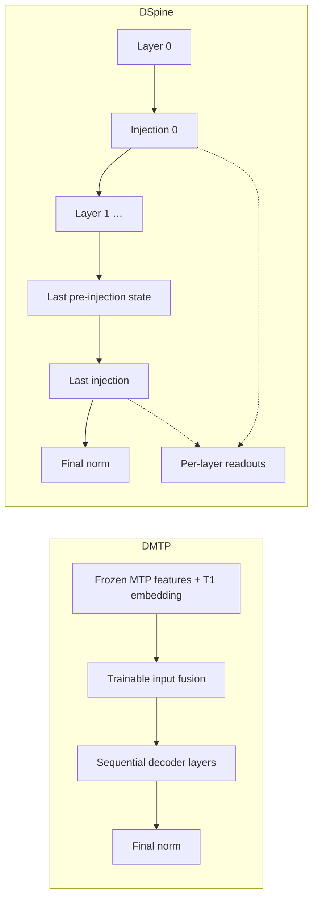

# Draft Model and Component Design

This document describes the target design for draft model configuration, model composition, and code boundaries. It is a target, not a description of the current implementation. Class and field names are illustrative unless stated otherwise, and example values do not describe real checkpoints. The [usage guide](config_usage_graph-eng.md) covers entry paths, import, export, and orchestration.

## 0. Principles

1. **Mirror HF target models.** Describe a draft the way HF describes a target model: attention and MLP components are assembled into decoder layers, and layers are stacked into a model. Configuration nodes and modules correspond one to one.
2. **One golden configuration.** Parsing produces a single frozen `DraftConfig`. Every other representation is derived from it: the HF configuration object, `config.json`, the SGLang layout, and every value read by training, data, or launch code. Derived values are never stored separately, written back, or read back as input.
3. **Explicit boundaries.** A module receives only its own configuration node and explicitly passed dimensions. Configuration, model definitions, training objectives, checkpoint formats, and orchestration live in separate packages with one-way dependencies that tests enforce.
4. **Fail before construction.** Structural fields have no defaults. Unknown fields, conflicting legacy aliases, unresolved references, and unsupported component combinations are rejected before any parameter is allocated.
5. **Open for extension.** New draft architectures and component types are added by registering them, not by editing shared code. A draft may also use the target model's weights (Section 7).

## 1. Model Composition

### 1.1 Base classes

Draft models inherit from `PreTrainedModel` through one project base class, `DraftPreTrainedModel`. They do not depend on model-family bases such as `Qwen3PreTrainedModel` or `LlamaPreTrainedModel`.

Every draft uses one HF configuration class, `SpecForgeDraftConfig(PreTrainedConfig)`, with `model_type = "specforge_draft"`. Transformers requires `model.config` to be a `PreTrainedConfig` and writes runtime fields onto it during construction and saving, such as `dtype`, the attention implementation, and `architectures`. `model.config` is therefore this shell, and the golden `DraftConfig` is `model.config.draft` (Section 8). There is no second accessor. Algorithms do not define their own `PreTrainedConfig` subclasses.

Because `save_pretrained` writes the model's class name into `architectures`, each model class is named after its registered architecture.

When replacing a model-family base class, take explicit ownership of initialization, RoPE, gradient checkpointing, and model metadata. Do not copy class attributes from the family base. In particular, `DraftPreTrainedModel` sets `_supports_attention_backend = False`, whereas `Qwen3PreTrainedModel` sets it to `True`. SGLang uses this attribute to decide whether its generic Transformers backend may load an architecture it does not implement, and a draft class must never load that way (usage guide, Section 4.1).

### 1.2 Composition

| Part | Responsibility | Built from |
|---|---|---|
| Components (`layers/`) | Attention, MLP / MoE, sublayer convolution, residual streams, normalization | One component node each |
| `DecoderLayer` | Wiring of one `decoder` layer: norms, residual connections, optional sublayer convolution | One `layer_configs` entry |
| `DraftBackbone` | Decoder layers, final norm, rotary embedding; sequential and per-layer execution | `layer_types` and model-level fields |
| Heads (`heads/`) | Auxiliary computations such as the DFlash2 selector, the DSpark Markov and confidence heads, the Domino GRU, and inter-layer DSpine injection | `spec_config` |
| Algorithm model (`models/<algorithm>.py`) | Input fusion, execution order, typed inputs and outputs, assembly of the backbone and heads | The whole `DraftConfig` |

An algorithm model is a composition of input fusion, `DraftBackbone`, and heads. It may call the backbone's sequential forward or own the layer loop; component reuse does not require a shared forward loop. No algorithm model inherits from another algorithm model, and base classes carry no hooks for a particular algorithm's heads. Training objectives and serving-time verification scheduling belong to algorithms, not to the model base class.

Specialized architectures, such as a native MTP draft or a vendor draft with fixed connections, implement those connections explicitly and reuse common components. They use the components their configuration declares rather than silently substituting fixed implementations. Do not introduce a specialized class when the general composition represents the native structure accurately.

### 1.3 Module interfaces

A component receives its own configuration node and the dimensions it needs as explicit arguments:

```python
GQAAttention(cfg: GQAAttentionConfig, *, hidden_size: int, rotary: RotaryEmbedding)
MoE(cfg: MoEConfig, *, hidden_size: int)
DecoderLayer(attention: nn.Module, mlp: nn.Module, *, hidden_size: int,
             rms_norm_eps: float, sublayer_conv: nn.Module | None)
```

Components never receive the whole `DraftConfig`, `spec_config`, or a model-family configuration such as `Qwen3Config`. HF modules receive the whole configuration and read whatever fields they need, for example `config.layer_types[layer_idx]` inside an attention module. This design deliberately does not copy that pattern, because it is what couples components to each other and to the model.

#### Execution ownership

`DraftBackbone.forward` runs the layers in order and applies final normalization. `run_layer` executes one layer through the same module-call and gradient-checkpointing path; `finalize` owns final normalization and any supported residual-stream reduction. Residual-stream expansion and per-layer RoPE preparation are shared by both execution paths. Layer inputs carry the required context tensors, masks, and positions or RoPE inputs, not an algorithm spec or training settings. The backbone contains no architecture-name branches or algorithm callbacks.

| Architecture | Model-owned computation | Backbone execution |
|---|---|---|
| DFlash | Target-feature fusion | Sequential forward |
| DFlash2 | Target-feature fusion and candidate selector; convolution stays inside each decoder layer | Sequential forward |
| DMTP | Fuse the first candidate's embedding with aligned, frozen MTP features | Sequential forward |
| DSpine | Interleave decoder layers and injection; collect intermediate features | Per-layer execution, then finalization |



DMTP's trainable fusion belongs to the model and is called by its forward in both training and serving. The feature provider runs the frozen MTP; training supplies the first candidate from data, while serving obtains it from MTP prediction. Input preparation aligns tokens and teacher features, the objective chooses supervised positions, and serving owns candidate sampling, verification, and cache updates. None of these policies is implemented by the backbone.

DSpine owns one injection module containing per-layer readout/write parameters and shared message/gating parameters. Its forward controls when injection runs; `heads/` does not imply execution only after the backbone. Illustrative forwards, with block reshaping and shared input preparation omitted:

```python
# DMTP model: learned input construction is part of forward.
first = self.mtp_fusion(first_token_embedding, mtp_hidden)
x = assemble_slots(first, masked_suffix_embeddings)
hidden = self.backbone(x, layer_inputs)

# DSpine model: the architecture owns the inter-layer computation.
features = []
for i in range(len(self.backbone.layers)):
    x = self.backbone.run_layer(i, x, layer_inputs[i])
    pre_injection = x
    x = self.injection(x, i, token_ids, self.transfer_codes, replace_mask)
    features.append(self.injection.feature(x, i))
output = DSpineOutput(
    hidden_states=self.backbone.finalize(x),
    pre_injection=pre_injection,
    layer_features=torch.stack(features),
)
```

`DSpineOutput` preserves the final pre-injection, pre-normalization state and the post-injection readouts with their gradients. Refinement reuses the same final-layer injection parameters and final normalization. Training computes replacement schedules and samples `replace_mask` before calling the model; the model receives the mask, not the training step or schedule. An injection module's residual-stream requirements are validated before construction; support for a single hidden stream does not imply support for mHC streams.

### 1.4 Algorithm contracts

Matching dimensions do not make components interchangeable. Algorithms declare what they require from layers, components declare what they provide, and validation compares the two for every layer before construction:

| Requirement | Checked against |
|---|---|
| DFlash family: attention accepts keys and values projected from injected target-context features | Attention capability |
| EAGLE3: the first layer accepts a fused input of twice the hidden size | Layer input width |
| DSpine: in-block attention is causal | `is_causal` of every attention node |
| DFlash2: the convolution kernel fits in one block | Convolution node against the block protocol |
| mHC: every layer supports the configured residual-stream layout | Residual capability of each layer |
| Target bindings: a bound draft module has compatible computation and parameter shapes under the weight mapping | Target configuration and checkpoint (Section 7.3) |

Components and decoder layers never check architecture names, and algorithms never rewrite a component setting to satisfy a requirement. An unmet requirement is a configuration error.

## 2. Configuration Structure

### 2.1 HF precedent

HF target configurations in Transformers 5.x already group parameters by component kind and map layers to kinds. They do it with field prefixes and model-specific lists:

| Target model | Component parameter groups | Per-layer mapping |
|---|---|---|
| Qwen3-Next | Second attention kind through `linear_*` fields; MoE through `num_experts`, `moe_intermediate_size` | `layer_types` (`linear_attention`, `full_attention`), `mlp_only_layers`, `decoder_sparse_step` |
| DeepSeek-V3 | MLA through `q_lora_rank`, `kv_lora_rank`; MoE through `n_routed_experts`, `moe_intermediate_size` | `first_k_dense_replace` |
| Gemma3 | `rope_parameters` keyed by layer type | `layer_types` (`sliding_attention`, `full_attention`) |
| Llama4 | MoE through `num_local_experts`, `intermediate_size`; dense layers through `intermediate_size_mlp` | `layer_types`, `no_rope_layers`, `moe_layers` |

The draft configuration makes these groups explicit. Named component definitions replace field prefixes, and one `layer_types` list replaces model-specific lists such as `first_k_dense_replace`, `mlp_only_layers`, `moe_layers`, and `no_rope_layers`.

Explicit groups also remove a naming conflict: the top-level `intermediate_size` is the dense width in DeepSeek-V3 but the per-expert width in Llama4. Inside a component node, a name has exactly one meaning.

### 2.2 Levels

| Level | Fields | Excluded |
|---|---|---|
| Model | `hidden_size`, `vocab_size`, `draft_vocab_size`, `rms_norm_eps`, `max_position_embeddings`, default `rope_parameters`, `initializer_range`, `tie_word_embeddings`, `residual_config`, `spec_config`, `target_bindings` | Component parameters such as head counts, `head_dim`, `intermediate_size`, and windows |
| Component | `attention_configs.<name>`, `mlp_configs.<name>`, `conv_configs.<name>` | Model-level dimensions. Each node has a `type` and only that type's parameters |
| Layer | `layer_configs.<name>`: a `LayerSpec` referencing attention, MLP, and optional `sublayer_conv` definitions | A layer-level `type` discriminator or copied component parameters |
| Stack | `layer_types`: one `layer_configs` name per decoder layer | — |

`LayerSpec` has no `type` field or type registry; the codec parses and validates its component references.

`num_hidden_layers` equals `len(layer_types)`. The codec writes it to `config.json` for HF tooling and verifies it on read; it never acts as a second, independent input.

`layer_types` holds `layer_configs` names, not HF's attention-kind values such as `full_attention` or `linear_attention`. Code that relies on HF's values, such as SGLang's hybrid-layout detection, reads the per-layer layout that the spec derives instead (usage guide, Section 4.1).

`tie_word_embeddings` is required. `true` is rejected when `target_bindings` binds `embed_tokens` or `lm_head`, because a bound module's weight comes from the target and each weight has one source.

Component nodes use HF field names without prefixes. A KDA node uses `num_key_heads`, not `linear_num_key_heads`. In a MoE node, `intermediate_size` is the per-expert width, so no new name such as `expert_intermediate_size` is needed.

Validation has two levels. Each node validates its own fields and rejects unknown ones. One cross-node step checks that references resolve, that every definition is used, that `layer_types` matches `num_hidden_layers`, and that algorithm contracts hold (Section 1.4).

### 2.3 Algorithm parameters

`spec_config` holds the algorithm protocol and computations around or between decoder layers: the block or step protocol, target feature layers, the mask token, input fusion, and algorithm heads. The draft architecture selects its schema (see the usage guide). Fields are valid only for their algorithm; there is no untyped `params` dictionary.

| Algorithm | Examples |
|---|---|
| EAGLE3 / P-EAGLE | Auxiliary target layers, draft vocabulary mapping, fusion normalization |
| DFlash | `block_size`, `mask_token_id`, `target_layer_ids` |
| DFlash2 | DFlash parameters, selector rank and top-k, output multiplier, final logit softcap |
| DMTP | Block protocol, MTP feature alignment and width, first-candidate input fusion |
| DSpark | Block and feature parameters, Markov head, confidence head |
| Domino | Block and feature parameters, GRU head |
| DSpine | Block and feature parameters, injection and transfer settings |

Training-objective settings are not model structure and stay in training configuration. These include loss weights, auxiliary-loss coefficients, and warmup or replacement schedules, such as DSpine's `ce_weight`, `alignment_weight`, and replacement probabilities. Changes to decoder-layer internals, such as DFlash2's convolution, belong to components rather than to `spec_config`.

Algorithm specs do not inherit from each other. Shared parts, such as a block protocol or a target-feature specification, are composed sub-specs. A subclass that reuses a field name with a different meaning would let generic code read a wrong value.

### 2.4 Block parameters

Each algorithm keeps its own block convention:

| Algorithm example | Configured value | New draft tokens | Verification window |
|---|---:|---:|---:|
| DFlash2 | `block_size = 16` | 15 | 16 |
| DSpark | `block_size = 7` | 7 | 8 |

Consumers never interpret `block_size` themselves. Each algorithm spec exposes the derived quantities, such as `num_draft_tokens`, `verify_window`, and the query layout. Training, data dispatch, export, and serving read those. The spec node owns these formulas, and SGLang vendors the same torch-free `config.draft` package, so both use one derivation (Section 8). EAGLE expansion steps are serving settings, not model structure.

The protocol also distinguishes model slots, positions predicted by the draft, and candidates supplied by another predictor. For example, DMTP with seven slots `[T1, MASK, ..., MASK]` predicts T2–T7 in the draft, receives T1 from MTP at serving time, and verifies `[A, T1, ..., T7]`, a window of eight. Token alignment and these counts come from the spec; training and serving do not infer them independently.

## 3. Examples

A DSpark draft with four sliding-window layers and one full-attention layer. Values are illustrative, and architecture names such as `SpecForgeDSpark` are placeholders until the naming question is settled (usage guide, Section 7):

```json
{
  "architectures": ["SpecForgeDSpark"],
  "model_type": "specforge_draft",
  "schema_version": 1,
  "hidden_size": 4096,
  "vocab_size": 129280,
  "draft_vocab_size": 129280,
  "num_hidden_layers": 5,
  "rms_norm_eps": 1e-06,
  "max_position_embeddings": 1048576,
  "initializer_range": 0.02,
  "tie_word_embeddings": false,
  "rope_parameters": {
    "rope_type": "yarn",
    "rope_theta": 10000,
    "factor": 16,
    "original_max_position_embeddings": 65536
  },
  "attention_configs": {
    "swa": {
      "type": "gqa",
      "num_attention_heads": 32,
      "num_key_value_heads": 8,
      "head_dim": 128,
      "sliding_window": 2048,
      "is_causal": true
    },
    "full": {
      "type": "gqa",
      "num_attention_heads": 32,
      "num_key_value_heads": 8,
      "head_dim": 128,
      "is_causal": false
    }
  },
  "mlp_configs": {
    "dense": {"type": "dense", "intermediate_size": 12288, "hidden_act": "silu"}
  },
  "layer_configs": {
    "swa_dense": {"attention": "swa", "mlp": "dense"},
    "full_dense": {"attention": "full", "mlp": "dense"}
  },
  "layer_types": ["swa_dense", "swa_dense", "swa_dense", "swa_dense", "full_dense"],
  "residual_config": {"type": "standard"},
  "target_bindings": {"embed_tokens": "model.embed_tokens", "lm_head": "lm_head"},
  "extensions": [],
  "spec_config": {
    "block_size": 7,
    "mask_token_id": 128799,
    "target_layer_ids": [1, 11, 21, 31, 41],
    "markov_rank": 256,
    "markov_head_type": "vanilla",
    "enable_confidence_head": true,
    "confidence_head_with_markov": true
  }
}
```

A KDA and GQA hybrid whose first layer is dense and whose remaining layers use MoE needs no model-specific field. The following shows only the fields that differ from the previous example and omits the MoE routing settings:

```json
{
  "attention_configs": {
    "kda": {"type": "kda", "num_heads": 32, "head_dim": 128, "short_conv_kernel_size": 4},
    "full": {
      "type": "gqa",
      "num_attention_heads": 32,
      "num_key_value_heads": 8,
      "head_dim": 128,
      "is_causal": false
    }
  },
  "mlp_configs": {
    "dense": {"type": "dense", "intermediate_size": 12288, "hidden_act": "silu"},
    "moe": {
      "type": "moe",
      "num_experts": 64,
      "num_experts_per_tok": 4,
      "intermediate_size": 2048,
      "num_shared_experts": 1
    }
  },
  "layer_configs": {
    "kda_dense": {"attention": "kda", "mlp": "dense"},
    "kda_moe": {"attention": "kda", "mlp": "moe"},
    "full_moe": {"attention": "full", "mlp": "moe"}
  },
  "layer_types": ["kda_dense", "kda_moe", "kda_moe", "full_moe"]
}
```

DFlash2's grouped causal convolution wraps both sublayers of a decoder layer, around attention and around the MLP. It is therefore a layer-level slot rather than an MLP type:

```json
{
  "conv_configs": {
    "grouped": {"type": "grouped_causal", "kernel_size": 4, "group_size": 64}
  },
  "layer_configs": {
    "full_dense": {
      "attention": "full",
      "mlp": "dense",
      "sublayer_conv": "grouped"
    }
  }
}
```

## 4. Attention

Each `attention_configs` node selects a structure with `type` and contains only that structure's parameters:

| Type | Node parameters |
|---|---|
| GQA / MHA | `num_attention_heads`, `num_key_value_heads`, `head_dim`, `is_causal`, optional `sliding_window` |
| MLA | `num_attention_heads`, optional `q_lora_rank`, `kv_lora_rank`, `qk_nope_head_dim`, `qk_rope_head_dim`, `v_head_dim`, rotation convention, `is_causal` |
| DSA | A projection sub-node, for example MLA, plus indexer and selection-policy settings |
| QSA | Projection, selection, quantization, or compression settings required by the variant |
| KDA | Head counts, state, gating, short-convolution, and projection settings; no GQA- or MLA-only fields |

For example, DSA combines an MLA projection with an indexer. The following shows organization only; real use requires all mandatory fields of each branch:

```json
{
  "attention_configs": {
    "dsa": {
      "type": "dsa",
      "projection": {"type": "mla"},
      "indexer": {"type": "learned_topk"},
      "is_causal": true
    }
  }
}
```

### 4.1 Causality and windows

`is_causal` and `sliding_window` are attention-node fields with concrete values. For block drafts, `is_causal` defines visibility within a block. Bidirectional in-block attention must not bypass context isolation during training.

A sliding-window layer and a full-attention layer are two attention definitions referenced from different layer definitions. There is no separate top-level window or layer-type field.

Legacy configurations may leave `is_causal` unset. Unset meant bidirectional for full-attention layers and causal for sliding-window layers. The legacy codec resolves that rule once, into explicit values on each attention node, and neither model code nor the serving engine reimplements it.

### 4.2 RoPE

The model-level `rope_parameters` is the default. An attention node may override it or disable rotary embedding, in the same way that Gemma3 configures RoPE per layer type and Llama4 has layers without RoPE. MLA applies rotation only to the `qk_rope_head_dim` part.

### 4.3 Compute backends and distributed execution

Structure, compute backends, and distributed execution are configured separately:

| Dimension | Code location, relative to `modeling/draft/layers/attention/` | Configuration location |
|---|---|---|
| Structures such as GQA, MLA, DSA, QSA, and KDA | `gqa.py`, `mla.py`, and so on | Attention nodes |
| Eager, SDPA, FlashAttention, and FlexAttention backends | `backends/` | Runtime configuration |
| Ring Attention distributed execution | `parallel/ring.py` | Runtime configuration |

`backends/flex.py` translates attention inputs and semantics into FlexAttention calls, including masks and score modifications. It does not own learnable projections or selection algorithms.

`parallel/ring.py` adapts Ring execution: communication, blockwise computation, and result merging. The distributed infrastructure creates process groups and passes them in; attention layers do not create process groups.

`masks.py` contains reusable visibility descriptions and validation. Algorithm models provide the query and context layout, attention nodes specify causal, window, or sparse-selection requirements, and backends convert these into the representations they accept. Selecting Flex, Flash, or Ring never changes attention semantics.

Compatibility among structure, backend, parallel execution, masks, and windows is validated at startup. Separate directories do not imply that every combination is supported. Ring's local compute interface may require additional intermediate results, DSA and QSA selection outputs require backend support, and KDA need not share the softmax-attention interface. Unsupported combinations fail before execution.

Backend and parallel settings may be saved with the training run for reproducibility. They are not part of the draft's structure or of its exported configuration.

## 5. Residual Streams

`residual_config` is a model-level node. A residual-stream layout, such as the number of mHC streams, must be consistent across layers, and expansion and reduction happen at the model boundaries.

```json
{"residual_config": {"type": "standard"}}
```

```json
{"residual_config": {"type": "gr"}}
```

```json
{"residual_config": {"type": "mhc", "num_streams": 4}}
```

Type-specific parameters, such as GR gating and the mHC mixer and constraints, live in the node. These examples do not list every type-specific field. Common normalization uses the model-level `rms_norm_eps`; only normalization unique to a residual-stream module belongs in the node.

The residual component declares its cross-layer constraints, such as stream count and tensor layout, and validation checks every layer against them before construction (Section 1.4). Allowing different residual types per layer later requires an explicit conversion rule declared by the components involved. Changing a type name alone is not sufficient.

## 6. MLP / MoE

A dense node holds `intermediate_size` and `hidden_act`:

```json
{"mlp_configs": {"dense": {"type": "dense", "intermediate_size": 14336, "hidden_act": "silu"}}}
```

A MoE node holds the expert count, top-k, per-expert `intermediate_size`, shared experts, and routing settings. The following shows organization only:

```json
{
  "mlp_configs": {
    "moe": {
      "type": "moe",
      "num_experts": 64,
      "num_experts_per_tok": 4,
      "intermediate_size": 2048,
      "num_shared_experts": 1,
      "router": {"scoring": "sigmoid", "normalize_top_k": true}
    }
  }
}
```

- Add fields or sub-nodes when routers, shared experts, or expert types need further distinction. Avoid expressing different structures through many interacting Boolean switches.
- If a `variant` field is used, it names concrete computational semantics, such as a routing and shared-expert rule, not a model family such as `qwen` or `deepseek`. It never supplies numeric parameters implicitly. Differences in weight names between sources belong in checkpoint format adapters and do not justify a new variant.
- Routing structure is model configuration. Auxiliary-loss weights are training configuration.
- The codec normalizes synonymous legacy MoE fields, so each parameter has one source.
- The choice between dense and MoE for each layer, including a dense first layer or interleaved MoE, is expressed only through `layer_types`.

Specialized architectures select the nodes that match their native structure. General architectures can use any MLP node without also adopting the attention or residual structure of the model it came from.

## 7. Extensibility and Target-Derived Drafts

Draft architectures and layer architectures keep changing, and a draft may be built from parts of its target. The structure supports this with typed nodes at every level and open registries, not with flags on shared classes.

### 7.1 Extension points

| Level | Selected by | A new kind registers |
|---|---|---|
| Draft architecture | `architectures` | Spec, a model class with the same name, a default training objective, and converters |
| Training objective | `training.objective`, defaulting to the architecture's | Objective, with the model inputs and outputs it requires and the modules it trains |
| Component | `type` of an attention, MLP, conv, or residual node | Node schema, builder, and declared capabilities |

- Architectures, objectives, and components dispatch through registries. Adding a kind means adding a module and registering it; shared files do not change. `LayerSpec` only groups component references and needs no registration.
- Packages outside the repository, for example for models under NDA, register the same way, through the `specforge.extensions` entry-point group. `extensions` in `config.json` lists the extensions whose kinds a configuration uses. It is a loading prerequisite, not part of `DraftConfig`: the loader reads it before decoding, loads each extension, and fails with the missing extension's name when one is not installed. The codec writes it from the kinds the configuration uses and verifies it on read. A YAML draft section that uses extension kinds lists them the same way, and SGLang resolves names through the same entry-point group. Configurations never contain Python import paths.
- Adding a kind is additive and does not change `schema_version`. Changing the fields or meaning of an existing kind requires a new name, or a new schema version with a codec migration so that older configurations stay readable.
- Flexibility does not relax validation. Every registered kind has a strict schema and declared capabilities, and it is checked against algorithm contracts (Section 1.4) like a built-in kind.

### 7.2 Native draft structures

`presets/native/` holds YAML configurations matching native draft structures, assembled from the same SpecForge components. There is no `target` component or layer type. Native checkpoint adapters convert source configuration and weights into these nodes and an explicit weight-loading plan.

### 7.3 Target weights: initialization and binding

A draft can relate to target weights in two ways:

| Relationship | Meaning | Declared in | Saved with the draft | At serving time |
|---|---|---|---|---|
| Initialization | Draft parameters start as a copy of target parameters and are then trained | Training configuration: `initialization.from_target` | Yes | The draft's own weights |
| Binding | A component-built draft module uses target-owned frozen weights | Draft configuration: `target_bindings` | No | Supplied by the target |

Initialization is a training choice. It belongs to training configuration and the weight-loading plan, and the run's metadata records it. Binding changes what the draft checkpoint contains and what serving must supply, so it is part of the golden configuration. Keys are draft module paths, and values are target module paths:

```json
{
  "target_bindings": {
    "embed_tokens": "model.embed_tokens",
    "lm_head": "lm_head",
    "layers.0": "model.layers.0",
    "layers.1": "model.layers.1"
  }
}
```

- A bound or initialized pair must have compatible computational structure and parameter shapes. The weight-loading plan validates explicit key mappings and any declared transforms before loading; it does not require identical Python classes.
- Bound modules are frozen, consistent with a frozen target. Training loads them from the target checkpoint, export omits them and keeps the bindings, and SGLang shares compatible target weight storage. A binding that the serving engine does not support fails at export or load, not silently.
- One mechanism covers several cases:
  - drafts that use the target's embeddings and LM head;
  - native MTP drafts initialized from the MTP weights in the target checkpoint;
  - drafts whose layers start from copies of target layers;
  - self-speculative drafts that run a prefix of the target's layers followed by trained heads.

## 8. Single Source of Truth

Parsing produces exactly one golden configuration: a frozen, hashable `DraftConfig`. Everything else is derived from it.

```text
Structural source, exactly one per run:
  YAML draft section  |  checkpoint config.json  |  import adapter output
                          |
                          v   codec: serialization and migration rules, including legacy aliases
  DraftConfig: frozen, hashable, with defaults and derivations resolved to concrete values   <- golden
                          |   passed by reference
      +-------------------+----------------------+------------------------------------+
      v                   v                      v                                    v
 model.config.draft   modules hold their     training objective, data dispatch,    derived artifacts:
 inside the HF shell  own node               and launch code read the spec         encode -> config.json
                                                                                   convert -> SGLang legacy layout
```

| Rule | Meaning |
|---|---|
| G1. One structural source per run | Training from scratch, and warm-starts that change structure (`initialization.weights_from`), read the YAML draft section; the source checkpoint of a warm-start supplies weights only, through an explicit mapping. Continued training from a checkpoint (`initialization.checkpoint`) and resumption read the checkpoint, and imports read the adapter output. If YAML also provides structure in those cases, it must be identical to the checkpoint's or loading fails; fields are never merged. Training configuration cannot contain structural fields. |
| G2. One parser, one owner per rule | Spec nodes own semantics, validation, and derivation formulas. The codec owns serialization and migration rules. It handles legacy aliases once, at the entry point, and rejects conflicting values; examples are a top-level `block_size` versus `dflash_config.block_size`, and `rope_theta` versus `rope_parameters`. Checkpoint adapters call both and own only weight mappings. Downstream code never reads raw configuration dictionaries or calls `getattr(config, name, default)`. |
| G3. One definition per default and derivation | Structural fields have no defaults. Values derived from the target, such as default `target_layer_ids`, EAGLE auxiliary layers, and `target_bindings`, are computed at parse time with the target configuration as an explicit input and stored as concrete values, so the saved configuration records what was used. Pure derivations, such as `num_hidden_layers` or `num_draft_tokens`, are methods. A derived value written to JSON for compatibility is recomputed and checked on read. |
| G4. Immutable after parsing | Values that depend on the tokenizer or the target, such as `mask_token_id`, are resolved by the parser, which receives the tokenizer and the target configuration as explicit inputs, before the model is built. Nothing writes to the configuration after construction; a structural change requires a new configuration and a new model. |
| G5. References, not copies | Modules hold their own node instead of copying values into attributes such as `self.block_size`. Training objectives, data dispatch, and launch code receive `config.spec` or the node they need, not separate arguments with their own defaults. `architectures` is the only structural selector, and the model family is derived from it. The training objective is chosen separately (Section 9.2) because it is not structure. |
| G6. The HF configuration object is a shell | `model.config` is `SpecForgeDraftConfig`, and `model.config.draft` is the golden configuration. The shell declares no structural fields or defaults. It may hold HF metadata and runtime fields that Transformers writes during construction and saving, such as `auto_map`, `transformers_version`, `architectures`, `dtype`, and the attention implementation. Its `to_dict` is the codec's encoding of `draft` plus that metadata, so re-saving an exported package keeps its loading entry points. Its `from_dict` decodes through the codec and sets no structural attributes, so generic HF or SGLang code that inspects attributes such as `head_dim` or `layer_types` finds nothing instead of misreading draft values. |
| G7. Artifacts are derived | The canonical `config.json` is the encoding of the golden configuration, and an SGLang legacy directory is a conversion of it. When a converted directory also carries the canonical configuration for re-import, SpecForge reads only the canonical file. Derived files are never read back as input. Every written directory also records artifact metadata outside `DraftConfig`: its format, weight layout, and converter version. One `DraftConfig` can be stored with different weight layouts, so loading selects its weight-loading plan from that metadata. |
| G8. SGLang shares the configuration package | SGLang vendors the same torch-free `config.draft` package, spec nodes and codec together, and runs the same fixtures. A rule that SpecForge and SGLang each implement, such as the legacy `is_causal` default, would otherwise have to be kept in sync by hand. SGLang reads the per-layer layout it needs for memory pools from a spec method, not from flat attributes (usage guide, Section 4.1). |

Section 9.3 lists the tests that enforce these rules.

## 9. Code Layout and Boundaries

The [usage guide](config_usage_graph-eng.md#5-code-organization) shows the full tree. The model side follows these conventions:

- `specforge/config/draft/` holds the frozen configuration nodes, the codec, and cross-node validation. It imports neither torch nor transformers, so SGLang can vendor the codec.
- `specforge/config/draft/presets/` holds draft configuration YAML files. Its `native/` subdirectory holds configurations matching a target model's native draft structure. A preset is read like any configuration file into the full frozen configuration before model construction; checkpoints persist the expanded configuration and never read the preset file on reload. Presets do not implement forward computation, load weights, or select training objectives.
- `specforge/modeling/draft/layers/` holds the components. It is a sibling of `models/` because general and specialized models both use it.
- `specforge/modeling/draft/heads/` holds algorithm heads, and `backbone.py` holds `DraftBackbone`.
- `specforge/modeling/draft/models/` holds algorithm models.
- Checkpoint formats, including native-draft extraction and SGLang conversion, live in `specforge/checkpoint/formats/`, not next to models.
- Model-family configuration classes such as `Qwen3Config` are constructed only in checkpoint formats.
- `specforge/loading.py` is the public entry point for reading drafts from files. It reads a directory through `checkpoint` and builds the model with `modeling.build_draft_model(config)`. `modeling` performs no file I/O.

### 9.1 Dependencies

Arrows point from a package to a package it may import. A package may import anything reachable along the arrows and nothing that can reach it:

```text
cli -> training -> loading -> checkpoint -> modeling -> config.draft
          |                                    ^
          +----------> algorithms -------------+
```

- `config.draft` depends on nothing else in SpecForge.
- `modeling` depends only on `config.draft` and performs no file I/O. It does not import `algorithms`, `training`, `checkpoint`, or `loading`.
- Inside `modeling/draft`, `layers` does not import `models`, `heads`, or algorithm specs.
- `checkpoint` depends on `config.draft` and `modeling`, never on `loading` or `training`.
- `loading` depends on `checkpoint`, `modeling`, and `config.draft`.
- `training` orchestrates the entry paths, builds objectives from `algorithms`, and owns training state.
- During migration, the existing `specforge.modeling.auto` entry point remains as a thin façade that imports `loading` inside its functions. It is the one documented exception to these rules and is removed once callers move to `loading`.

### 9.2 Registries

Each package owns its registry:

- `config.draft` maps architecture names to specs.
- `modeling` maps architecture names to model classes. Each class is named after its architecture.
- `checkpoint.formats` maps architecture names to converters.
- `algorithms` registers objectives under their own names. Each objective declares the model inputs and outputs it requires and the modules it trains, and each architecture names a default objective.

Each architecture also declares the modules it uses at serving time, such as the DFlash2 selector or the DSpark Markov head. An objective is compatible with an architecture only if each of those modules is trained by the objective, bound to the target, or listed as frozen in training configuration. Matching inputs and outputs is not enough: a DFlash objective can train a DFlash2 model's logits but not its selector, and the untrained selector would be exported and served.

A consistency test checks that every architecture has the entries it needs and that its default objective is compatible. Training can select another objective that is compatible in the same sense, so a new objective never needs a new architecture. Components register their schemas in `config.draft` and their builders in `modeling` the same way, and extensions outside the repository call the same functions.

SpecForge loads drafts through these registries. Standard Transformers loading works differently: AutoModel selects the model class from the configuration class and uses `architectures` only to choose among several classes registered for it, and remote code goes through `auto_map`. An exported HF package therefore names its concrete model class in `auto_map`.

No single registry links configuration, models, training protocols, and adapters. Such a registry would make every package depend on every other.

### 9.3 Enforcement

| Rule | Test |
|---|---|
| `config.draft` loads neither torch nor transformers | Import it in a subprocess and inspect `sys.modules` |
| Package dependencies follow Section 9.1 | Scan imports with `ast` |
| Components receive only their own node and explicit dimensions | Inspect the constructor signatures of registered components |
| Shared components support model-owned execution | With the same layers and inputs, sequential and manual per-layer backbone execution agree; DMTP fusion and DSpine intermediate outputs, refinement, and gradients remain unchanged with checkpointing enabled |
| No algorithm class inherits from another algorithm's class | For every registered spec, model, and objective class, check that its MRO contains no other registered algorithm class |
| Encoding is lossless | `parse(encode(c)) == c`, and `encode(parse(j)) == j` for canonical fixtures |
| No scattered defaults or raw formats | `dflash_config`, `eagle_config`, and similar keys appear only under `config/draft/codec/` and `checkpoint/formats/`, and no code calls `getattr(config, name, default)` on configuration objects |
| Family configuration classes stay in checkpoint formats | `Qwen3Config`, `DeepseekV3Config`, and similar classes are imported only under `checkpoint/formats/` |
| No mutable mirrors | Nothing writes to the configuration or to a value copied from it after construction, and `hash(model.config.draft)` is unchanged after building the model and running a training step |
| Values cross packages as nodes | Registered objectives, data dispatch, and launch components take configuration nodes, not copied scalars such as `block_size` |
| One owner per derivation | Fixture tests compare the derived quantities that consumers use, including SGLang's, with the spec methods |
| No structural fields in training configuration | The training schema forbids extra fields and rejects structural names |
| Registries agree | Every architecture has a spec, a model class named after it, a compatible default objective that covers its serving-time modules, and, where applicable, a converter; every registered component kind has both a schema and a builder |
| Canonical names never reach SGLang's legacy model classes | Registered architecture names are compared with a frozen list of the names that released SGLang versions register |
| SGLang's Transformers backend refuses draft classes | `is_backend_compatible()` is False for every registered model class |

These checks target independent sources of the same value. Read-only values that a module derives from its own node at construction, and HF metadata on the shell, are allowed.

### 9.4 Avoiding god classes

| Area | Risk | Structure |
|---|---|---|
| Configuration | One class per algorithm holding dimensions, components, algorithm parameters, HF serialization, and aliases | Small nodes; the codec and validation are separate modules |
| Model | A family base class that knows every variant's heads and hooks, with variants overriding its forward | Composition of fusion, backbone, and heads; no cross-algorithm inheritance |
| Training | One family training model with many constructor arguments and behavior switched by attributes | One objective per algorithm; mask construction, anchor sampling, and loss primitives are shared functions |
| Registry | One registry linking configuration, models, training protocols, and adapters | One registry per package |
| Loading | A checkpoint loader that also creates and restores training state | Orchestration in `training/model_loading.py`; file reading in `loading.py` and `checkpoint`, which never touch training state |

## 10. Implementation and Validation

Proceed incrementally and keep existing entry points until migration is complete:

1. Configuration nodes, the canonical codec, and the legacy codec. Every existing draft configuration and checkpoint configuration decodes. The files that training and export write do not change yet.
2. The generic base class and `DraftBackbone`.
3. Components behind node-only constructors.
4. Algorithm models as compositions, with heads extracted.
5. One training objective per algorithm.
6. The switch to canonical artifacts, in one PR: training checkpoints and `--format hf` write canonical configurations, and the SGLang converter covers every algorithm. The usage guide (Section 6) lists the resulting changes for users. Native SGLang support for canonical configurations follows in SGLang, with shared fixtures.
7. Target bindings, starting with the embeddings and LM heads that drafts already share, then compatible component-built layers.

Steps 1 to 5 are behaviour-equivalent: they change no file format, command flag, or numerics, and checks 1 and 2 hold after each step. Every user-visible change waits for step 6.

Checks:

1. With identical weights and inputs, outputs match before and after base-class replacement, and initialization and gradient checkpointing are preserved.
2. Encoding round-trips. Every existing configuration decodes and builds a model whose parameter names, shapes, and forward outputs on identical weights are bit-identical to those of the model that main builds from the same file. Existing checkpoints load, including EAGLE3 warm-start checkpoints.
3. Derived algorithm quantities, especially block semantics, agree between SpecForge and SGLang on shared fixtures.
4. Forward, backward, and parameter-update checks pass for every declared component combination.
5. Supported backend and Ring combinations preserve masks, and their outputs match the eager backend within each combination's measured tolerance. Unsupported combinations fail before execution.
6. Specialized architectures use their declared components and reject configurations that violate fixed structural constraints before construction.
7. A released SGLang version without canonical support rejects a canonical directory instead of serving it with default settings, including an HF export loaded with `--trust-remote-code`.
8. The boundary tests in Section 9.3 pass.
9. A bundled preset YAML, an equivalent user configuration file, and inline YAML produce the same `DraftConfig` without dispatching on file names or directories. Native presets build only registered components and match the native computation on reference weights and inputs.
10. Bound parameters are frozen, are excluded from the draft checkpoint, and are restored from the target when the checkpoint is loaded.
11. Two draft architectures load in one process, are saved, and reload with the same `DraftConfig`, both through SpecForge's loader and through Transformers with the exported `auto_map`.
12. Exporting to each format and re-importing gives identical weights and forward outputs.
13. For every existing configuration, the `config.json` that the SGLang converter writes equals the one that main's `--to hf` export writes, except for listed differences that SGLang does not read.
14. With each architecture's default objective, every module that the architecture uses at serving time receives a gradient.
