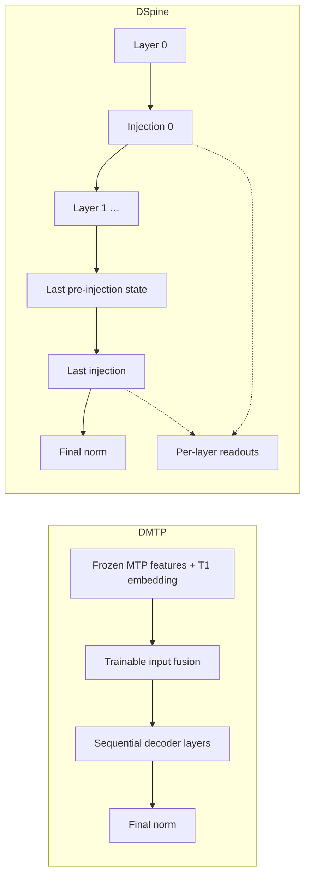

# Draft Model and Component Design

This document describes the target design for draft model configuration, model composition, and code boundaries. It is a target, not a description of the current implementation. Class and field names are illustrative unless stated otherwise, and example values do not describe real checkpoints. The [usage guide](config_usage_graph-eng.md) covers entry paths, import, export, and orchestration. The [node reference](spec-eng.md) summarizes the configuration nodes; where the two differ, this document is normative.

## 0. Principles

1. **Mirror HF target models.** Describe a draft the way HF describes a target model: attention and MLP components are assembled into decoder layers, and layers are stacked into a model. Configuration nodes and modules correspond one to one.
2. **One golden configuration.** Parsing produces a single frozen `DraftConfig`. Every other representation is derived from it: the HF configuration object, `config.json`, the SGLang export, and every value read by training, data, or launch code. Derived values are never stored separately, written back, or read back as input.
3. **Explicit boundaries.** A module receives only its own configuration node and explicitly passed dimensions. Configuration, model definitions, training objectives, checkpoint formats, and orchestration live in separate packages with one-way dependencies that tests enforce.
4. **Fail before construction.** Structural fields have no defaults. Unknown fields, conflicting legacy aliases, unresolved references, and unsupported component combinations are rejected before any parameter is allocated.
5. **Open for extension.** New draft architectures and component types are added by registering them, not by editing shared code. A draft may also use the target model's weights (Section 7).

## 1. Model Composition

### 1.1 Base classes

Draft models inherit from `PreTrainedModel` through one project base class, `DraftPreTrainedModel`. They do not depend on model-family bases such as `Qwen3PreTrainedModel` or `LlamaPreTrainedModel`.

Every draft uses one HF configuration class, `SpecForgeDraftConfig(PreTrainedConfig)`, with `model_type = "specforge_draft"`. Transformers requires `model.config` to be a `PreTrainedConfig` and writes runtime fields onto it during construction and saving, such as `dtype`, the attention implementation, and `architectures`. `model.config` is therefore this shell, and the golden `DraftConfig` is `model.config.draft` (Section 8). There is no second accessor. Algorithms do not define their own `PreTrainedConfig` subclasses.

Because `save_pretrained` writes the model's class name into `architectures`, each model class is named after its registered architecture.

When replacing a model-family base class, take explicit ownership of initialization, RoPE, gradient checkpointing, and model metadata. Do not copy class attributes from the family base. In particular, `DraftPreTrainedModel` sets `_supports_attention_backend = False`, whereas `Qwen3PreTrainedModel` sets it to `True`. SGLang uses this attribute to decide whether its generic Transformers backend may load an architecture it does not implement, and a draft class must never load that way (usage guide, Section 4.1).

### 1.2 Composition

| Part | Responsibility | Built from |
|---|---|---|
| Components (`layers/`) | Attention, MLP / MoE, sublayer convolution, residual streams, normalization | One component node each |
| `DecoderLayer` | Wiring of one `decoder` layer: norms, residual connections, optional sublayer convolution | One `layer_configs` entry |
| `DraftBackbone` | Decoder layers, final norm, rotary embedding; sequential and per-layer execution | `layer_types` and model-level fields |
| Heads (`heads/`) | Auxiliary computations such as the DFlash2 selector, the DSpark Markov and confidence heads, the Domino GRU, and inter-layer DSpine injection | `spec_config` |
| Algorithm model (`models/<algorithm>.py`) | Input fusion, execution order, typed inputs and outputs, assembly of the backbone and heads | The whole `DraftConfig` |

An algorithm model is a composition of input fusion, `DraftBackbone`, and heads. It may call the backbone's sequential forward or own the layer loop; component reuse does not require a shared forward loop. No algorithm model inherits from another algorithm model, and base classes carry no hooks for a particular algorithm's heads. Training objectives and serving-time verification scheduling belong to algorithms, not to the model base class.

Specialized architectures, such as a native MTP draft or a vendor draft with fixed connections, implement those connections explicitly and reuse common components. They use the components their configuration declares rather than silently substituting fixed implementations. Do not introduce a specialized class when the general composition represents the native structure accurately.

### 1.3 Module interfaces

A component receives its own configuration node and the dimensions it needs as explicit arguments:

```python
GQAAttention(cfg: GQAAttentionConfig, *, hidden_size: int, norm: NormConfig,
             rotary: RotaryEmbedding)
MoE(cfg: MoEConfig, *, hidden_size: int)
DecoderLayer(attention: nn.Module, mlp: nn.Module, *, hidden_size: int,
             norm: NormConfig, sublayer_conv: nn.Module | None)
```

Components never receive the whole `DraftConfig`, `spec_config`, or a model-family configuration such as `Qwen3Config`. HF modules receive the whole configuration and read whatever fields they need, for example `config.layer_types[layer_idx]` inside an attention module. This design deliberately does not copy that pattern, because it is what couples components to each other and to the model.

#### Execution ownership

`DraftBackbone` has one execution path in three steps:

- `begin(x, layer_inputs)` expands residual streams, prepares per-layer RoPE inputs, and returns a `BackboneState`.
- `run_next_layer(state)` runs the state's next layer through the shared module-call and gradient-checkpointing path. There is no layer index to pass, so layers cannot run out of order.
- `finalize(state)` requires every layer to have run, then reduces residual streams and applies final normalization.

`forward(x, layer_inputs)` is exactly these calls in a loop, so sequential and per-layer execution cannot diverge; running past the last layer or finalizing early raises. A model that changes the hidden state between layers reads and replaces it through the state. Whether an inter-layer module supports multiple residual streams is validated before construction. Layer inputs carry the required context tensors, masks, and positions or RoPE inputs, not an algorithm spec or training settings. The backbone contains no architecture-name branches or algorithm callbacks.

| Architecture | Model-owned computation | Backbone execution |
|---|---|---|
| DFlash | Target-feature fusion | Sequential forward |
| DFlash2 | Target-feature fusion and candidate selector; convolution stays inside each decoder layer | Sequential forward |
| DMTP | Fuse the first candidate's embedding with aligned, frozen MTP features | Sequential forward |
| DSpine | Interleave decoder layers and injection; collect intermediate features | `begin`, `run_next_layer` per layer, then `finalize` |



DMTP's trainable fusion belongs to the model and is called by its forward in both training and serving. The feature provider runs the frozen MTP; training supplies the first candidate from data, while serving obtains it from MTP prediction. Input preparation aligns tokens and teacher features, the objective chooses supervised positions, and serving owns candidate sampling, verification, and cache updates. None of these policies is implemented by the backbone.

DSpine owns one injection module containing per-layer readout/write parameters and shared message/gating parameters. Its forward controls when injection runs; `heads/` does not imply execution only after the backbone. Illustrative forwards, with block reshaping and shared input preparation omitted:

```python
# DMTP model: learned input construction is part of forward.
first = self.mtp_fusion(first_token_embedding, mtp_hidden)
x = assemble_slots(first, masked_suffix_embeddings)
hidden = self.backbone(x, layer_inputs)

# DSpine model: the architecture owns the inter-layer computation.
features = []
state = self.backbone.begin(x, layer_inputs)
for i in range(self.backbone.num_layers):
    state = self.backbone.run_next_layer(state)
    pre_injection = state.hidden
    state = state.with_hidden(
        self.injection(state.hidden, i, token_ids, self.transfer_codes, replace_mask)
    )
    features.append(self.injection.feature(state.hidden, i))
output = DSpineOutput(
    hidden_states=self.backbone.finalize(state),
    pre_injection=pre_injection,
    layer_features=torch.stack(features),
)
```

`DSpineOutput` preserves the final pre-injection, pre-normalization state and the post-injection readouts with their gradients. Refinement reuses the same final-layer injection parameters and final normalization. Training computes replacement schedules and samples `replace_mask` before calling the model; the model receives the mask, not the training step or schedule. An injection module's residual-stream requirements are validated before construction; support for a single hidden stream does not imply support for mHC streams.

### 1.4 Algorithm contracts

Matching dimensions do not make components interchangeable. Algorithms declare what they require from layers, components declare what they provide, and validation compares the two for every layer before construction:

| Requirement | Checked against |
|---|---|
| DFlash family: attention accepts keys and values projected from injected target-context features | Attention capability |
| EAGLE3: the first layer accepts a fused input of twice the hidden size | Layer input width |
| DSpine: in-block attention is causal | `is_causal` of every attention node |
| DFlash2: the convolution kernel fits in one block | Convolution node against the block protocol |
| mHC: every layer supports the configured residual-stream layout | Residual capability of each layer |
| Target bindings: only `embed_tokens` and `lm_head`, with the target's vocabulary and hidden sizes | Target configuration (Section 7.3) |

Components and decoder layers never check architecture names, and algorithms never rewrite a component setting to satisfy a requirement. An unmet requirement is a configuration error.

## 2. Configuration Structure

### 2.1 HF precedent

HF target configurations in Transformers 5.x already group parameters by component kind and map layers to kinds. They do it with field prefixes and model-specific lists:

| Target model | Component parameter groups | Per-layer mapping |
|---|---|---|
| Qwen3-Next | Second attention kind through `linear_*` fields; MoE through `num_experts`, `moe_intermediate_size` | `layer_types` (`linear_attention`, `full_attention`), `mlp_only_layers`, `decoder_sparse_step` |
| DeepSeek-V3 | MLA through `q_lora_rank`, `kv_lora_rank`; MoE through `n_routed_experts`, `moe_intermediate_size` | `first_k_dense_replace` |
| Gemma3 | `rope_parameters` keyed by layer type | `layer_types` (`sliding_attention`, `full_attention`) |
| Llama4 | MoE through `num_local_experts`, `intermediate_size`; dense layers through `intermediate_size_mlp` | `layer_types`, `no_rope_layers`, `moe_layers` |

The draft configuration makes these groups explicit. Named component definitions replace field prefixes, and one `layer_types` list replaces model-specific lists such as `first_k_dense_replace`, `mlp_only_layers`, `moe_layers`, and `no_rope_layers`.

Explicit groups also remove a naming conflict: the top-level `intermediate_size` is the dense width in DeepSeek-V3 but the per-expert width in Llama4. Inside a component node, a name has exactly one meaning.

### 2.2 Levels

| Level | Fields | Excluded |
|---|---|---|
| Model | `hidden_size`, `vocab_size`, `draft_vocab_size`, `norm_config`, `max_position_embeddings`, default `rope_parameters`, `initializer_range`, `tie_word_embeddings`, `residual_config`, `spec_config`, `target_bindings`, `target_logit_transform` | Component parameters such as head counts, `head_dim`, `intermediate_size`, and windows |
| Component | `attention_configs.<name>`, `mlp_configs.<name>`, `conv_configs.<name>` | Model-level dimensions. Each node has a `type` and only that type's parameters |
| Layer | `layer_configs.<name>`: a `LayerSpec` referencing attention, MLP, and optional `sublayer_conv` definitions | A layer-level `type` discriminator or copied component parameters |
| Stack | `layer_types`: one `layer_configs` name per decoder layer | — |

`LayerSpec` has no `type` field or type registry; the codec parses and validates its component references.

`num_hidden_layers` equals `len(layer_types)`. The codec writes it to `config.json` for HF tooling and verifies it on read; it never acts as a second, independent input.

`layer_types` holds `layer_configs` names, not HF's attention-kind values such as `full_attention` or `linear_attention`. SGLang never reads canonical configurations: the SGLang converter writes the per-layer values that SGLang reads, in SGLang's own format (usage guide, Section 4.1).

`tie_word_embeddings` is required. `true` is rejected when `target_bindings` lists `embed_tokens` or `lm_head`, because a bound module's weight comes from the target and each weight has one source.

`norm_config` is a model-level node used by every normalization in the draft: the decoder layers' norms, the final norm, and normalization inside components, such as query and key norms. It holds a `type`, `eps`, and that type's parameters, for example `{"type": "rms", "eps": 1e-06, "weight_offset": 0}`. `weight_offset` is 1 for RMSNorm parameterized as `1 + w`, as in Gemma3 and Qwen3-Next, and 0 otherwise. It is required, because the two parameterizations have the same weight shapes and different outputs. The legacy codec maps `rms_norm_eps` to a node with the source implementation's `weight_offset`: 0 for Qwen3-style drafts and 1 for main's Qwen3.5 MTP draft. A normalization used by only one component, such as a gated norm inside a linear-attention component, belongs to that component's node. A per-layer normalization can later be added as an optional `LayerSpec` reference without changing existing configurations.

Component nodes use HF field names without prefixes, for example `num_key_heads` rather than Qwen3-Next's `linear_num_key_heads`. In a MoE node, `intermediate_size` is the per-expert width, so no new name such as `expert_intermediate_size` is needed.

Validation has two levels. Each node validates its own fields and rejects unknown ones. One cross-node step checks that references resolve, that every definition is used, that `layer_types` matches `num_hidden_layers`, and that algorithm contracts hold (Section 1.4).

### 2.3 Algorithm parameters

`spec_config` holds the algorithm protocol and computations around or between decoder layers: the block or step protocol, target feature layers, the mask token, input fusion, and algorithm heads. The draft architecture selects its schema (see the usage guide). Fields are valid only for their algorithm; there is no untyped `params` dictionary.

| Algorithm | Examples |
|---|---|
| EAGLE3 / P-EAGLE | Auxiliary target layers, fusion normalization |
| DFlash | `block_size`, `mask_token_id`, `target_layer_ids` |
| DFlash2 | DFlash parameters, selector rank and top-k, output multiplier, final logit softcap |
| DMTP | Block protocol, MTP feature alignment and width, first-candidate input fusion |
| DSpark | Block and feature parameters, Markov head, confidence head |
| Domino | Block and feature parameters, GRU head |
| DSpine | Block and feature parameters, injection and transfer settings |

A draft vocabulary mapping is tensor data, not configuration. `draft_vocab_size` is a model-level field; the mapping tables are saved with the draft's weights and validated against it on load.

Training-objective settings are not model structure and stay in training configuration. These include loss weights, auxiliary-loss coefficients, and warmup or replacement schedules, such as DSpine's `ce_weight`, `alignment_weight`, and replacement probabilities. Changes to decoder-layer internals, such as DFlash2's convolution, belong to components rather than to `spec_config`.

Algorithm specs do not inherit from each other. Shared parts, such as a block protocol or a target-feature specification, are composed sub-specs. A subclass that reuses a field name with a different meaning would let generic code read a wrong value.

### 2.4 Block parameters

Each algorithm keeps its own block convention:

| Algorithm example | Configured value | New draft tokens | Verification window |
|---|---:|---:|---:|
| DFlash2 | `block_size = 16` | 15 | 16 |
| DSpark | `block_size = 7` | 7 | 8 |

Consumers never interpret `block_size` themselves. Each algorithm spec exposes the derived quantities, such as `num_draft_tokens`, `verify_window`, and the query layout. Training, data dispatch, and export read those. The spec node owns these formulas, and the SGLang converter writes the resulting values in SGLang's own terms, so SGLang never interprets a SpecForge field (Section 8). EAGLE expansion steps are serving settings, not model structure.

The protocol also distinguishes model slots, positions predicted by the draft, and candidates supplied by another predictor. For example, DMTP with seven slots `[T1, MASK, ..., MASK]` predicts T2–T7 in the draft, receives T1 from MTP at serving time, and verifies `[A, T1, ..., T7]`, a window of eight. Token alignment and these counts come from the spec; training and serving do not infer them independently.

## 3. Examples

A DSpark draft with four sliding-window layers and one full-attention layer. Values are illustrative, and architecture names such as `SpecForgeDSpark` are placeholders until the naming question is settled (usage guide, Section 7):

```json
{
  "architectures": ["SpecForgeDSpark"],
  "model_type": "specforge_draft",
  "schema_version": 1,
  "hidden_size": 4096,
  "vocab_size": 129280,
  "draft_vocab_size": 129280,
  "num_hidden_layers": 5,
  "norm_config": {"type": "rms", "eps": 1e-06, "weight_offset": 0},
  "max_position_embeddings": 1048576,
  "initializer_range": 0.02,
  "tie_word_embeddings": false,
  "rope_parameters": {
    "rope_type": "yarn",
    "rope_theta": 10000,
    "factor": 16,
    "original_max_position_embeddings": 65536
  },
  "attention_configs": {
    "swa": {
      "type": "gqa",
      "num_attention_heads": 32,
      "num_key_value_heads": 8,
      "head_dim": 128,
      "qk_norm": true,
      "attention_bias": false,
      "output_gate": false,
      "sliding_window": 2048,
      "is_causal": true
    },
    "full": {
      "type": "gqa",
      "num_attention_heads": 32,
      "num_key_value_heads": 8,
      "head_dim": 128,
      "qk_norm": true,
      "attention_bias": false,
      "output_gate": false,
      "sliding_window": null,
      "is_causal": false
    }
  },
  "mlp_configs": {
    "dense": {"type": "dense", "intermediate_size": 12288, "hidden_act": "silu"}
  },
  "layer_configs": {
    "swa_dense": {"attention": "swa", "mlp": "dense"},
    "full_dense": {"attention": "full", "mlp": "dense"}
  },
  "layer_types": ["swa_dense", "swa_dense", "swa_dense", "swa_dense", "full_dense"],
  "residual_config": {"type": "standard"},
  "target_bindings": ["embed_tokens", "lm_head"],
  "target_logit_transform": {"type": "none"},
  "extensions": [],
  "spec_config": {
    "block_size": 7,
    "mask_token_id": 128799,
    "target_layer_ids": [1, 11, 21, 31, 41],
    "markov_rank": 256,
    "markov_head_type": "vanilla",
    "enable_confidence_head": true,
    "confidence_head_with_markov": true
  }
}
```

A KDA and GQA hybrid whose first layer is dense and whose remaining layers use MoE needs no model-specific field. The following shows only the fields that differ from the previous example and omits the MoE routing settings:

```json
{
  "attention_configs": {
    "kda": {"type": "kda", "num_heads": 32, "head_dim": 128, "short_conv_kernel_size": 4},
    "full": {
      "type": "gqa",
      "num_attention_heads": 32,
      "num_key_value_heads": 8,
      "head_dim": 128,
      "qk_norm": true,
      "attention_bias": false,
      "output_gate": false,
      "sliding_window": null,
      "is_causal": false
    }
  },
  "mlp_configs": {
    "dense": {"type": "dense", "intermediate_size": 12288, "hidden_act": "silu"},
    "moe": {
      "type": "moe",
      "num_experts": 64,
      "num_experts_per_tok": 4,
      "intermediate_size": 2048,
      "num_shared_experts": 1
    }
  },
  "layer_configs": {
    "kda_dense": {"attention": "kda", "mlp": "dense"},
    "kda_moe": {"attention": "kda", "mlp": "moe"},
    "full_moe": {"attention": "full", "mlp": "moe"}
  },
  "layer_types": ["kda_dense", "kda_moe", "kda_moe", "full_moe"]
}
```

DFlash2's grouped causal convolution wraps both sublayers of a decoder layer, around attention and around the MLP. It is therefore a layer-level slot rather than an MLP type:

```json
{
  "conv_configs": {
    "grouped": {"type": "grouped_causal", "kernel_size": 4, "group_size": 64}
  },
  "layer_configs": {
    "full_dense": {
      "attention": "full",
      "mlp": "dense",
      "sublayer_conv": "grouped"
    }
  }
}
```

## 4. Attention

Each `attention_configs` node selects a structure with `type` and contains only that structure's parameters:

| Type | Node parameters |
|---|---|
| GQA / MHA | `num_attention_heads`, `num_key_value_heads`, `head_dim`, `qk_norm`, `attention_bias`, `output_gate`, `is_causal`, `sliding_window` (`null` for none) |
| MLA | `num_attention_heads`, `q_lora_rank` (`null` for none), `kv_lora_rank`, `qk_nope_head_dim`, `qk_rope_head_dim`, `v_head_dim`, rotation convention, `is_causal` |
| DSA | A projection sub-node, for example MLA, plus indexer and selection-policy settings |
| QSA | Projection, selection, quantization, or compression settings required by the variant |
| KDA | Head counts, state, gating, short-convolution, and projection settings; no GQA- or MLA-only fields |

Every field that changes a node's parameters or its computation is required and explicit, including the presence of query and key norms, projection biases, and an attention output gate. A value that may be absent from the computation, such as a window or a query LoRA rank, is still required and is written as `null`. A strict copy from the target (Section 7.3) and the SGLang converter (G8) both rely on the node alone; neither may assume a model family's default.

For example, DSA combines an MLA projection with an indexer. The following shows organization only; real use requires all mandatory fields of each branch:

```json
{
  "attention_configs": {
    "dsa": {
      "type": "dsa",
      "projection": {"type": "mla"},
      "indexer": {"type": "learned_topk"},
      "is_causal": true
    }
  }
}
```

### 4.1 Causality and windows

`is_causal` and `sliding_window` are attention-node fields with concrete values. For block drafts, `is_causal` defines visibility within a block. Bidirectional in-block attention must not bypass context isolation during training.

A sliding-window layer and a full-attention layer are two attention definitions referenced from different layer definitions. There is no separate top-level window or layer-type field.

Legacy configurations may leave `is_causal` unset. Unset meant bidirectional for full-attention layers and causal for sliding-window layers. The legacy codec resolves that rule once, into explicit values on each attention node, and neither model code nor the serving engine reimplements it.

### 4.2 RoPE

The model-level `rope_parameters` is the default, including partial rotation such as `partial_rotary_factor`. An attention node may override it or disable rotary embedding, in the same way that Gemma3 configures RoPE per layer type and Llama4 has layers without RoPE. MLA applies rotation only to the `qk_rope_head_dim` part.

Precision is not a runtime choice. RoPE frequencies, angles, and cosine/sine tables are computed in FP32 whatever the training dtype. Rotation computes in FP32 and casts once to the Q/K dtype, following the SGLang serving reference. Linear scaling divides positions; dynamic NTK uses a fixed factor times the original context length, independent of call history. Main casts the rotary module together with the model, so BF16 training there rounds the frequencies. This is a numerics change relative to main, not a refactor: it is listed in the usage guide (Section 6) and measured on its own (checks 16 and 17).

### 4.3 Compute backends and distributed execution

Structure, compute backends, and distributed execution are configured separately:

| Dimension | Code location, relative to `modeling/draft/layers/attention/` | Configuration location |
|---|---|---|
| Structures such as GQA, MLA, DSA, QSA, and KDA | `gqa.py`, `mla.py`, and so on | Attention nodes |
| Eager, SDPA, FlashAttention, and FlexAttention backends | `backends/` | Runtime configuration |
| Ring Attention distributed execution | `parallel/ring.py` | Runtime configuration |

`backends/flex.py` translates attention inputs and semantics into FlexAttention calls, including masks and score modifications. It does not own learnable projections or selection algorithms.

`parallel/ring.py` adapts Ring execution: communication, blockwise computation, and result merging. The distributed infrastructure creates process groups and passes them in; attention layers do not create process groups.

`masks.py` contains reusable visibility descriptions and validation. Algorithm models provide the query and context layout, attention nodes specify causal, window, or sparse-selection requirements, and backends convert these into the representations they accept. Selecting Flex, Flash, or Ring never changes attention semantics.

Compatibility among structure, backend, parallel execution, masks, and windows is validated at startup. Separate directories do not imply that every combination is supported. Ring's local compute interface may require additional intermediate results, DSA and QSA selection outputs require backend support, and KDA need not share the softmax-attention interface. Unsupported combinations fail before execution.

Kernel implementations follow the same rule. A component may have more than one implementation of one computation, such as Liger RMSNorm and SwiGLU or the fused grouped convolution, and an objective may compute its loss fused or in chunks. These are runtime choices on the same node, the same parameters, and the same checkpoint keys. One place in training resolves each choice at startup from the runtime configuration and the device. A kernel that was requested, or resolved by default, and cannot be used fails instead of falling back to another implementation. Each kernel is checked against the eager implementation within a tolerance measured once and recorded with the test (check 5).

Backend, kernel, and parallel settings may be saved with the training run for reproducibility. They are not part of the draft's structure or of its exported configuration.

## 5. Residual Streams

`residual_config` is a model-level node. A residual-stream layout, such as the number of mHC streams, must be consistent across layers, and expansion and reduction happen at the model boundaries.

```json
{"residual_config": {"type": "standard"}}
```

```json
{"residual_config": {"type": "gr"}}
```

```json
{"residual_config": {"type": "mhc", "num_streams": 4}}
```

Type-specific parameters, such as GR gating and the mHC mixer and constraints, live in the node. These examples do not list every type-specific field. Common normalization uses the model-level `norm_config`; only normalization unique to a residual-stream module belongs in the node.

The residual component declares its cross-layer constraints, such as stream count and tensor layout, and validation checks every layer against them before construction (Section 1.4). Allowing different residual types per layer later requires an explicit conversion rule declared by the components involved. Changing a type name alone is not sufficient.

## 6. MLP / MoE

A dense node holds `intermediate_size` and `hidden_act`:

```json
{"mlp_configs": {"dense": {"type": "dense", "intermediate_size": 14336, "hidden_act": "silu"}}}
```

A MoE node holds the expert count, top-k, per-expert `intermediate_size`, shared experts, and routing settings. The following shows organization only:

```json
{
  "mlp_configs": {
    "moe": {
      "type": "moe",
      "num_experts": 64,
      "num_experts_per_tok": 4,
      "intermediate_size": 2048,
      "num_shared_experts": 1,
      "router": {"scoring": "sigmoid", "normalize_top_k": true}
    }
  }
}
```

- Add fields or sub-nodes when routers, shared experts, or expert types need further distinction. Avoid expressing different structures through many interacting Boolean switches.
- If a `variant` field is used, it names concrete computational semantics, such as a routing and shared-expert rule, not a model family such as `qwen` or `deepseek`. It never supplies numeric parameters implicitly. Differences in weight names between sources belong in weight-loading plans, through external format adapters or renames in a `from_target` mapping (Section 7.3), and do not justify a new variant.
- Routing structure is model configuration. Auxiliary-loss weights are training configuration.
- The codec normalizes synonymous legacy MoE fields, so each parameter has one source.
- The choice between dense and MoE for each layer, including a dense first layer or interleaved MoE, is expressed only through `layer_types`.

Specialized architectures select the nodes that match their native structure. General architectures can use any MLP node without also adopting the attention or residual structure of the model it came from.

## 7. Extensibility and Target-Derived Drafts

Draft architectures and layer architectures keep changing, and a draft may be built from parts of its target. The structure supports this with typed nodes at every level and open registries, not with flags on shared classes.

### 7.1 Extension points

| Level | Selected by | A new kind registers |
|---|---|---|
| Draft architecture | `architectures` | Spec, a model class with the same name, a default training objective, and, if it is served, its SGLang converter |
| Training objective | `training.objective`, defaulting to the architecture's | Objective, with the model inputs and outputs it requires and the modules it trains |
| Component | `type` of an attention, MLP, conv, norm, or residual node | Node schema, builder, and declared capabilities; a checkpoint layout only if it fuses tensors that checkpoints store separately |

- Architectures, objectives, and components dispatch through registries. Adding a kind means adding a module and registering it; shared files do not change. `LayerSpec` only groups component references and needs no registration.
- Packages outside the repository, for example for models under NDA, register the same way, through the `specforge.extensions` entry-point group. `extensions` in `config.json` lists the extensions whose kinds a configuration uses. It is a loading prerequisite, not part of `DraftConfig`: the loader reads it before decoding, loads each extension, and fails with the missing extension's name when one is not installed. The codec writes it from the kinds the configuration uses and verifies it on read. A YAML draft section that uses extension kinds lists them the same way. Configurations never contain Python import paths. SGLang never loads extensions: an extension kind is served only if the architecture's SGLang converter supports it and SGLang implements the computation; otherwise `--converter sglang` fails naming the kind (G8).
- Canonical schema v1 remains provisional until the format cutover in step 6. Intermediate configurations must use the current explicit structural fields; after that cutover, the compatibility rules below apply.
- Adding a kind is additive and does not change `schema_version`. Changing the fields or meaning of an existing kind requires a new name, or a new schema version with a codec migration so that older configurations stay readable.
- Flexibility does not relax validation. Every registered kind has a strict schema and declared capabilities, and it is checked against algorithm contracts (Section 1.4) like a built-in kind.
- A mechanism is built when a second instance needs it. Until then it is specified here but not implemented, and its absence fails loudly. A non-empty `extensions` list is rejected until the entry-point group exists. A component with fused parameters cannot be registered until checkpoint layouts exist. Residual types other than `standard`, and the DSA, QSA, KDA, and MoE nodes in this document, show where a new kind goes; they are not a list of supported kinds.

### 7.2 Native draft structures

Some targets ship their own draft, such as the MTP layers that Qwen3.5 checkpoints store under `mtp.*`. A native draft is not a special case: it is a native preset plus an ordinary copy (Section 7.3).

- `presets/native/` holds one YAML configuration per supported target, assembled from SpecForge components and a registered architecture. There is no `target` component or layer type, and no code derives nodes from the target's configuration.
- The bundled recipe for the target copies the native draft's weights with an ordinary `initialization.from_target` mapping, for example from the target's `mtp.` prefix to the draft's modules, under the same strict rules as any copy.
- Serving belongs to the architecture's SGLang converter. SGLang's format for a native draft is the target checkpoint itself, so `--converter sglang` writes the trained weights back into a copy of the target checkpoint under the native names, as main's `specforge/export/mtp.py` does today. This export therefore requires the target checkpoint (`--target-model`). It rewrites only the shards that hold native draft tensors and links the unchanged shards, so a large target is not copied; copying them into a self-contained directory is an explicit export option. Rewriting matters for correctness, not only size: SGLang loads every tensor in every shard, so a stale native draft tensor left in a copied shard would also load, and which copy wins would depend on file order.
- SGLang builds the native draft from the target's `config.json`, so the converter treats the fields that SGLang's native class reads as written fields. It adds a field the target configuration lacks, from the `DraftConfig`, and fails when the target configuration holds a different value; it never overwrites a target value. SGLang's native format also loads the draft's own embedding and LM head from the checkpoint, so the converter writes copies of the target's tensors under the native names, as main does, and fails if a source tensor is missing.
- The correspondence between draft and native names appears in the recipe and in the converter; exporting a native preset and copying it back must give identical weights, which keeps the two in agreement.
- CI checks each native preset with its copied weights against SGLang's serving of the target's native draft on reference inputs. SGLang is the reference because Transformers often omits native draft layers.

Main keeps the network and the `mtp.*` key layout in one family class (`Qwen3_5MTPDraftModel`). This design moves the network into components and a preset and keeps the merge-back export.

### 7.3 Target weights: copies, and the shared embeddings and LM head

Target weights reach a draft in two ways:

| Relationship | Meaning | Declared in | Saved with the draft | At serving time |
|---|---|---|---|---|
| Copy | Draft parameters start as bit-for-bit copies of target parameters, then are trained or frozen as training configuration says | Training configuration: `initialization.from_target` | Yes | The draft's own weights |
| Shared embeddings and LM head | The draft uses the target's `embed_tokens` and `lm_head`, frozen | Draft configuration: `target_bindings` | No | SGLang uses the target's modules, as it already does for the EAGLE3 embedding and for DFlash drafts' embedding and LM head |

Decoder layers are reused only by copying. Binding them, or deriving draft nodes from a target layer automatically, would require SGLang to share target weight storage with the draft and to understand SpecForge's mapping. A copy keeps the two decoupled: SGLang loads the draft's own weights and never sees `initialization`.

Copies:

- `initialization.from_target` maps draft module prefixes to target checkpoint prefixes. The mapping is written by hand in training YAML, and the draft's nodes are written explicitly like any other draft's. Nothing derives nodes from the target's layers, and there is no per-family adapter for decoder layers. Where tensor names under a prefix differ between the target and the draft, for example `shared_expert` against `shared_experts`, the mapping lists explicit renames.
- Copies are bit-preserving. The loader applies only layout operations that move elements without changing them: renaming, stacking, concatenating, splitting, and transposing. A component's parameters normally match the per-tensor Hugging Face checkpoint convention one to one. Only a component kind that fuses tensors that checkpoints store separately declares, next to its builder, how to assemble them. For example, a MoE component that stores its experts as one fused tensor declares that the tensor is stacked from per-expert `gate_proj`, `up_proj`, and `down_proj` tensors, the layout that Transformers 5 itself fuses at load time. The declaration carries no model-family knowledge. Value transforms are never applied: no offset such as `1 + w`, no scaling, no dequantization, and no cast to a narrower dtype. Widening, such as BF16 to FP32, is exact and allowed.
- The copy is strict. Every element of every draft parameter under a mapped prefix receives exactly one target element, every target tensor under the prefix is used, and shapes match after the declared layout operations. A violation fails before training and names the tensors. A target tensor in a quantized format, or one with scale tensors, fails the copy by name; dequantizing is a precision decision made outside the copy, for example by copying from the target's BF16 checkpoint.
- A target computation that no node can express, such as a normalization or gating form that no registered component offers, needs a component or node field that implements it. The copy never rewrites values to fit another component.
- SpecForge reads tensors from the target's checkpoint files, as main already does for embeddings and LM heads, and never asks the target server for weights. The weight-loading plan is built and validated from checkpoint metadata alone, the tensor names, shapes, and dtypes in the safetensors headers, before any tensor is read. Every rank builds the same plan from the same inputs, so validation passes or fails on all ranks together. Each rank then reads only the slices of the parameters it holds, so copying one layer of a very large target never loads the target.
- `from_target` is allowed when training from scratch or with `initialization.weights_from`. Its draft prefixes must be disjoint from the `weights_from` mapping and from `allow_new`, and bound modules are never covered: a mapping under the empty prefix covers every draft parameter except the bound `embed_tokens` and `lm_head`. With `initialization.checkpoint` or `resume` it is an error, because it would overwrite loaded weights.
- Matching names and shapes do not prove matching computation: `1 + w` and `w` norm weights, or two partial-rotary fractions, have the same shapes, and the draft would train from a worse start without an error. Bundled presets that copy target weights are therefore checked in CI. The draft layer runs where its algorithm-specific inputs are absent, for example with zero context length and a causal mask for a DFlash-family layer, and must reproduce the target layer's output on reference inputs. Both sides run in FP32 with eager attention, and the tolerance is measured once per preset, recorded with the test, and never raised to make a preset pass. For a user-written mapping, the loader prints the full mapping, and the node definitions are the user's responsibility.
- Freezing a copied layer is a training setting. A frozen copy is still saved with the draft and costs serving memory; self-speculative drafts that run the target's own layers at serving time are not supported.

Shared embeddings and LM head:

- `target_bindings` lists modules from the closed set `embed_tokens` and `lm_head`; no other module can be bound. The configuration records only which modules come from the target. The target checkpoint keys they load from are not part of `DraftConfig`. The weight-loading plan resolves them from the target checkpoint's index through a closed list of candidate names, as main's MTP draft already does, and fails when none or several match; training, export, and `loading.load_draft` use the same resolution.
- Bound modules are frozen, consistent with a frozen target. Training loads them from the target checkpoint, and exports omit them and record `target_bindings`.
- A bound LM head computes logits as the target does. Target settings that change logits, such as `logits_mup_width_multiplier`, are target-derived values like `target_layer_ids` (G3). The parser reads them from the target configuration through a closed table and stores the result as `target_logit_transform`, for example `{"type": "mup", "multiplier": 8.0}` or `{"type": "none"}`. The field is required when `target_bindings` lists `lm_head` and rejected otherwise. The table lists the logit-affecting target fields SpecForge knows: a known field with an unsupported value fails parsing, and a field SpecForge does not know is caught on bundled targets by the logits oracle (check 10). When a target configuration is available on load, the value is recomputed and checked. A checkpoint written before the change has no such field, so reading it for export or continued training requires the target configuration. The bound LM head reads this node like any module reads its own, so `modeling` never sees the target configuration.
- SGLang applies the same settings from the target configuration when it serves, so the converter does not write `target_logit_transform`. A binding cannot avoid these two implementations of one target computation, so an oracle compares them: on reference final hidden states, the bound LM head's logits match SGLang's target logits within the floor measured for identical weights. `mup` means exactly what main does today: after loading, the bound LM head's weight is divided by the multiplier in the training dtype. A different numerical treatment, such as scaling the logits instead, is a new type and a numerics decision of its own.
- SGLang decides per architecture which modules come from the target; for example, its DFlash drafts always use the target's LM head. The SGLang converter declares the binding sets that SGLang's format expresses for each architecture, and export fails for any other set (G8).
- Copying them into the draft would make exports self-contained, but each costs serving memory of the vocabulary size times the hidden size, and SGLang would have to load them from the draft instead of sharing the target's.

## 8. Single Source of Truth

Parsing produces exactly one golden configuration: a frozen, hashable `DraftConfig`. Everything else is derived from it.

```text
Structural source, exactly one per run:
  YAML draft section  |  checkpoint config.json  |  import adapter output
                          |
                          v   codec: serialization and migration rules, including legacy aliases
  DraftConfig: frozen, hashable, with defaults and derivations resolved to concrete values   <- golden
                          |   passed by reference
      +-------------------+----------------------+------------------------------------+
      v                   v                      v                                    v
 model.config.draft   modules hold their     training objective, data dispatch,    derived artifacts:
 inside the HF shell  own node               and launch code read the spec         encode -> config.json
                                                                                   convert -> SGLang format
```

| Rule | Meaning |
|---|---|
| G1. One structural source per run | Training from scratch, and warm-starts that change structure (`initialization.weights_from`), read the YAML draft section; the source checkpoint of a warm-start supplies weights only, through an explicit mapping. Continued training from a checkpoint (`initialization.checkpoint`) and resumption read the checkpoint, and imports read the adapter output. If YAML also provides structure in those cases, it must be identical to the checkpoint's or loading fails; fields are never merged. Training configuration cannot contain structural fields. |
| G2. One parser, one owner per rule | Spec nodes own semantics, validation, and derivation formulas. The codec owns serialization and migration rules. It handles legacy aliases once, at the entry point, and rejects conflicting values; examples are a top-level `block_size` versus `dflash_config.block_size`, and `rope_theta` versus `rope_parameters`. Checkpoint adapters call both and own only weight mappings. Downstream code never reads raw configuration dictionaries or calls `getattr(config, name, default)`. |
| G3. One definition per default and derivation | Structural fields have no defaults; canonical YAML must explicitly supply `target_layer_ids` (including EAGLE auxiliary layers) and `mask_token_id`. Only a missing `target_logit_transform` for a bound LM head is derived from the explicitly supplied target configuration at parse time and stored as a concrete value. Pure derivations, such as `num_hidden_layers` or `num_draft_tokens`, are methods. A derived value written to JSON for compatibility is recomputed and checked on read. |
| G4. Immutable after parsing | Configuration values are resolved and validated before the model is built. `mask_token_id` is supplied explicitly, with no tokenizer-based fallback, and is checked against the target's vocabulary size. Nothing writes to the configuration after construction; a structural change requires a new configuration and a new model. |
| G5. References, not copies | Modules hold their own node instead of copying values into attributes such as `self.block_size`. Training objectives, data dispatch, and launch code receive `config.spec` or the node they need, not separate arguments with their own defaults. `architectures` is the only structural selector, and the model family is derived from it. The training objective is chosen separately (Section 9.2) because it is not structure. |
| G6. The HF configuration object is a shell | `model.config` is `SpecForgeDraftConfig`, and `model.config.draft` is the golden configuration. The shell declares no structural fields or defaults. It may hold HF metadata and runtime fields that Transformers writes during construction and saving, such as `auto_map`, `transformers_version`, `architectures`, `dtype`, and the attention implementation. Its `to_dict` is the codec's encoding of `draft` plus that metadata, so re-saving an exported package keeps its loading entry points. Its `from_dict` decodes through the codec and sets no structural attributes, so generic HF or SGLang code that inspects attributes such as `head_dim` or `layer_types` finds nothing instead of misreading draft values. The exceptions are attributes that Transformers itself reads or writes: `tie_word_embeddings`, which `PreTrainedModel.tie_weights` reads with a default of false, is a read-only view of `draft`, and `architectures`, which Transformers writes on save, must equal the draft's architecture. |
| G7. Artifacts are derived | The canonical `config.json` is the encoding of the golden configuration, and an SGLang directory is a one-way conversion of it for serving. SpecForge never reads an SGLang directory back: continued training and re-export start from the canonical checkpoint or the HF export, so no converter needs an inverse. Every written directory records artifact metadata outside `DraftConfig`: its format and, for an SGLang directory, the converter version and the SGLang version whose format it targets. |
| G8. SGLang is reached only through an exported artifact | SGLang imports no SpecForge code and never reads canonical configurations; SpecForge depends only on the draft format that the pinned SGLang version reads. SGLang owns that format. The SGLang converter is the one place that translates a `DraftConfig` into it, and it writes every field that SGLang reads and that affects computation, including per-layer values where SGLang's format has them. A CI check records the fields SGLang reads and fails on any field the converter did not write, apart from a versioned list, kept with the converter, of fields that do not affect computation, such as `torch_dtype`. SGLang's defaults therefore never decide a draft's computation, and no rule, such as the legacy `is_causal` default, is implemented in both repositories. A structure or binding set that SGLang's format cannot express fails the export, including a draft whose layers differ in a value that SGLang's format holds once for all layers (usage guide, Section 4.1). |

Section 9.3 lists the tests that enforce these rules.

## 9. Code Layout and Boundaries

The [usage guide](config_usage_graph-eng.md#5-code-organization) shows the full tree. The model side follows these conventions:

- `specforge/config/draft/` holds the frozen configuration nodes, the codec, and cross-node validation. It imports neither torch nor transformers, so configurations are parsed and validated before any model code loads.
- `specforge/config/draft/presets/` holds draft configuration YAML files. Its `native/` subdirectory holds one configuration per supported target with a native draft (Section 7.2). A preset is read like any configuration file into the full frozen configuration before model construction; checkpoints persist the expanded configuration and never read the preset file on reload. Presets do not implement forward computation, load weights, or select training objectives.
- `specforge/modeling/draft/layers/` holds the components. It is a sibling of `models/` because general and specialized models both use it.
- `specforge/modeling/draft/heads/` holds algorithm heads, and `backbone.py` holds `DraftBackbone`.
- `specforge/modeling/draft/models/` holds algorithm models.
- Checkpoint formats, including external drafts and SGLang conversion, live in `specforge/checkpoint/formats/`, not next to models.
- Model-family configuration classes such as `Qwen3Config` are constructed only in checkpoint formats.
- The target configuration that the parser receives is a plain mapping. `checkpoint` reads it from the target's `config.json`, resolving `text_config`, so neither `config.draft` nor `training` constructs a model-family configuration class.
- `specforge/loading.py` is the public entry point for reading drafts from files. It reads a directory through `checkpoint` and builds the model with `modeling.build_draft_model(config)`. `modeling` performs no file I/O.

### 9.1 Dependencies

Arrows point from a package to a package it may import. A package may import anything reachable along the arrows and nothing that can reach it:

```text
cli -> training -> loading -> checkpoint -> modeling -> config.draft
          |                                    ^
          +----------> algorithms -------------+
```

- `config.draft` depends on nothing else in SpecForge.
- `modeling` depends only on `config.draft` and performs no file I/O. It does not import `algorithms`, `training`, `checkpoint`, or `loading`.
- Inside `modeling/draft`, `layers` does not import `models`, `heads`, or algorithm specs.
- `checkpoint` depends on `config.draft` and `modeling`, never on `loading` or `training`.
- `loading` depends on `checkpoint`, `modeling`, and `config.draft`.
- `training` orchestrates the entry paths, builds objectives from `algorithms`, and owns training state.
- The diagram names the packages this design defines. Other code takes the rules of the level it sits on. Export orchestration sits above `loading` and is imported only by `cli`. Loss and kernel primitives are imported only by `algorithms`. Launch and deployment code sits with `cli`. Code that reads the target's configuration or weights from files follows the `checkpoint` rules wherever it lives, so draft modeling never reads files.
- During migration, the existing `specforge.modeling.auto` entry point remains as a thin façade that imports `loading` inside its functions. It is the one documented exception to these rules and is removed once callers move to `loading`.

### 9.2 Registries

Each package owns its registry:

- `config.draft` maps architecture names to specs.
- `modeling` maps architecture names to model classes, each named after its architecture, and component kinds to builders.
- `checkpoint.formats` maps architecture names to SGLang converters. Each converter translates the spec, the binding set, and the component nodes it supports, using shared helper functions for common nodes; a node or binding set it does not support fails export.
- `algorithms` registers objectives under their own names. Each objective declares the model inputs and outputs it requires, the modules it trains, and what it needs from capture and the runtime (Section 9.5), and each architecture names a default objective.

Each architecture also declares the modules it uses at serving time, such as the DFlash2 selector or the DSpark Markov head. An objective is compatible with an architecture only if each of those modules is trained by the objective, bound to the target, or listed as frozen in training configuration. Matching inputs and outputs is not enough: a DFlash objective can train a DFlash2 model's logits but not its selector, and the untrained selector would be exported and served.

A consistency test checks that every architecture has the entries it needs and that its default objective is compatible. Training can select another objective that is compatible in the same sense, so a new objective never needs a new architecture. Components register their schemas in `config.draft` and their builders in `modeling` the same way, and extensions outside the repository call the same functions.

SpecForge loads drafts through these registries. Standard Transformers loading works differently: AutoModel selects the model class from the configuration class and uses `architectures` only to choose among several classes registered for it, and remote code goes through `auto_map`. An exported HF package therefore names its concrete model class in `auto_map`.

No single registry links configuration, models, training protocols, and adapters. Such a registry would make every package depend on every other.

### 9.3 Enforcement

| Rule | Test |
|---|---|
| `config.draft` loads neither torch nor transformers | Import it in a subprocess and inspect `sys.modules` |
| Package dependencies follow Section 9.1 | Scan imports with `ast` |
| Components receive only their own node and explicit dimensions | Inspect the constructor signatures of registered components |
| Shared components support model-owned execution | `forward` is implemented as `begin`, `run_next_layer`, and `finalize`; manual per-layer execution with the same layers and inputs is bit-identical to it; running past the last layer and early `finalize` raise; DMTP fusion and DSpine intermediate outputs, refinement, and gradients remain unchanged with checkpointing enabled |
| No algorithm class inherits from another algorithm's class | For every registered spec, model, and objective class, check that its MRO contains no other registered algorithm class |
| Encoding is lossless | `parse(encode(c)) == c`, and `encode(parse(j)) == j` for canonical fixtures |
| No scattered defaults or raw formats | `dflash_config`, `eagle_config`, and similar keys appear only under `config/draft/codec/` and `checkpoint/formats/`, and no code calls `getattr(config, name, default)` on configuration objects |
| Family configuration classes stay in checkpoint formats | Within `specforge/`, `Qwen3Config`, `DeepseekV3Config`, and similar classes are imported only under `checkpoint/formats/`. Tests may import target-family modeling classes as references for equivalence checks |
| No mutable mirrors | Nothing writes to the configuration or to a value copied from it after construction, and `hash(model.config.draft)` is unchanged after building the model and running a training step |
| Values cross packages as nodes | Registered objectives, data dispatch, and launch components take configuration nodes, not copied scalars such as `block_size` |
| One owner per derivation | Fixture tests compare the derived quantities that consumers use, including the values the SGLang converter writes, with the spec methods |
| Copies from the target are strict | A `from_target` mapping that leaves a draft element without a source, leaves a target tensor unused, mismatches a name or shape, narrows a dtype, or reads a quantized tensor fails before training and names the tensors |
| Component checkpoint layouts are bit-preserving | For every component kind that declares a checkpoint layout, splitting its parameters into the declared checkpoint layout and joining them back reproduces them bitwise |
| Weight plans are validated before reading | A plan with a missing, unused, or mismatched tensor fails on every rank from checkpoint metadata alone, before any tensor is read |
| No structural fields in training configuration | The training schema forbids extra fields and rejects structural names |
| Registries agree | Every architecture has a spec, a model class named after it, a compatible default objective that covers its serving-time modules, and, where applicable, an SGLang converter; every registered component kind has both a schema and a builder |
| Shared training code reads declarations, not names (Section 9.5) | A test registers a new architecture and objective from outside the shared packages and runs one training step without editing them; a scan finds no comparison with a registered architecture or objective name in shared training code |
| Capture ranges are checked before launch | A draft whose target layer ids fall outside its capture method's declared range fails startup validation on the launch side and on the trainer side |
| Canonical names never reach SGLang's model classes | Registered architecture names are compared with a frozen list of the names that released SGLang versions register |
| SGLang's Transformers backend refuses draft classes | `is_backend_compatible()` is False for every registered model class |

These checks target independent sources of the same value. Read-only values that a module derives from its own node at construction, and HF metadata on the shell, are allowed.

### 9.4 Avoiding god classes

| Area | Risk | Structure |
|---|---|---|
| Configuration | One class per algorithm holding dimensions, components, algorithm parameters, HF serialization, and aliases | Small nodes; the codec and validation are separate modules |
| Model | A family base class that knows every variant's heads and hooks, with variants overriding its forward | Composition of fusion, backbone, and heads; no cross-algorithm inheritance |
| Training | One family training model with many constructor arguments and behavior switched by attributes | One objective per algorithm; mask construction, anchor sampling, and loss primitives are shared functions |
| Registry | One registry linking configuration, models, training protocols, and adapters | One registry per package |
| Loading | A checkpoint loader that also creates and restores training state | Orchestration in `training/model_loading.py`; file reading in `loading.py` and `checkpoint`, which never touch training state |

### 9.5 Training inputs and the capture contract

The trainer and the target server are separate processes. What crosses between them follows from the draft and its objective, and each fact has one owner that shared training code reads:

| Fact | Owner | Read by |
|---|---|---|
| Which target layers feed the draft, and the mask token | The feature spec inside `spec_config` | Capture launch, offline feature preparation, the trainer, and the SGLang converter |
| Which other target tensors a training step needs, such as final hidden states or target logits, and whether it needs a frozen target LM head | The objective's registration | Capture launch, data loading, and model assembly |
| Which target layers a capture method can record | The capture method | Startup validation, on the launch side and on the trainer side |
| Batch constraints, and the backends, kernels, and parallel modes an objective supports | The objective's registration | Startup validation |

- A target layer id `k` is the hidden state that decoder layer `k` writes to the residual stream, counted from 0, before the target's final normalization. The target's final hidden state after its final normalization is a different feature, which the feature spec declares as such; it is never written as the last layer id.
- A capture method declares the ids it can record. A hook that records the input of layer `k + 1` cannot record the last layer; a hook that records each layer's own output can. Startup validation compares the draft's ids with the method's range before any server starts, so a draft that cannot be captured, and therefore cannot be served through the same hook, fails there.
- Shared training code never branches on an architecture or objective name and never probes a model with `hasattr` for one algorithm's hook. What it needs is a declaration on the registration, including an algorithm's one-time preparation, such as building DSpine's transfer space or loading a draft vocabulary mapping. A registration that omits a required declaration fails when it registers. There is no fallback value, such as a default capture method.

## 10. Implementation and Validation

Proceed incrementally and keep existing entry points until the cutover in step 8:

1. Configuration nodes, including `norm_config` and the explicit attention fields, the canonical codec, and the legacy codec. Every existing draft configuration and checkpoint configuration decodes. The files that training and export write do not change yet.
2. The generic base class and `DraftBackbone` with its `begin`, `run_next_layer`, and `finalize` execution path.
3. Components behind node-only constructors, with a checkpoint layout for each component that fuses parameters.
4. Algorithm models as compositions, with heads extracted.
5. One training objective per algorithm.
6. The switch to canonical artifacts, in one PR: training checkpoints and `specforge export` write canonical configurations, the embeddings and LM heads that drafts already share become `target_bindings`, the muP multiplier that main reads at load time becomes `target_logit_transform`, and the SGLang converter (`--converter sglang`) covers every architecture that main can serve today. The usage guide (Section 6) lists the resulting changes for users. SGLang keeps reading only its own format. Step 6 depends on one SGLang change to its own format: per-layer causality for DFlash-family drafts. SGLang reads one `is_causal` today and otherwise applies its legacy per-layer default, which existing drafts that mix sliding-window and full-attention layers rely on; under G8 the converter cannot rely on that default.
7. Strict, bit-preserving `initialization.from_target` copies; native presets with ordinary `from_target` mappings and merge-back export, replacing the MTP family classes; and the CI equivalence check for each bundled preset that copies target weights.
8. The cutover, in separate PRs so that each has one verification method:
   1. Move the remaining capabilities onto the canonical path: kernels, fused and chunked losses, attention backends, and parallel execution. Each is compared with main's implementation while both exist (checks 5 and 16).
   2. Store the outputs of main's models and objectives as reference fixtures for every architecture, and run the end-to-end comparison (check 17).
   3. Migrate the bundled recipes and make the canonical path the default. Retired configuration keys and command flags fail with an error that names the replacement, and a command rewrites a legacy draft configuration as canonical YAML (check 18). The usage guide (Section 6) lists these changes.
   4. Delete the replaced models, training code, and their tests. The reference fixtures stay.

Steps 1 to 5 preserve file formats and command flags. Their computation is behaviour-equivalent except for the explicitly measured RoPE numerics change in Section 4.2; checks 1, 2, and 16 account for that exception. Every user-visible change waits for step 6, except native MTP fine-tuning, which moves in step 7, and the training-configuration changes of step 8 (usage guide, Section 6).

Behaviour-equivalent is a claim about code that runs. A step that adds canonical code next to the implementation it will replace leaves every user on the old code, so the step is equivalent by construction and says nothing about the new code. For such a step the checks compare the two implementations directly, with main's implementation as the reference. The reference is deleted only in step 8, after its outputs are stored as fixtures, so the comparison outlives it. A difference that is intended, such as the RoPE precision (Section 4.2), is listed and measured on its own; it is never absorbed into a tolerance.

Checks:

1. With identical weights and inputs, outputs match before and after base-class replacement, and initialization and gradient checkpointing are preserved.
2. Encoding round-trips. Every existing configuration decodes and builds a model whose parameter names, shapes, and forward outputs on identical weights are bit-identical to those of the model that main builds from the same file. Existing checkpoints load, including EAGLE3 warm-start checkpoints.
3. For every architecture, the SGLang export loads in the pinned SGLang version, and its block quantities and draft outputs on reference inputs match SpecForge's. While SGLang builds the draft, the configuration fields it reads are recorded, and a read of any field the converter did not write, other than the listed fields that do not affect computation, fails the check. For a native architecture, the target-configuration fields that the converter checked count as written.
4. Forward, backward, and parameter-update checks pass for every declared component combination.
5. Supported backend, kernel, and Ring combinations preserve masks, and their outputs match the eager implementation within each combination's measured tolerance. Unsupported combinations fail before execution.
6. Specialized architectures use their declared components and reject configurations that violate fixed structural constraints before construction.
7. SGLang rejects a canonical directory instead of serving it with default settings, including an HF export loaded with `--trust-remote-code`.
8. The boundary tests in Section 9.3 pass.
9. A bundled preset YAML, an equivalent user configuration file, and inline YAML produce the same `DraftConfig` without dispatching on file names or directories. Native presets build only registered components and, with weights copied from the target's native draft, match SGLang's serving of the target's native draft on reference inputs.
10. Bound embeddings and LM heads are frozen, are excluded from the draft checkpoint, and are restored from the target when the checkpoint is loaded. On reference final hidden states, the bound LM head's logits, with `target_logit_transform`, match SGLang's target logits within the floor measured for identical weights.
11. Two draft architectures load in one process, are saved, and reload with the same `DraftConfig`, both through SpecForge's loader and through Transformers with the exported `auto_map`.
12. Exporting to HF and re-importing gives identical weights and forward outputs. SGLang exports are one-way; checks 3 and 15 cover them.
13. For every existing configuration, the pinned SGLang version builds the same draft from the converter's output as from main's export, `--to hf` for DFlash-family and P-EAGLE drafts and `--to sglang` for EAGLE3: the same resolved settings, such as block size, per-layer attention type, causality, and head counts, and the same outputs on reference inputs. Textual differences between the two files, such as fields now written explicitly, are listed.
14. With each architecture's default objective, every parameter used at serving time that is intended to be trained receives a gradient; target-bound parameters and parameters explicitly frozen in training configuration are excluded.
15. Each bundled preset that copies target weights reproduces the target computation with the copied weights, as Section 7.3 describes. A native preset exported with `--converter sglang` and copied back through its recipe's `from_target` mapping gives identical weights.
16. For every architecture, the default objective's loss and parameter gradients match those of main's objective on identical weights and inputs, in the training dtype and with the default kernels: bit-identically, or within a floor measured once and recorded with the test. Where a difference is declared, such as the RoPE precision, the reference is run with that one difference applied, and the difference itself is measured separately.
17. One bundled recipe per algorithm family runs on main's path and on the canonical path with the same data and seed. The first-step loss matches as in check 16, the loss curves agree over a fixed number of steps, throughput and peak memory are no worse than main's beyond measurement noise, and acceptance length on the evaluation set is within the run-to-run noise measured for main.
18. Every recipe and draft configuration bundled on main has a migrated counterpart, and the migrated configuration parses to the same `DraftConfig` that the legacy codec decodes from the original file. Each retired key and flag has a test that its error names the replacement.
