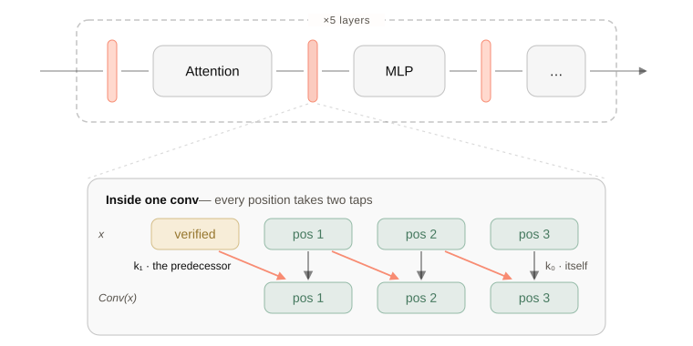

# DFlash2

## Overview

DFlash drafts several future tokens with one parallel backbone forward. A
known anchor and masked proposal positions read context features from the
target. This reduces sequential drafting work, but each position's highest
scoring token may not form a good continuation with its neighbors.

[DFlash2](https://inco.ai/blog/dflash2/) keeps this one-pass backbone and adds
two components: grouped dynamic convolutions for local information exchange,
and a low-rank selector for choosing a coherent path through candidate tokens.
The target still verifies the resulting proposal. Review
[speculative decoding](./speculative_decoding.md) for the common
draft-and-verify loop.

## How it works?



<p align="center"><em>Source: <a href="https://inco.ai/blog/dflash2/#figure-4">Inco AI, DFlash 2: Keep drafting parallel, Figure 4</a>. The official diagram shows the placement and operation of the dynamic convolutions.</em></p>

One inference cycle has four stages:

1. **Build a draft block.** The input contains a known anchor and masked
   positions for the proposed continuation. Target features supply the
   verified context.
2. **Predict positions in parallel.** Attention reads context, while short
   dynamic convolutions exchange information between nearby block positions.
   The language-model head produces a vocabulary distribution at each slot.
3. **Choose a candidate path.** Retain a small top-k set at every slot. The
   selector combines each candidate's own score with its compatibility with
   the preceding token.
4. **Verify with the target.** The target checks the chosen continuation and
   commits the accepted prefix. Unaccepted draft positions are discarded.

### Why use a local convolution?

Later positions must predict farther from the known anchor. A short causal
convolution gives each position an additional route to nearby representations
without running another draft backbone forward. A two-tap example is

$$
y_t = k_{t,0}\odot x_t + k_{t,1}\odot x_{t-1}.
$$

The coefficients depend on the current hidden state, and groups of channels
share their dynamic corrections. This exchanges local information while the
positions remain parallel. The example uses two taps; kernel size and channel
group size are configurable in SpecForge.

### Why select a path instead of independent top-1 tokens?

A candidate can be plausible at one position yet fit poorly after the token
chosen immediately before it. The selector adds a predecessor-dependent
transition score to the unary logit:

$$
S_t(a,b)=U_t(b)+\langle A(a)\odot H(h_t),B(b)\rangle.
$$

`a` is the predecessor token, `b` is a candidate at the current position, and
`h_t` is the draft hidden state. The token codebooks and hidden projection
use a low rank so candidate scoring is cheaper than another full-vocabulary
prediction. Pair scores can be computed together; a small path-selection
step still depends on earlier choices. Thus, parallel backbone prediction
does not imply that every operation in the cycle is independent.

The selector cannot recover a token absent from its candidate set. Candidate
coverage and selection accuracy therefore measure different problems. The
[candidate-selector implementation](https://github.com/sgl-project/SpecForge/blob/main/specforge/modeling/draft/heads/candidate_selector.py)
contains both the pair-score lattice and the local greedy path helper.

## Training

The frozen target supplies context features. SpecForge trains the draft's
token predictions and an auxiliary selector objective. Selector supervision
is limited to positions whose reference token is in the unary top-k set;
positions outside that set still contribute to the configured base loss.

The selector coefficient can warm up and ramp with optimizer steps. This
lets its influence increase gradually rather than changing the objective
abruptly. Convolutions start as identity operations and the selector's
transition correction starts at zero, preserving the corresponding plain
draft computation at initialization. The configuration details below explain
how the coefficient and gradient routing are controlled.

## Inference

The draft architecture changes proposal generation; the target remains the
verifier. The runtime must use the proposal probabilities corresponding to
its selector and sampling path when performing exact rejection sampling.
The selector itself is not an acceptance test.

A larger candidate set offers more choices but increases scoring work.
A longer block offers more potential tokens per verification but can reduce
acceptance at later positions. Compare accepted length with complete
draft-and-verify latency or throughput under the same sampling settings.
The [DFlash2 report](https://inco.ai/blog/dflash2/) provides workload-specific
measurements; its speedups should not be treated as guarantees for another
target, batch size, or runtime.

## Using DFlash2 in SpecForge

The published recipes reuse DFlash capture and data semantics. The draft
architecture selects the DFlash2 model and its selector objective; the target
does not need a different feature-capture protocol.

| Boundary | DFlash2 value |
| --- | --- |
| Default objective | `dflash2` |
| Draft architecture | `DFlash2DraftModel` |
| Online server capture | `--speculative-algorithm DFLASH` |
| Offline feature schema | DFlash inputs; final target states when teacher metrics are enabled |
| Export target | `specforge export --converter sglang` |
| SGLang serving algorithm | `DFLASH` |

The sections below retain the model configuration, selector schedule, online
and offline commands, and serving requirements for these recipes. Start with
the [training guide](../basic_usage/training.md) for the shared run lifecycle.

### Architecture

Every attention and MLP sublayer is wrapped by a grouped, dynamic depthwise
convolution. `kernel_size` controls its number of causal taps and
`group_size` controls how channels share dynamic kernel coefficients. The
base kernel is an identity and the kernel projection is zero-initialized, so a
new convolution starts as an exact no-op.

The candidate selector first takes the target LM head's unary top-k at every
proposal position. It then adds a low-rank transition score conditioned on the
draft hidden state and the predecessor token. The successor codebook is
zero-initialized, so a new selector initially preserves unary DFlash scores.

The draft YAML names convolution nodes in `conv_configs` and references one
from each layer's `sublayer_conv`. The selector settings belong to `spec_config`.
For example, these fields are part of a complete canonical draft:

```yaml
architectures: [DFlash2DraftModel]
conv_configs:
  local:
    type: grouped_causal
    kernel_size: 2
    group_size: 16
layer_configs:
  decoder:
    attention: full
    mlp: dense
    sublayer_conv: local
spec_config:
  # target_features and protocol are also required.
  selector_rank: 256
  selector_top_k: 16
```

`kernel_size` must be positive and no larger than the protocol block size;
`group_size` must divide `hidden_size`; `selector_rank` must be positive;
`selector_top_k` must be between 1 and `vocab_size`. Use the complete
[Qwen3.6 preset](https://github.com/sgl-project/SpecForge/blob/main/specforge/config/draft/presets/qwen3.6-27b-dflash2.yaml)
as a starting point. A saved canonical checkpoint already contains its structure.

### Selector objective and schedule

The base head keeps the configured DFlash, D-PACE, CE/LK, and TV behavior. The
selector has a separate categorical cross-entropy objective over the strict
unary top-k candidate set. Tokens whose gold target is outside that set do not
contribute selector CE; `dflash/hard_label/unary_topK_recall` measures how often it is present.
See the [training metrics guide](../basic_usage/training.md#reading-the-acceptance-metrics)
for prefix survival, candidate misses, selector errors, and dashboard migration.

Configure its weight and optimizer-step schedule in the training YAML:

```yaml
training:
  loss:
    terms:
      selector: {coefficient: 1.0}
  objective_options:
    selector_warmup_ratio: 0.0005
    selector_ramp_ratio: 0.0005
    selector_stop_gradient: false
```

The effective selector weight is zero during warmup, increases linearly during
the ramp, and then stays at `loss.terms.selector.coefficient`. Warmup and ramp are
fractions of the resolved optimizer-step horizon, not micro-batch counts. With
a positive configured alpha the selector remains in the optimizer and autograd
graph during warmup, which keeps DDP behavior stable. Setting the configured
alpha to exactly zero statically disables selector training, freezes its
parameters, and excludes them from the optimizer.

`selector_stop_gradient` controls whether the selector CE also trains
the parameters it reads. It defaults to `false`, which keeps the coupled
behavior: selector CE flows back into the unary logits and draft hidden states.
Setting it to `true` detaches both inputs inside the selector term, so only the
selector's own parameters receive that gradient while the primary
DFlash/D-PACE/LK objective keeps its unchanged gradient path.

The combined base and selector numerator is normalized with the DFlash valid
effective-token denominator. Selector metrics retain their own denominators so
coverage, accuracy, probability, and CE remain interpretable when only part of
the unary candidate set covers the target.

### Train online or offline

The managed-local Qwen3.6-27B example owns one target capture process and one
trainer process. Update its model/data paths and GPU allocation, then run:

```bash
specforge train \
  -c examples/configs/online/disaggregated/managed-local/qwen3.6-27b-dflash2.yaml
```

For external online services, use the same YAML model and training fields but
omit `deployment.disaggregated.managed_local`, provide the Mooncake endpoints
and `server_urls`, and start SGLang with `--speculative-algorithm DFLASH`. Its
auxiliary layer IDs must exactly match `spec_config.target_features.target_layer_ids`.

Offline DFlash2 uses the normal DFlash feature preparation path. First start
the matching plugin server and Mooncake using the
[offline capture guide](https://github.com/sgl-project/SpecForge/blob/main/examples/offline/README.md):

```bash
python scripts/prepare_hidden_states.py \
  --server-urls http://127.0.0.1:30000 \
  --target-model-path /path/to/Qwen3.6-27B \
  --draft specforge/config/draft/presets/qwen3.6-27b-dflash2.yaml \
  --data-path /path/to/train.jsonl \
  --output-path ./cache/hidden_states/qwen3.6-27b-dflash2 \
  --chat-template qwen3.5 \
  --max-length 8192
```

Point an offline training YAML at that directory with
`data.hidden_states_path` and use the same draft config. DFlash2 supports the DFlash `eager`, `sdpa`, and `flex_attention`
training backends and the same full/sliding per-layer layouts.

### Export and serve

Export the runtime checkpoint as an SGLang serving directory:

```bash
specforge export --converter sglang \
  --checkpoint ./outputs/qwen3.6-27b-dflash2-disaggregated-with-selector/qwen3.6-27b-dflash2-disaggregated-with-selector-latest \
  --output-dir ./exports/qwen3.6-27b-dflash2
```

See [export restrictions](/draft_export.md); mixed per-layer causality
is rejected until the pinned SGLang format can express it.

Use an SGLang release or revision that contains DFlash2 support
([SGLang PR #35371](https://github.com/sgl-project/sglang/pull/35371)). The
serving algorithm remains `DFLASH`; `DFlash2DraftModel` in the exported config
selects the convolution and path-selector implementation. The resolved target logit transform is applied to
unary logits in both SpecForge's local generation path and the matching serving
contract.

Training supports the shared DFlash-family `gqa`, `mha`, `mla` and `kda`
attention kinds. Export checks whether the pinned SGLang format can express the selected
components; unsupported settings fail before writing an artifact.
