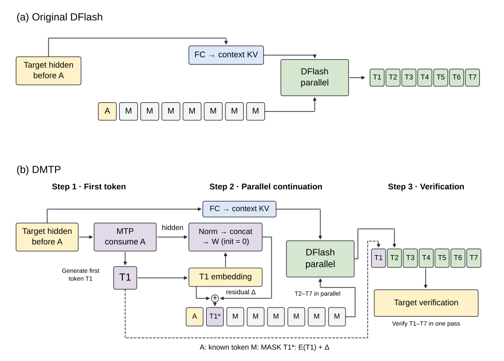

# DMTP

## Overview

DMTP combines native multi-token prediction (MTP) with parallel drafting
from the DFlash family. The parallel draft can use DFlash, DFlash2, or
another DFlash-family variant. Native MTP proposes the first candidate, T1;
the parallel draft uses that candidate and its MTP representation to propose
the rest of the block. The target verifies the combined proposals.

The motivation is the accepted-prefix rule: if the first proposal is rejected,
the rest of the block cannot be committed in that round. A target model's
pretrained MTP module can provide a useful first proposal, while a small
parallel draft provides a longer continuation at low additional drafting cost.
DMTP combines these roles and passes the MTP predictor representation to the
parallel draft. Its benefit depends on the target's MTP quality and the cost
of the extra MTP step.

Start with [speculative decoding](./speculative_decoding.md) for the common
verification procedure. [DFlash2](./DFlash2.md) describes one of the parallel
draft architectures that can be used inside DMTP.

[Method blog](https://sylvan820.github.io/D-MTP/) ·
[Training implementation](https://github.com/sgl-project/SpecForge/tree/feat/dmtp-plugin) ·
[Inference implementation](https://github.com/Sylvan820/sglang-dmtp/tree/dmtp-qsa-four-slot-20261113) ·
[SGLang PR #50270](https://github.com/sgl-project/sglang/pull/50270)

## How it works?

<em>Source: <a href="https://sylvan820.github.io/D-MTP/">the official DMTP blog, Figure 2</a>. The diagram illustrates dual-anchor residual conditioning; the conditioning adapter and proposal layout are checkpoint-specific.</em>

Let A be the last emitted token and T1 the next candidate. One round proceeds
as follows:

1. **Run native MTP once.** Given the aligned target state and token input,
   MTP predicts T1. Retain the hidden representation that produced T1.
2. **Condition the parallel draft.** Provide T1 and its predictor state along
   with the normal target-context features. In the released residual adapters,
   the conditioning update is added only to T1's token embedding.
3. **Draft the remaining positions.** A DFlash-family model predicts the
   continuation in parallel. In the 27B release, `[A, T1, MASK × 6]` yields
   seven proposals: T1 from MTP and six from DFlash2. A is already emitted and
   is not a new proposal.
4. **Verify the combined block.** The target applies the runtime's speculative
   verification rules. Commit the accepted prefix and correction or bonus
   token, update caches, and repeat from the new verified context.

### Why pass both a token and a hidden state?

T1 identifies the concrete first candidate. The MTP predictor state also
contains information useful for continuing after it. The residual interface
can be written schematically as

$$
\widetilde e_{T1}=e_{T1}+f(e_{T1},\operatorname{stopgrad}(h_{\mathrm{MTP}})).
$$

The function `f` is checkpoint-specific. It can project the MTP state through
a low-rank network or combine separately normalized token and MTP features.
The original token embedding remains available through the residual path.
The released variants below use these different adapters.

Correct alignment matters: the predictor state for T1 is the state that
generated T1, not the state obtained after consuming T1. The target context
must also stop at the boundary expected by the checkpoint. These interfaces
affect what the draft can read, so they belong to the training and serving
contract rather than being interchangeable tensor shapes.

## Training

The target and native MTP remain frozen while the parallel draft and its
conditioning adapter are trained. In the released checkpoints, T1 is taken
from the training sequence; at inference it is proposed by native MTP.
The unknown continuation positions receive draft prediction supervision.
The MTP predictor state is detached, so the draft loss does not fine-tune
the target's MTP module.

For DMTP training, use the SpecForge implementation
[branch](https://github.com/sgl-project/SpecForge/tree/feat/dmtp-plugin).
Follow its [training guide](https://github.com/sgl-project/SpecForge/blob/feat/dmtp-plugin/docs/sections/advanced_features/dmtp.md)
for capture-plugin setup, MTP feature preparation, and online or offline
training. A [Qwen3.6-27B example configuration](https://github.com/sgl-project/SpecForge/blob/feat/dmtp-plugin/examples/configs/online/disaggregated/external/qwen3.6-27b-dmtp.yaml)
is provided on that branch; update the model and dataset paths and server URL
for your environment. The guide documents supported target architectures,
dependencies, and feature-alignment requirements. Its example layout and
fusion interface should be read alongside the checkpoint you intend to train.

## Inference

DMTP adds an MTP step before parallel drafting. The runtime must coordinate
the two proposal sources, use the corresponding proposal distributions for
exact sampling, and commit or roll back their cache state after verification.
An ordinary DFlash worker does not acquire this behavior merely by loading
DMTP draft weights.

Performance should be measured over the entire cycle, including MTP, parallel
drafting, selection, target verification, and cache management. Improving T1's
acceptance can help later candidates become usable, but does not by itself
guarantee higher throughput. Sampling settings, concurrency, and the model's
native MTP implementation all affect the result.

## Using DMTP in SpecForge

Use the training branch linked above for its supported training workflow,
and a checkpoint-compatible serving implementation for inference. The
following release details identify the two published drafts and their
runtime requirements.

### Checkpoints

The two checkpoints released here use DFlash2 as their parallel drafting
component.

| Target | Draft checkpoint | Draft parameters | T1 conditioning |
| --- | --- | --- | --- |
| [Qwen3.6-27B](https://huggingface.co/Qwen/Qwen3.6-27B) | [Piggy12/Qwen3.6-27B-DMTP](https://huggingface.co/Piggy12/Qwen3.6-27B-DMTP) | 1.167B | Rank-256 residual network over the MTP representation |
| [Qwen3.8-Flash-Next (120B)](https://huggingface.co/Qwen/Qwen3.8-Flash-Next) | [Piggy12/Qwen3.8-next-120b-dmtp](https://huggingface.co/Piggy12/Qwen3.8-next-120b-dmtp) | 616.2M | Projection of separately normalized T1 embedding and MTP representation, concatenated |

Both repositories contain BF16 draft weights. Supply the matching target,
its native MTP module, and shared embedding and language-model head separately.
The conditioning residual is added to the T1 embedding. The two checkpoints
use different adapters and are not interchangeable.

The 120B draft was continued from
[incoai/Qwen3.8-Flash-Next-DFlash2](https://huggingface.co/incoai/Qwen3.8-Flash-Next-DFlash2).
Its released step-7000 export has passed artifact checks; GPU generation
validation remains pending according to its model card.

### Qwen3.6-27B acceptance results

The [27B model card](https://huggingface.co/Piggy12/Qwen3.6-27B-DMTP#evaluation)
compares DMTP with a DFlash2 baseline under the same training configuration.
Both use token-level rejection sampling, seven proposals per verification
round, TP4, concurrency up to 32, and temperature 1. Each task uses 64 fixed
inputs. See the card for the full evaluation settings.

| Task | DFlash2 | DMTP |
| --- | ---: | ---: |
| Code | 3.9621 | 4.6022 |
| Math | 4.2909 | 4.8871 |
| MT-Bench | 4.0044 | 4.1826 |
| Agent | 3.8197 | 4.6871 |
| SWE | 2.9273 | 3.9427 |
| Long-horizon | 3.1929 | 4.3310 |

The metric is tokens advanced per verification round:
`1 + total accepted draft tokens / total verification rounds`.
These are acceptance results, not task accuracy or throughput measurements.
They are reported separately from the SpecBundle throughput dashboard.

### Serving

Use a DMTP-aware runtime with the adapter matching the checkpoint. For 27B,
follow the reference launch command in the
[model card](https://huggingface.co/Piggy12/Qwen3.6-27B-DMTP#quick-start) or its
[serve_dmtp.sh](https://huggingface.co/Piggy12/Qwen3.6-27B-DMTP/blob/main/serve_dmtp.sh).
That reference uses the implementation
[branch](https://github.com/Sylvan820/sglang-dmtp/tree/feat/dmtp-upstream-20261113)
and enables `SGLANG_DMTP_T1_RESIDUAL=1`.

For 120B, follow its
[model card](https://huggingface.co/Piggy12/Qwen3.8-next-120b-dmtp#quick-start)
and the implementation
[branch](https://github.com/Sylvan820/sglang-dmtp/tree/dmtp-qsa-four-slot-20261113). It additionally
requires the architecture-specific HC/QSA adapter. Its configuration defines
its own query-slot and proposal layout; do not reuse the 27B launch settings.

These release-specific serving paths do not establish support in an
unmodified SGLang release or in SpecForge's canonical SGLang exporter.
See [training and export](../basic_usage/training.md) for the current exporter
support. Inference performance is still being optimized; consult the model
cards for runtime requirements and validation status.
