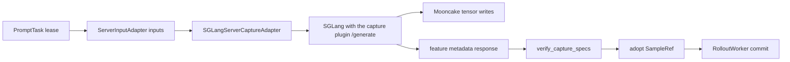

# Inference plane design (`specforge.inference`)

The inference plane is an external-server transport boundary. Online training
does not load or execute a target model in a trainer or producer process.

## Ownership of target execution

Every forward pass through target layers that produces training features runs
behind this plane, in an SGLang server with the capture plugin. That covers
online capture and offline preparation: `specforge.offline_capture` uses the
same plugin client and transport. No trainer, producer or data-preparation
process runs such a forward.

Reading target weights is not executing the target, and the training plane does
read them:

| What | Owner | What the training plane does with it |
|---|---|---|
| Target layers: prefill, tap hidden states, final hidden state | SGLang, reached through this plane | nothing; it receives the captured features |
| Bound target tables (`target_bindings`: token embedding, LM head) and the teacher head | the target checkpoint | holds frozen copies, kept out of sharding, the optimizer and the draft's state dict |
| Target tensors copied at initialization (`initialization.from_target`, `model.load_target_embedding`) | the draft, from then on | trains them as draft parameters |
| Captured features | the data plane (`FeatureStore`) | reads them as `TrainBatch.tensors` |
| Draft parameters | the training plane | the trainable state |

The training plane applies the bound tables: an embedding lookup for draft
inputs, and a projection of the captured final hidden state through the LM head
when an objective needs teacher logits. Sending the hidden state and projecting
it locally is far smaller than sending full-vocabulary logits per token.

What follows from the rule:

- At run time the only target-derived tensors a trainer receives are the
  captured features in `TrainBatch`. It can be run, tested and compared on
  recorded features with no server.
- A training backend or a dedicated trainer
  ([`../training/BACKENDS.md`](../training/BACKENDS.md)) does not add an
  in-process target forward. A design that needs one changes this rule first,
  with a check that its hidden states agree with the server's.

What the rule does not cover today:

- `verify_capture_specs` checks feature names, auxiliary layer ids and shapes
  against the capture configuration. It does not check dtype or the capture
  method; the server's dtype is adopted as returned.
- DMTP's `mtp_hidden_states` are accepted only as precomputed records. Their
  producer is outside this repository, so the rule is not enforced for it.
- The legacy DFlash model's `spec_generate` helper takes a target module as an
  argument. It is a generation utility, not on any training or preparation path.

## Responsibility

`SGLangServerCaptureAdapter` sends model inputs and capture metadata to a
SGLang server running the capture plugin. The server performs prefill and
writes captured tensors directly to Mooncake. Its response contains only sample ids and feature
key/shape/dtype metadata. The adapter validates those feature specifications,
adopts the server-written objects into the producer store, and returns
`SampleRef`s for `RolloutWorker` to commit.

Algorithm registrations own the requested capture layout, target
representation, collator, and optional modality-specific `ServerInputAdapter`.
The transport owns sampling and capture metadata. This keeps target execution,
algorithm policy, and deployment wiring separate.

`RolloutWorker` treats this adapter as a `RefSource`: it leases tasks, calls
`produce_refs`, and commits only metadata. Per-task server failures remain
retryable without failing successful tasks from the same batch. Tensors never
pass through the controller or the producer process.

## Offline capture

The separate `specforge.offline_capture` package is used only by
`scripts/prepare_hidden_states.py`. Its CPU client uses the same capture plugin and Mooncake transport as online
capture, then persists algorithm-owned offline feature layouts. It is not imported by
online application or training assembly.

## Endpoints

| From | Endpoint | Plane |
|---|---|---|
| `RolloutWorker` | `DataFlowController.lease_prompt_tasks` | control |
| `RolloutWorker` | `SGLangServerCaptureAdapter.produce_refs` | inference |
| `SGLangServerCaptureAdapter` | SGLang with the capture plugin `/generate` | external compute |
| SGLang with the capture plugin | Mooncake feature keys | data |
| `SGLangServerCaptureAdapter` | `MooncakeFeatureStore.adopt` | data |
| `RolloutWorker` | `DataFlowController.commit_samples` | control |
| producer | `StreamingRefChannel.publish` | data |
