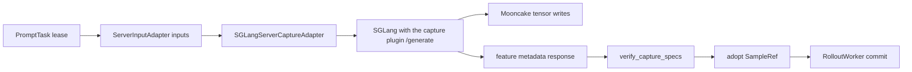

# Inference plane design (`specforge.inference`)

The inference plane is an external-server transport boundary. Online training
does not load or execute a target model in a trainer or producer process.

## Ownership of target execution

Every forward pass through target layers runs behind this plane, in an SGLang
server with the capture plugin. That covers online capture and offline
preparation: `specforge.offline_capture` uses the same plugin client and
transport. No trainer, producer or data-preparation process loads target layers.

| What | Owner | What the training plane holds |
|---|---|---|
| Target layers: prefill, tap hidden states, final hidden state | SGLang, reached through this plane | nothing |
| Target tables: token embedding, LM head | the target checkpoint | frozen copies, read once, replicated on every rank, never sharded or optimized |
| Captured features | the data plane (`FeatureStore`) | `TrainBatch.tensors` |
| Draft parameters | the training plane | the trainable state |

The training plane applies the tables it holds: an embedding lookup for draft
inputs, and a projection of the captured final hidden state through the LM head
when an objective needs teacher logits. Sending the hidden state and projecting
it locally is far smaller than sending full-vocabulary logits per token.

What follows from the rule:

- A trainer's only input is a stream of `TrainBatch`. It can be run, tested and
  compared on recorded features with no server.
- The capture contract (method, layer ids, feature shapes and dtypes) is
  resolved once and checked against the server's response by
  `verify_capture_specs`. A trainer does not derive it again.
- A training backend or a dedicated trainer
  ([`../training/BACKENDS.md`](../training/BACKENDS.md)) does not add an
  in-process target forward. A design that needs one changes this rule first,
  with a check that its hidden states agree with the server's.

The legacy DFlash model's `spec_generate` helper takes a target module as an
argument. It is a generation utility, not on any training or preparation path.

## Responsibility

`SGLangServerCaptureAdapter` sends model inputs and capture metadata to a
SGLang server running the capture plugin. The server performs prefill and
writes captured tensors directly to Mooncake. Its response contains only sample ids and feature
key/shape/dtype metadata. The adapter validates those feature specifications,
adopts the server-written objects into the producer store, and returns
`SampleRef`s for `RolloutWorker` to commit.

Algorithm registrations own the requested capture layout, target
representation, collator, and optional modality-specific `ServerInputAdapter`.
The transport owns sampling and capture metadata. This keeps target execution,
algorithm policy, and deployment wiring separate.

`RolloutWorker` treats this adapter as a `RefSource`: it leases tasks, calls
`produce_refs`, and commits only metadata. Per-task server failures remain
retryable without failing successful tasks from the same batch. Tensors never
pass through the controller or the producer process.

## Offline capture

The separate `specforge.offline_capture` package is used only by
`scripts/prepare_hidden_states.py`. Its CPU client uses the same capture plugin and Mooncake transport as online
capture, then persists algorithm-owned offline feature layouts. It is not imported by
online application or training assembly.

## Endpoints

| From | Endpoint | Plane |
|---|---|---|
| `RolloutWorker` | `DataFlowController.lease_prompt_tasks` | control |
| `RolloutWorker` | `SGLangServerCaptureAdapter.produce_refs` | inference |
| `SGLangServerCaptureAdapter` | SGLang with the capture plugin `/generate` | external compute |
| SGLang with the capture plugin | Mooncake feature keys | data |
| `SGLangServerCaptureAdapter` | `MooncakeFeatureStore.adopt` | data |
| `RolloutWorker` | `DataFlowController.commit_samples` | control |
| producer | `StreamingRefChannel.publish` | data |
