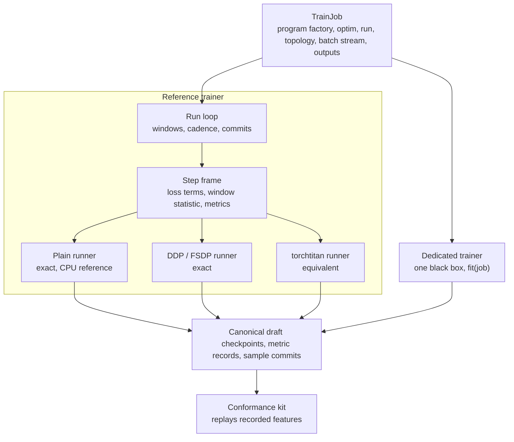

# Training backends: program, step runner, trainer (`specforge.training`)

**Status: proposal.** Nothing in this note is implemented. The design that runs today is
[`DESIGN.md`](DESIGN.md); the cross-plane picture is
[`../runtime/ARCHITECTURE.md`](../runtime/ARCHITECTURE.md). Symbols cited as "today" were read on
`main` at `c0f0a39c`.

## Goals

1. **Attach an external training engine** (first: [torchtitan](https://github.com/pytorch/torchtitan))
   without changing an objective, a draft definition or the data path.
2. **Allow a trainer dedicated to draft training**, free in how it loops, parallelizes and steps,
   and accepted on evidence rather than on code review of its internals.
3. **Keep the API small and closed**: a handful of value types and two protocols, each with one
   owner and a conformance test.

Out of scope: fault tolerance, a run controller, changes to capture or transport, and how a loss is
executed inside a program (chunking, fused kernels).

## What the workload fixes

These six facts decide the shape of the contract. The first two separate SpecForge from an RL
training system such as [miles](https://github.com/radixark/miles), whose backend layout this
proposal otherwise follows.

1. **The target is frozen and only prefills.** A captured feature is a function of target weights
   and tokens. It does not depend on the draft. There is no weight sync and no staleness, and a
   recorded feature stream can be replayed into any trainer at any time.
2. **Target execution belongs to the inference plane.** See
   [`../inference/DESIGN.md`](../inference/DESIGN.md#ownership-of-target-execution). A trainer's
   input is a stream of `TrainBatch`; it never runs target layers.
3. **The loss denominator is not known before the forward.** Anchors are sampled inside the
   objective and some weightings depend on the draft's own predictions. An update cannot be
   normalised by a token count taken from the batch beforehand; it is normalised after the
   backward.
4. **The unit of training is a program, not a model.** An objective drives the draft, sometimes
   several times per batch (the EAGLE3 rollout, the DSpine two-pass window), and never materializes
   full-vocabulary logits for the whole batch. What every backend can treat alike is
   `program(tensors, ctx) -> ObjectiveResult`.
5. **The draft is small and its frozen tables are large.** Target embedding and LM head are
   replicated and never optimized. Replication across ranks is the common case; sharding is the
   exception.
6. **The artifact is the product.** A canonical draft directory goes to export and to SGLang.
   Which trainer produced it must not show.

## Today

`Trainer -> TrainerController -> TrainerCore -> DraftTrainStrategy -> FSDPTrainingBackend`
([`DESIGN.md`](DESIGN.md)). A `TrainingBackend` ABC exists and has one implementation. Five
couplings keep a second one out:

| Coupling | Where |
|---|---|
| The model tells the backend what it needs through attributes set after construction | `build_bundle` sets `frozen_target_modules` and `fsdp_param_dtype`; `FSDPTrainingBackend` reads them and `_no_split_modules` with `getattr` |
| Collectives are issued outside the backend | `objectives.base.microbatch_mean`, the window replay in `CanonicalTrainStrategy`, `TrainerCore._normalize_gradients`, `BF16Optimizer`, the evaluator, the checkpoint manager |
| The step core scales gradients assuming ranks average them | `TrainerCore._normalize_gradients` multiplies by world size |
| Structure, weights, target tables and kernels are built in one call | `training.canonical.build_bundle` |
| The artifact and the backend's state share one file | `training_state.pt` holds the draft weights, the backend state and the loop counters |

Each has one fixed producer as well: `Trainer.__init__` constructs `FSDPTrainingBackend`, and
`training.assembly` constructs `BF16Optimizer`.

## The contract

Two plug-in levels. Everything a trainer is told is a value; everything it produces is an artifact.



```python
# training/contracts.py: value types and protocols only

class TrainingProgram(Protocol):                 # today's ObjectiveModel, plus declarations
    draft: nn.Module                             # trainable; its state dict is the artifact
    frozen: tuple[nn.Module, ...]                # target tables, teacher head: replicated, never sharded or optimized
    partition: PartitionHints                    # indivisible blocks, parameter dtype
    requires: DataRequirements                   # features, capture layers, batch constraint, sample cost
    window_statistic: WindowStatistic | None
    def forward(self, tensors: Mapping[str, Tensor], ctx: StepContext) -> ObjectiveResult: ...

class ProgramFactory(Protocol):                  # the one way a program comes to exist
    spec: ProgramSpec                            # draft config, objective, loss, weighting, kernels: pure data, recorded
    def build(self, *, device, dtype) -> TrainingProgram      # structure only; legal on the meta device
    def initialize(self, program: TrainingProgram) -> None    # weights: scratch, a checkpoint, copies from the target
    def export(self, draft_state: Mapping[str, Tensor], out: Path) -> None   # the canonical draft directory

@dataclass(frozen=True)
class StepContext:
    step: int
    total_steps: int
    detailed_metrics: bool
    reduce_sum: Callable[[Tensor], Tensor]       # the only collective an objective may use

class StepRunner(Protocol):                      # level 2: the mechanics of one update
    numerics: ClassVar[Literal["exact", "equivalent"]]
    @classmethod
    def supports(cls, spec: ProgramSpec, optim: OptimSpec, topology: TopologyRequest) -> Unsupported | None: ...
    def prepare(self, factory: ProgramFactory, optim: OptimSpec, topology: TopologyRequest) -> None: ...
    def forward_backward(self, window: Iterable[TrainBatch], ctx: StepContext) -> list[ObjectiveResult]: ...
    def forward_only(self, batches: Iterable[TrainBatch], ctx: StepContext) -> list[ObjectiveResult]: ...
    def reduce_sum(self, values: Tensor) -> Tensor: ...
    def apply_step(self, loss_denominator: Tensor) -> StepMetrics: ...   # normalise, clip, step
    def draft_state(self) -> dict[str, Tensor]: ...                      # full, canonical keys
    def save_resume(self, out: Path) -> None: ...
    def load_resume(self, src: Path) -> None: ...

class Trainer(Protocol):                         # level 1: the whole trainer
    numerics: ClassVar[Literal["exact", "equivalent"]]
    @classmethod
    def supports(cls, job: TrainJob) -> Unsupported | None: ...
    def fit(self, job: TrainJob) -> TrainResult: ...

@dataclass(frozen=True)
class TrainJob:
    program: ProgramFactory
    optim: OptimSpec                             # update rule, groups, LR schedule, clipping, master weights
    run: RunSpec                                 # horizon, batch size, accumulation, seed, cadence
    topology: TopologyRequest
    data: BatchStream                            # windows of TrainBatch; commit(sample_ids, step)
    out: Outputs
```

### One update, in one line

For a window of micro-batches over all ranks, the update is the gradient of

```
U = sum(numerator) / sum(denominator)
```

with both sums over every micro-batch of the window and every rank. `apply_step(loss_denominator)`
receives the local sum of denominators. The runner reduces it across ranks, checks that it is finite
and positive, turns its accumulated gradients into the gradient of `U` under whatever reduction it
uses, clips and steps.

This is what `TrainerCore` computes today: each numerator is divided by the accumulation count,
ranks average, and the gradients are rescaled by world size x accumulation / global denominator. An
objective that wants the mean of micro-batch losses returns a denominator of one. Whether a runner
averages or sums across ranks is its own business; the frame never touches a gradient.

### What each part owns

| Part | Owns | Must not know |
|---|---|---|
| Program | supervision, the draft forward, loss terms; declares what it needs | ranks, the optimizer, how it is wrapped |
| Step frame | walking the window, the two-pass window statistic, reducing metrics | gradients, process groups, the optimizer |
| Step runner | wrapping and placing the program, backward, every collective, normalisation, clipping, the optimizer and LR schedule, its resume state | the loss math, where data comes from |
| Run loop | the horizon, windows, logging, evaluation and checkpoint cadence, sample commits | `torch.distributed`, model internals |
| Trainer | everything between the batch stream and the artifacts | how features were produced; anything about SGLang |

`OptimSpec` is a value. A runner honours it or refuses in `supports()`; the reference runners
implement it with SpecForge's own optimizer code.

### Artifact and resume state

| | Written by | Format | Read by |
|---|---|---|---|
| Artifact | `factory.export(runner.draft_state(), dir)` | the canonical draft directory | export, SGLang conversion, `initialization.checkpoint`, the conformance kit |
| Resume state | `runner.save_resume(dir)`, plus a run record owned by the loop: step, epoch, samples, spec hash, runner name and version | private to the runner | the same runner only |

Resuming with a different runner is refused by name. Starting from the artifact always works.

### Exact and equivalent

A runner or trainer declares its numerics. `exact` means bit-identical to the plain runner on the
same inputs, at one rank and across ranks on a deterministic process group. `equivalent` means a
different numerical program for the same objective; it is a numerics change, needs a measured
comparison on acceptance length, and is never selected by default until that comparison exists. The
choice is made once at startup, logged, and recorded in the run record.

## The reference trainer

A restructuring of today's classes, not new behaviour:

| Today | Becomes |
|---|---|
| `TrainerController` | the run loop |
| `TrainerCore` and `CanonicalTrainStrategy` | the step frame |
| `FSDPTrainingBackend`, with `BF16Optimizer` behind it | the DDP / FSDP runner |
| (none) | the plain runner: one process, no wrapping; the reference every other runner is compared with, and the one CI runs on CPU |
| `build_bundle` | `ProgramFactory.build`, `initialize`, `export` |
| attributes set on the model after construction | declared members of `TrainingProgram` |
| `microbatch_mean` and the DSpine window replay calling `torch.distributed` | `ctx.reduce_sum` |

## Attaching torchtitan

At the step-runner level. The mapping below is read from torchtitan `a1f6dcd2`
(`training_engine.py`, `models/base/model.py`); nothing was run.

| Contract | torchtitan | Adapter work |
|---|---|---|
| `prepare` | `TrainingEngine.initialize`: `model_config.build()` on the meta device, `model.parallelize(...)`, `to_empty`, `init_weights`, optimizer, checkpointer | a `BaseModel` subclass that holds the program: `Config.build()` calls `factory.build`, `init_states` calls `factory.initialize`, `_apply_fsdp` shards the blocks named by `partition` and leaves `frozen` replicated |
| `forward_backward` | `pred = model(inputs, **kwargs)`; `loss, metrics = loss_fn(pred, labels, **loss_kwargs)`; `loss.backward()`; FSDP reduction deferred to the last micro-batch | the model's forward is the program's forward; a `BaseLoss` subclass returns the numerator and keeps the terms |
| `reduce_sum` | a sum over the `dp` mesh | none |
| `apply_step` | `engine.optim_step()` returns the gradient norm; learning rates from `optim.lr_schedulers` | scale the reduced gradients first: torchtitan sums across ranks where the reference runner averages |
| `save_resume`, `load_resume` | `engine.save_checkpoint`, `engine.load_checkpoint` | none |
| `draft_state` | full state through a state-dict adapter | map to canonical keys |
| `TopologyRequest` | `ParallelismConfig` -> `ParallelismContext` | one translation function |

Reasons this runner declares `equivalent`:

- **Precision model.** The reference keeps bf16 parameters with fp32 master copies. torchtitan
  keeps fp32 parameters and computes in bf16, optionally with bf16 optimizer moments.
- **Reduction.** Sum against mean; absorbed by `apply_step`.
- **Random state on resume.** The reference restores RNG state so a resumed run equals an
  uninterrupted one bitwise. Whether torchtitan's checkpoint does is unverified.
- **Compilation.** The program owns its kernels. A runner must not recompile or patch inside it.

Packaging follows what miles does for the same engine: one package, `training/backends/torchtitan/`;
config translated in one function; version shims in one module; a pinned torchtitan revision; the
dependency optional and imported lazily, so the CPU suite runs without it.

## A dedicated trainer

It implements `Trainer` and is free inside. It honours the `TrainJob` or refuses in `supports()`; it
does not approximate silently.

What it may assume, from the workload: features arrive complete and immutable; nothing outside has
to be kept in step with the weights; the trainable part is small enough to replicate; batch shapes
can be bucketed and a whole step compiled; samples can be committed asynchronously.

What it may not do: execute target layers. Target prefill stays in the inference plane. A trainer
that wants its own prefill changes that rule first.

## Conformance

Because features do not depend on the draft, one recording judges every trainer.

- **Recorded feature streams**: directories in the existing offline feature format; small ones for
  CPU, one at recipe scale.
- **A step runner** runs the training suite once, selected by one fixture. An `exact` runner
  reproduces stored trajectories (loss sequence, final weights, optimizer state) bitwise at one
  rank, two-rank DDP and FSDP.
- **A trainer** replays a recording. Its artifacts are loaded with `specforge.loading` and scored by
  the reference evaluator on held-out recorded features at matched samples, against the reference
  trainer's artifacts. Throughput is measured on the same replay.
- **Anything `equivalent`** is held to a band set from repeats of the reference, never by the
  candidate.

No SGLang server takes part, so the comparison runs unattended.

## API rules

| Rule | Enforced by |
|---|---|
| Parts meet only through `training/contracts.py`, `runtime/contracts.py` and `config.draft` | an import scan |
| Values cross, handles do not: no `getattr` on another part's object, no process-global topology, no environment read below `application` | a lint with an allowlist that may only shrink |
| Honour or refuse: `supports()` returns a named reason | a test per refusal |
| A backend is one package under `training/backends/`, registered by name; core never imports it | the import scan; the CPU suite without the dependency |
| Every protocol has a conformance suite | the kit |
| A contract gains a member only with a second implementation that needs it | review |

## Delivery

Each step is one verification method. Prerequisites from the canonical-training migration: one step
path (the legacy strategies removed), and stored trajectories recorded through the CLI while the
legacy path still exists.

| # | Change | Kind | Gate |
|---|---|---|---|
| 0 | `ProgramFactory`: split `build_bundle`; declared program members replace attributes set after construction | equivalent | stored trajectories unchanged |
| 1 | Step frame and `StepRunner`; DDP / FSDP runner from `FSDPTrainingBackend`; plain runner; optimizer behind the runner; `ctx.reduce_sum` | equivalent | stored trajectories, bitwise, at one rank, DDP and FSDP |
| 2 | `TrainJob` and the run loop; artifact and resume state separated; `application` as the only composition root | equivalent, plus one on-disk change | stored trajectories; a reader for existing run directories |
| 3 | `OptimSpec`; the optimizer split into master weights, update rule, LR schedule, clipping, groups | equivalent | parameters and optimizer state bitwise after N steps |
| 4 | `Trainer` protocol and the conformance kit | tests and contract | the reference trainer passes its own kit |
| 5 | torchtitan runner | new, `equivalent` | the kit; a GPU comparison of throughput, memory and acceptance length |
| 6 | A dedicated trainer | new | the kit |

Order: 0 -> 1 -> 2 -> 4; 3 after 1; 5 after 1 and 3; 6 after 4.

## Open questions

- **torchtitan's numerics class.** Accepting `equivalent` (fp32 parameters, bf16 compute) is a
  numerics decision; the alternative is to require bit-equality with the reference, which
  torchtitan cannot give without changes.
- **Run directory layout.** Step 2 changes it. Existing directories need a reader, or a documented
  break.
- **Hosting a transformers-style module in torchtitan.** Whether a canonical draft builds on the
  meta device, and what the adapter costs in throughput, are unknown. torchtitan's own experimental
  backend for such modules lists weight loading as future work and a lower MFU than its native
  models.
- **Random state on resume** under torchtitan.

## Prior art

- miles: one step frame over a four-method runner
  (`miles/backends/training_utils/torch_native/`), and torchtitan attached by wrapping its
  `TrainingEngine` (`miles/backends/torchtitan_utils/`). Taken from it: the two levels, the
  optimizer behind the runner, one adapter package per backend, refusals asserted at init. Not
  taken: a loss defined on full logits, a normaliser computed before the backward, process-global
  parallel state, and a backend that owns the model definition.
- torchtitan: `trainer.py` (the loop) over `training_engine.py` (model build, parallelization,
  optimizer, checkpoint, forward-backward).
