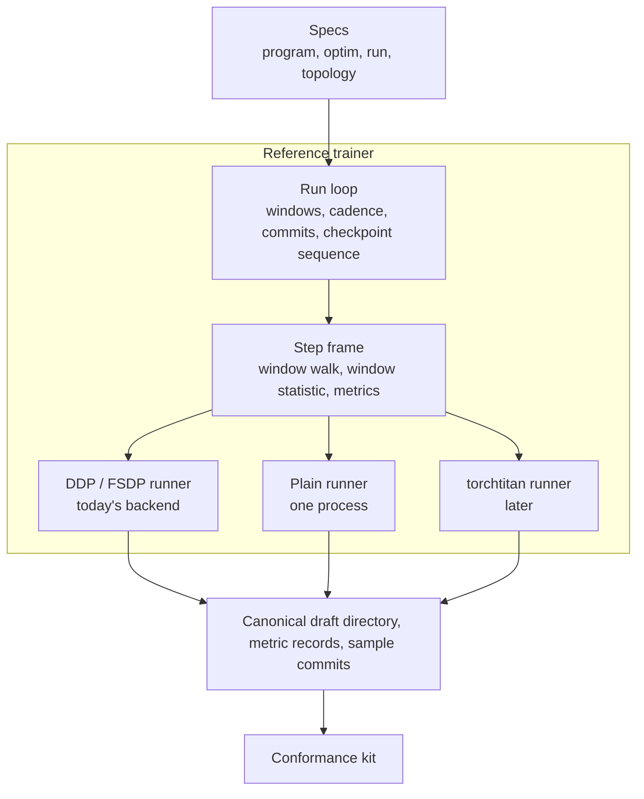

# Training backends: program, step runner, trainer (`specforge.training`)

**Status: proposal, second revision.** Nothing in this note is implemented and nothing in it was
run. The design that runs today is [`DESIGN.md`](DESIGN.md); the cross-plane picture is
[`../runtime/ARCHITECTURE.md`](../runtime/ARCHITECTURE.md). Symbols cited as "today" were read on
`main` at `c0f0a39c`. The section [Decisions for maintainers](#decisions-for-maintainers) lists the
choices this note does not make.

## Goals

1. **Attach an external training engine** (first: [torchtitan](https://github.com/pytorch/torchtitan))
   without changing an objective, a draft definition or the data path.
2. **Allow a trainer dedicated to draft training**, accepted on evidence rather than on review of
   its internals.
3. **Keep the API small and closed**: a few value types and protocols, each with one owner and a
   conformance test.

Out of scope: fault tolerance, a run controller, changes to capture or transport, and how a loss
is executed inside a program (chunking, fused kernels).

**Not yet shown.** No measurement in the repository shows that the step mechanics, rather than the
data path, bound training throughput, and no gain has been attributed to torchtitan for a small
trainable draft beside large frozen tables. The first deliverable of this work is that
measurement; see [Delivery](#delivery).

## What the design starts from

| # | Statement | Kind |
|---|---|---|
| 1 | The target is frozen and only prefills. A captured feature depends on target weights and tokens, not on the draft. There is no weight sync and no staleness, and recorded features can be replayed into any trainer | workload |
| 2 | Target execution belongs to the inference plane ([`../inference/DESIGN.md`](../inference/DESIGN.md#ownership-of-target-execution)). A trainer never runs target layers | decision |
| 3 | The loss denominator is not known before the forward: anchors are sampled inside the objective and some weightings depend on the draft's own predictions. An update is therefore normalised after the backward | consequence of how today's objectives sample; a backend cannot assume otherwise |
| 4 | The unit a backend can treat uniformly is a program: `program(tensors, ctx) -> ObjectiveResult`. An objective may drive the draft several times per batch (the EAGLE3 rollout, the DSpine two-pass window) and may or may not materialize full logits. A backend cannot assume logits exist | workload |
| 5 | The frozen target tables are large and are never sharded or optimized; the trainable draft is a few layers. Today the default wraps the draft with FSDP `SHARD_GRAD_OP` (`training.fsdp_sharding`); `NO_SHARD` selects DDP | fact about today |
| 6 | The artifact is the product: a canonical draft directory goes to export and to SGLang. Which trainer produced it must not show | decision |

## Process model

This is fixed outside the training plane and a backend must fit inside it.

- **Ranks are launched before any trainer code runs**, by the launcher (`torchrun`). Training is
  SPMD: every protocol method below runs on every rank, in the same order.
- **The world is initialized once**, in `specforge.cli`: `init_distributed` creates the process
  groups, and `set_seed(training.seed)` seeds every rank with the same seed. The data plane then
  creates its own groups in a fixed order (`runtime/control_plane/dp_ack.py`).
- **A runner derives what it needs from that world.** It does not initialize or destroy it, does
  not create groups in a rank-dependent order, does not re-seed, and does not change process-wide
  torch state without declaring it.
- **The launcher owns process lifetime.** A trainer that starts helper processes owns their death.

torchtitan's `TrainingEngine` constructor binds the device, applies NUMA binding, seeds RNG, sets
process-group timeouts and calls its own `init_distributed`, which returns early when the world is
already initialized. An adapter has to make each of those either a no-op or the single owner; see
[Attaching torchtitan](#attaching-torchtitan).

## Today

`Trainer -> TrainerController -> TrainerCore -> DraftTrainStrategy -> FSDPTrainingBackend`
([`DESIGN.md`](DESIGN.md)). A `TrainingBackend` ABC exists and has one implementation. What keeps
a second one out:

| Coupling | Where |
|---|---|
| The model tells the backend what it needs through attributes set after construction | `build_bundle` sets `frozen_target_modules` and `fsdp_param_dtype`; `FSDPTrainingBackend` reads them and `_no_split_modules` with `getattr` |
| Collectives are issued outside the backend | `objectives.base.microbatch_mean`, the window replay in `CanonicalTrainStrategy`, `TrainerCore._normalize_gradients`, `BF16Optimizer`, the evaluator, `CheckpointManager` |
| The step core rescales gradients assuming the wrapper averages across ranks | `TrainerCore._normalize_gradients` multiplies by world size |
| Structure, weights, target tables and kernels are built in one call | `training.canonical.build_bundle` |
| A checkpoint mixes the draft weights with the backend's state | `training_state.pt` holds the draft weights, the loop counters and, under DDP, the optimizer; `training_state_rank{r}.pt` holds FSDP optimizer state and every rank's RNG |

Each side has one fixed producer as well: `Trainer.__init__` constructs `FSDPTrainingBackend`, and
`training.assembly` constructs `BF16Optimizer`.

## The contract

Two levels. The first is specified here; the second is introduced only together with its first
real implementation (see [A dedicated trainer](#a-dedicated-trainer)).



```python
# training/contracts.py: value types and protocols only

@dataclass(frozen=True)
class ProgramSpec:                               # pure data; recorded; available without building a model
    draft: DraftConfig
    objective: ObjectiveSelection                # objective, loss, weighting, options
    kernels: Kernels
    requires: DataRequirements                   # features, capture layers, batch constraint, host inputs, sample cost

class TrainingProgram(Protocol):                 # today's ObjectiveModel, plus declarations
    draft: nn.Module                             # trainable; its state is the artifact
    frozen: tuple[nn.Module, ...]                # target tables, teacher head: never sharded or optimized
    partition: PartitionHints                    # indivisible blocks, parameter dtype
    window_statistic: WindowStatistic | None
    def forward(self, tensors: Mapping[str, Tensor], ctx: StepContext) -> ObjectiveResult: ...

class ProgramFactory(Protocol):
    spec: ProgramSpec
    def build(self, *, device, dtype) -> TrainingProgram      # structure only
    def initialize(self, program: TrainingProgram) -> None    # weights: scratch, a checkpoint, copies from the target

@dataclass(frozen=True)
class StepContext:                               # values only; no callables
    step: int
    total_steps: int
    window_value: Tensor | None                  # the reduced window statistic; None outside a replay

class StepRunner(Protocol):
    @classmethod
    def supports(cls, spec: ProgramSpec, optim: OptimSpec, topology: TopologyRequest, run: RunSpec) -> Supported | Unsupported: ...
    def prepare(self, factory: ProgramFactory, optim: OptimSpec, topology: TopologyRequest, run: RunSpec) -> None: ...
    def forward_backward(self, window: Sequence[TrainBatch], ctx: StepContext) -> PendingStep: ...
    def apply_step(self, pending: PendingStep) -> StepMetrics: ...    # consumes the handle
    def prepass(self, batch: TrainBatch, ctx: StepContext) -> ObjectiveResult: ...   # training mode, no gradients
    def evaluate(self, batch: TrainBatch, ctx: StepContext) -> ObjectiveResult: ...  # eval mode, no gradients
    def reduce_sum(self, values: Tensor) -> Tensor: ...
    def agree(self, error: str | None) -> None: ...                   # raises on every rank if any rank reported an error
    def draft_state(self) -> dict[str, Tensor]: ...                   # full on rank 0, empty elsewhere
    def save_resume(self, out: Path) -> None: ...
    def load_resume(self, src: Path) -> None: ...
    def close(self) -> None: ...
```

`ObjectiveResult` carries detached-safe loss terms `(coefficient, numerator, denominator)`, metric
pairs, and one declared **reduction**:

| Reduction | The update's objective over a window of `A` micro-batches and all ranks | Who reduces |
|---|---|---|
| `window` (default) | `sum(c * numerator) / sum(denominator)`, both sums over every micro-batch and rank. An objective that wants the mean of local losses returns a denominator of one | the runner, once, after the last backward |
| `microbatch` | the mean over the `A` micro-batches of `sum_t c_t * (sum over ranks of numerator_t) / (sum over ranks of denominator_t)` | the runner, per micro-batch, between that micro-batch's forward and backward |

The program never issues a collective and never needs the world size. The two reductions are what
`TrainerCore` and `microbatch_mean` compute today in exact arithmetic for every canonical objective:
each numerator is divided by the accumulation count, the wrapper averages over ranks, and the
gradients are rescaled by world size x accumulation / global denominator. How a runner gets there
(averaging or summing across ranks, where it divides) is its own business. The formula does not fix
rounding: see [Numerics classes](#numerics-classes).

### Rank symmetry

Every method runs on every rank in the same order. Collectives and failure handling:

| Method | Collective | A rank-local failure |
|---|---|---|
| `supports` | no; pure, and the verdicts are compared across ranks at startup | a disagreement stops the run before `prepare` |
| `prepare` | yes | raises on that rank before the first collective of the step path; the launcher tears the world down |
| `forward_backward`, `prepass`, `evaluate` | yes under sharding; every rank receives the same number of batches | as above |
| `reduce_sum`, `apply_step`, `draft_state`, `save_resume`, `load_resume` | yes | reported through `agree`, never raised between two collectives |
| `agree` | yes: one gather of error strings | raises the combined error on every rank |
| `close` | no | — |

`draft_state()` is legal only between `apply_step` and the next `forward_backward`.

### What each part owns

| Part | Owns | Must not know |
|---|---|---|
| Program | supervision, the draft forward, loss terms, the declared reduction and window statistic | ranks, world size, the optimizer, how it is wrapped |
| Step frame | walking the window; for a declared window statistic, the prepass, saving and restoring RNG around each micro-batch, and the replay; reducing metrics through the runner | gradients, process groups, the optimizer |
| Step runner | wrapping and placing the program; backward; every collective; normalisation; clipping; the optimizer and LR schedule; its resume state | the loss math; where data comes from |
| Run loop | the horizon; windows and the incomplete tail; repositioning the stream on resume; logging and checkpoint cadence; evaluation data, cadence and best-checkpoint tracking; the checkpoint sequence; sample commits | `torch.distributed`; model internals |

`OptimSpec` is a frozen value with today's fields (learning rate, schedule and warmup, total steps,
clip norm, master-weight placement). A runner honours it or refuses in `supports()`. It grows a
field when a second optimizer needs one.

### Checkpoints

A checkpoint has three parts and one commit point.

| Part | Content | Written by | Read by |
|---|---|---|---|
| Resume state | everything needed to continue: every draft parameter and buffer at the runner's precision, optimizer and scheduler state, RNG | `runner.save_resume`, every rank | the same runner at the same world size |
| Artifact | the canonical draft directory, a view derived from the resume state at the draft's declared dtype | rank 0, from `runner.draft_state()` | export, SGLang conversion, `initialization.checkpoint`, the conformance kit |
| Run record | step, epoch, samples consumed, the per-key resume contract and model provenance compared today, runner name and version, world size | rank 0, **last** | the run loop on resume |

Sequence, on every rank: flush sample commits up to this step → `draft_state()` → rank 0 writes the
artifact → `save_resume()` → `agree(errors)` → rank 0 writes the run record → rank 0 moves the
`latest` link. A checkpoint exists if and only if its run record exists. A checkpoint is never ahead
of its durable commit, as today (`TrainerController.save_checkpoint`), and online resume keeps
requiring the ledger marker to equal the checkpoint step.

The resume state is the truth for continuing; the artifact is derived. The step counter has one
owner, the run loop; a runner whose engine keeps its own counter takes it from the run record.
Resuming with a different runner or world size is refused, naming both; starting from the artifact
always works and restarts the optimizer.

### Numerics classes

`supports()` returns the class for this job, not a constant of the runner: the kernels a runner
executes depend on configuration.

- **`exact`**: bit-identical to the stored trajectory of the reference runner **for the same
  topology** (same runner family, world size, device type and torch build). Bit-equality across
  wrappers or world sizes is not defined: DDP and FSDP divide gradients at different points, and a
  single process cannot reproduce several ranks drawing from the same seed.
- **`equivalent`**: a different numerical program for the same objective. It is a numerics change.
  It is held to two checks, both set from the reference and never by the candidate:
  1. *first update*: from the same weights and the same recorded window, the pre-clip gradient norm
     and the parameter update agree with the reference within a stated relative tolerance;
  2. *end to end*: the comparison in [Conformance](#conformance), with a band taken from repeats of
     the reference.
  An `equivalent` runner is never selected by default until both exist for its class of jobs.

The choice is made once at startup, logged, compared across ranks and written to the run record.
Selecting a runner whose dependency is missing is an error; it never falls back to another runner.

## The reference trainer

| Today | Becomes |
|---|---|
| `TrainerController` | the run loop |
| `TrainerCore` and `CanonicalTrainStrategy` | the step frame |
| `FSDPTrainingBackend`, with `BF16Optimizer` behind it | the DDP / FSDP runner; the reference |
| (none) | the plain runner: one process, no wrapper. New code; it becomes a reference for CPU only after it is shown bit-identical to the DDP / FSDP runner at one rank |
| `build_bundle` | `ProgramFactory.build` and `initialize`; the artifact keeps its writer in `specforge.checkpoint` |
| attributes set on the model after construction | declared members of `TrainingProgram` |
| `microbatch_mean` and the DSpine replay calling `torch.distributed` | the declared reductions and the frame's prepass |
| `CheckpointManager._all_ok` | `runner.agree` |

What the current backend provides implicitly, and a new runner must provide or refuse: `no_sync`
around forward and backward for DDP, backward only for FSDP; the loss-denominator check folded into
the optimizer's single host read; frozen target modules kept out of sharding and out of the state
dict; per-rank RNG and FSDP optimizer state; failing when the stream ends inside a window instead of
stepping unreduced gradients.

## Attaching torchtitan

At the step-runner level, by wrapping its `TrainingEngine`, as
[miles](https://github.com/radixark/miles) does (`miles/backends/torchtitan_utils/`). This section
is a list of what an adapter has to solve, not a mapping that is known to work. Read from
torchtitan `main` at `a1f6dcd2`; miles pins the `v0.4.0` release, where several names differ.

**Choose first: the torchtitan revision and the torch build.** SpecForge pins `torch==2.14.1`.
miles runs torchtitan `v0.4.0` on torch 2.14 by patching `torch.distributed.fsdp` at import time,
and notes that the release targets torch 2.15. A comparison across torch builds is confounded, so
the reference has to be re-recorded on whichever build is chosen.

| Contract | torchtitan | What the adapter has to solve |
|---|---|---|
| `prepare` | `TrainingEngine.initialize`: `model_config.build()` on the meta device → `model.parallelize(...)` → `to_empty` → `init_weights` → optimizer → checkpointer | Every stateful child must implement torchtitan's `Module` protocol; `_parallelize` raises on a plain `nn.Module` that owns parameters or buffers. Parameters are sharded before `init_weights`, while SpecForge's initialization copies full tensors; torchtitan's own route for initial weights is its checkpointer with a state-dict adapter. `Config` must provide `max_context_length`, `get_parameter_counts` and `build_flops_estimator` |
| Process model | the constructor binds the device, applies NUMA binding, seeds RNG and sets group timeouts | make each a no-op or the single owner |
| `forward_backward` | `engine.forward_backward` expects its micro-batch type, `global_loss_token_counts` before the forward, and `preprocess_inputs`; accelerator-graph capture is on by default and forbids host syncs and varying shapes | miles bypasses it and drives `model_parts`, `loss_fn` and `engine.loss` itself, with a stateful loss object. Either route depends on engine internals; say which |
| Reduction | stock FSDP2 divides; torchtitan disables the division only inside its decoder helper; deferring the reduction to the last micro-batch is opt-in | the adapter's own `_apply_fsdp` decides, and `apply_step` scales accordingly |
| `apply_step` | `engine.optim_step()`: clip, finite check by `torch._assert_async`, step, scheduler | scale the reduced gradients before it |
| `save_resume`, `load_resume` | its checkpointer saves on its own interval, model-only at the last step by default, rotates, and loads the newest step in its folder. It saves no RNG | drive it explicitly; add RNG; reconcile its step counter with the run record |
| `draft_state` | no engine call gathers a full state | gather; map names to canonical keys; cast to the artifact dtype |
| Precision | fp32 parameters with bf16 compute; under replication through autocast, under sharding through the FSDP cast; frozen parameters stored in bf16 | declare; this is why the runner is `equivalent` |
| `close` | `engine.close()` | call it |

miles's adapter is about 1,000 lines for the core and, beyond the table, needed shape buckets with
compile warm-up and a custom checkpoint manager.

## A dedicated trainer

A second level, `Trainer.fit(job)`, lets a trainer replace the run loop, the frame and the runner
together. Its types (`Trainer`, `TrainJob`) are **not** specified here: they are introduced with the
first trainer that needs them, so that the abstraction is drawn from two working implementations.

What is fixed now, because it comes from the other planes:

- It consumes the same per-rank stream of `TrainBatch` and never executes target layers.
- It runs inside the process model above.
- **It keeps the commit contract.** A sample is committed only after the update that consumed it
  has been applied on every rank; commits are issued by every rank in the same order; an incomplete
  window is never committed; commits are flushed before a checkpoint. Features may be deleted at
  commit, and each rank receives exactly its dispatched references per window.
- It produces the same three checkpoint parts with the same commit point.

## Conformance

- **Numerics, by replay.** Recorded feature streams in the offline feature format: small ones for
  CPU, one at recipe scale. Features do not depend on the draft, so one recording serves every
  runner. An `exact` runner reproduces the stored trajectory for its topology (loss sequence, final
  weights, optimizer state). An `equivalent` one passes the first-update check and the end-to-end
  band.
- **Protocol, by a fake stream.** A consume-once stream with a recording ledger checks what a
  recording cannot: commit order across ranks, no commit for an incomplete window, commits flushed
  before a checkpoint, the run record written last.
- **The kit must be able to fail.** Three mutations of the reference are part of it and each must be
  caught: gradients scaled by the world size, clipping skipped, the LR schedule shifted by one step.
- **End metric.** The repository's evaluator reports a teacher-forced proxy for acceptance length.
  Serving acceptance length, measured through SGLang, is the metric for a default change.

## API rules

| Rule | Enforced by |
|---|---|
| Parts meet only through `training/contracts.py`, `runtime/contracts.py` and `config.draft` | an import scan |
| Values cross, handles do not: no `getattr` on another part's object, no callable in a context, no process-global topology, no environment read below `application` | a lint with an allowlist that may only shrink |
| Honour or refuse: `supports()` names the reason; verdicts are compared across ranks | a test per refusal; a per-field mutation test on the first update for each `OptimSpec` field a runner claims |
| A step cannot be applied twice or without a backward | `PendingStep` is single-use |
| A backend is one package under `training/backends/`, registered by name; core never imports it; a missing dependency is an error | the import scan; the CPU suite without the dependency |
| A contract gains a member only with a second implementation that needs it | review |

## Delivery

Prerequisites, both unmet at `c0f0a39c` and owned by the canonical-training migration: one step path
(the legacy strategies removed), and trajectories recorded through the CLI while the legacy path
exists, at every world size the bundled recipes use.

| # | Change | Kind | Gate |
|---|---|---|---|
| 0 | Measure where step time goes on one recipe per family: data wait, forward, loss, backward, optimizer | measurement | a table in this note; the remaining steps are justified by it or dropped |
| 1 | Declarations replace attributes set after construction; `DataRequirements` on the spec; `build_bundle` split into `build` and `initialize` | equivalent | stored trajectories unchanged |
| 2 | Step frame, run loop and `StepRunner` over today's backend: the DDP / FSDP runner only; declared reductions; `agree` | equivalent | stored trajectories, bitwise, per topology |
| 3 | Plain runner | new | bit-identical to the DDP / FSDP runner at one rank on CPU, or the difference explained |
| 4 | Checkpoint parts and commit point | on-disk change | a census of every reader of `training_state.pt`; a reader for existing run directories |
| 5 | `application` as the only composition root for training | equivalent | the import scan |
| 6 | Conformance kit: replay, fake stream, mutations | tests | the three mutations fail |
| 7 | A spike: one canonical draft built and stepped under torchtitan at the chosen revision and torch build | measurement | a go or no-go with the adapter's size and throughput |
| 8 | torchtitan runner | new, `equivalent` | the kit; serving acceptance length; throughput and memory |
| 9 | `Trainer` and `TrainJob`, with the first dedicated trainer | new | the kit; serving acceptance length |

Order: 0 first. 1 → 2 → 3. 4, 5 and 6 after 2. 7 before 8. 9 after 6.

The first change a user can see is step 4. Step 2 changes the shape of the public
`specforge.training.Trainer` only if maintainers choose so.

## Decisions for maintainers

| # | Decision | Why it is not made here |
|---|---|---|
| 1 | Whether the measured step cost justifies this work, and for which recipes | step 0 has not been run |
| 2 | The torchtitan revision and the torch build | a dependency and numerics choice; SpecForge and torchtitan target different torch versions |
| 3 | Accepting torchtitan as `equivalent`, the first-update tolerance, and who sets the end-to-end band | a numerics trade |
| 4 | The artifact's dtype rule: written at the draft's declared dtype, cast by the same rounding the reference uses when it copies masters to parameters | a precision decision; a runner with fp32 parameters would otherwise produce a different artifact |
| 5 | The run-directory layout in step 4, and whether existing directories get a reader or a documented break | a user-visible on-disk contract |
| 6 | The config field that selects a runner, its default, and its relation to `training.fsdp_sharding` | a user-visible key |
| 7 | Whether `specforge.training.Trainer` keeps its public shape | a public API |
| 8 | Whether a dedicated trainer is in scope now | no implementation exists |

## Prior art

- miles: one step frame over a four-method runner
  (`miles/backends/training_utils/torch_native/`), and torchtitan `v0.4.0` attached by wrapping its
  `TrainingEngine` (`miles/backends/torchtitan_utils/`). Taken from it: the optimizer behind the
  runner, one adapter package per backend, refusals asserted at init. Not taken: a loss defined on
  full logits, a normaliser computed before the backward, process-global parallel state, and a
  backend that owns the model definition.
- torchtitan: `trainer.py` (the loop) over `training_engine.py` (model build, parallelization,
  optimizer, checkpoint, forward-backward).
