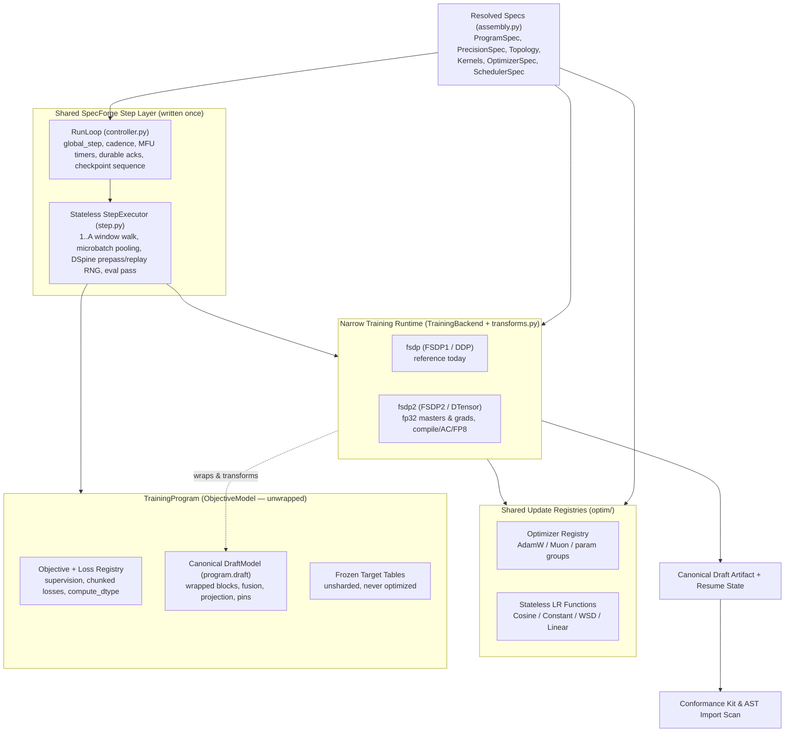

# Training backends: program, step layer, parallel runtime (`specforge.training`)

**Status: seventh revision — aligned with the `#1204–#1215`, `#1234–#1237`, and `#1242–#1245` implementation stack.**
The design that runs on `main` today is [`DESIGN.md`](DESIGN.md); the cross-plane picture is
[`../runtime/ARCHITECTURE.md`](../runtime/ARCHITECTURE.md). Compared with the sixth revision, this
revision reflects what building and testing the first two runtimes (`PlainRunner` and
`FSDP2TrainingBackend`) and auditing state ownership showed:

1. **The pluggable seam sits one layer lower** `[A8]`. Window orchestration, denominator scaling,
   `microbatch` pooling, DSpine replay and evaluation are SpecForge-owned semantics shared by every
   backend. The pluggable interface is a narrow **parallel + precision runtime** (`TrainingBackend`,
   ~6 primitives), not an 11-method `StepRunner` reimplemented per engine.
2. **PyTorch-native FSDP2 (`training.runtime: fsdp2`) is the primary second runtime, not
   torchtitan** `[A1, A7]`. For a small canonical draft beside large frozen tables, FSDP2 directly
   fixes FSDP1's `bf16` gradient accumulation/reduction on `torch==2.14.1` and composes natively
   with `torch.compile`, activation checkpointing, `torchao` FP8 and future HSDP / CP / EP without
   external-engine lock-in. Attaching torchtitan and dedicated whole-trainers are deferred until
   profiling or coverage demands them.
3. **Update mechanics are decoupled from shared Optimizer and Stateless LR registries** `[A2, A4, A8]`.
   Global gradient norms, finite/denominator checks, gradient clipping and `zero_grad` belong to the
   runtime unconditionally (no `getattr` duck-typing); parameter-group policies + update rules
   (`AdamW`, `Muon`, `AdamW8bit`) and stateless LR curves (`cosine`, `constant`, `wsd`, `linear`,
   `min_lr`) live in backend-agnostic registries shared by every runtime.
4. **Zero double-bookkeeping and strict module budgets (no God classes)** `[A4, A5]`. Every counter
   and weight copy has a single owner (`RunLoop.global_step` is the sole step counter; LR schedules
   are stateless functions of `global_step`; window state lives in local variables of a stateless
   `StepExecutor` rather than duplicated instance counters; `FSDP2` `fp32` `DTensor` parameters
   eliminate separate `fp32_params` master copies), and orthogonal transforms (`transforms.py`) keep
   every module within a ~150–300 line single-responsibility budget.
5. **MFU observability and host-side anchor sampling are first-class** `[A6, A7]`. Permanent
   per-stage timing and Trainer/Server MFU metrics replace a one-off measurement gate, and block
   objectives support deterministic host-side anchor sampling (`training.anchor_sampling: host`).

The section [Decisions](#decisions) separates choices already settled in the implementation stack
from those still open for maintainers.

## Goals

1. **Keep canonical draft architectures, objectives and data paths independent of the training
   runtime**, so switching precision, parallelism or execution optimizations never requires editing
   draft models or loss formulas.
2. **Adopt PyTorch-native FSDP2 as the primary high-accuracy, high-efficiency runtime** — `fp32`
   masters, low-precision compute (`bf16` and future `FP8`), `fp32` gradient accumulation and
   reduction, and clean composition with `torch.compile`, activation checkpointing and multi-axis
   `DeviceMesh` topologies (DP, HSDP, CP, EP).
3. **Make optimizers, LR schedules and loss functions pluggable with minimal effort** via three
   orthogonal registries (Loss in the program; Optimizer and stateless LR Scheduler shared behind
   the runtime), with zero duck-typing (`getattr`) between runtime and optimizer.
4. **Keep state single-owned and the seam narrow, closed and verified**: one owner per counter/state,
   no God classes, AST import boundaries, bitwise trajectory recordings for behaviour-preserving
   changes, a mutation-tested conformance kit, and serving acceptance-length gates for numerics
   changes.

Out of scope for the runtime seam itself: fault tolerance, a run controller, changes to capture or
transport, and how a loss kernel executes internally (chunking, fusion). The contract fixes only how
kernel and precision choices are requested, realised, agreed across ranks and recorded.

## What the design starts from

| # | Statement | Kind |
|---|---|---|
| 1 | The target is frozen and only prefills. A captured feature depends on target weights and tokens, not on the draft. There is no weight sync and no staleness, and recorded features can be replayed into any runtime | workload |
| 2 | Target execution belongs to the inference plane ([`../inference/DESIGN.md`](../inference/DESIGN.md#ownership-of-target-execution)). A trainer never runs target layers | decision |
| 3 | The loss denominator is not guaranteed to be known before the forward: DSpine's replay statistic and draft-dependent weightings depend on the draft's own predictions, and under default `training.anchor_sampling: device` block objectives sample anchors inside forward. Updates are therefore normalised after the backward. Opting into `training.anchor_sampling: host` moves block-objective anchor draws out of forward onto the host (keyed on seed, sample id and epoch), removing rank/padding dependence while keeping draft-dependent objectives as declared exceptions | workload + `#1237` |
| 4 | The unit the training plane executes uniformly is a program: `program(tensors, ...) -> ObjectiveResult`. An objective may drive the draft several times per batch (EAGLE3 rollout and `fusion`, DSpine two-pass window, deferred chunked `project` / `lm_head`) and may or may not materialize full logits. A runtime cannot assume logits exist | workload |
| 5 | The frozen target tables are large and are never sharded or optimized; the trainable draft is a few layers. Today `training.runtime: fsdp` wraps the draft in FSDP1 (`SHARD_GRAD_OP` / `FULL_SHARD`) or DDP (`NO_SHARD`), which accumulates and reduces gradients in `model.torch_dtype` (`bf16`) under `no_sync()`. `training.runtime: fsdp2` holds trainable parameters in `fp32`, computes in `model.torch_dtype` and accumulates/reduces gradients in `fp32` | fact (`main` + `#1244`) |
| 6 | The artifact is the product: a canonical draft directory written at the declared artifact dtype goes to export and to SGLang. Which runtime or optimizer produced it must not show | decision |
| 7 | Canonical training has one model-parallel axis today: sequence parallelism (ring and Ulysses attention) for an objective that declares `supports_sequence_parallel` (EAGLE3 under `attention_backend: usp`). Trainer tensor-parallel size is one (`training/canonical.py`). Four things happen in four places: the data plane cuts sequences into per-rank shards; attention exchanges data on groups bound at construction (`training/sequence_parallel.py`); LK losses sum per-sequence statistics over the sequence-parallel group inside the objective; and the accumulation count is multiplied by the sequence-parallel size (`training/assembly.py`) while the wrapper synchronises gradients over the world | fact |

## Process model

This is fixed outside the training plane and every runtime fits inside it.

- **Ranks are launched before any trainer code runs**, by the launcher (`torchrun`). Training is
  SPMD: every training method runs on every rank in the same order, with one exception for
  `evaluate` (see [Rank symmetry](#rank-symmetry)).
- **The world is initialized once**, in `specforge.cli`: `init_distributed` creates the process
  groups in a fixed order and returns one frozen `Topology` value (`specforge/distributed.py`),
  replacing the legacy module-global getters (`#1235`). `set_seed(training.seed)` seeds every
  rank identically. The data plane then creates its own acknowledgement group where a run uses one
  (`runtime/control_plane/dp_ack.py`).
- **A runtime consumes that `Topology` explicitly.** It does not initialize or destroy the world,
  does not create groups in a rank-dependent order, does not re-seed, and does not mutate
  process-wide torch state without declaring it. Any temporary helper group needed for one-time
  cross-runtime checkpoint conversion (e.g., FSDP1→FSDP2 resume on Gloo) is created identically on
  every rank and destroyed before training begins.
- **Evolution to `DeviceMesh`.** Today `Topology` carries the flat sizes, ranks and process groups
  for DP, TP and SP. As multi-node HSDP (`dp_replicate`, `dp_shard`), CP or EP are added, `Topology`
  becomes the single owner of the PyTorch `DeviceMesh`, deriving every named sub-group and the
  flattened full-DP reduction group in one place so data plane, program and runtime always agree on
  the layout.
- **The launcher owns process lifetime.** Any helper process or background ack thread started by a
  trainer/runtime is torn down on a single `finally` exit path.

## Today on `main` vs. the implementation stack

On `main` (`d4391211`), `Trainer -> TrainerController -> TrainerCore -> CanonicalTrainStrategy -> FSDPTrainingBackend`
([`DESIGN.md`](DESIGN.md)) mixes window walking, cross-sample collectives, gradient scaling and
model wrapping across layers. The table below tracks each coupling against its status in the stacked
PRs (`#1204–#1215`, `#1234–#1237`, `#1242–#1245`) and the remaining follow-up work:

| Original coupling / hazard | Status in stack (`#1204–#1215`, `#1234–#1237`, `#1242–#1245`) | Remaining work |
|---|---|---|
| Post-construction attributes (`frozen_target_modules`, `fsdp_param_dtype`, SP groups, `_no_split_modules` via `getattr`) | **Resolved** (`#1211`, `#1212`, `#1243`): `program.frozen`, `ProgramSpec.partition.blocks`, bound `SequenceParallel` groups, explicit `PrecisionSpec` (including `buffer_dtype`) | Remove `ObjectiveModel.forward`'s remaining `embed_tokens.weight.dtype` inference (`base.py`) when unwrapping root |
| Cross-sample collectives outside the runner (`microbatch_mean`, DSpine replay, evaluator, `CheckpointManager._all_ok`, `ExecutionSelection.agree`) | **Resolved** (`#1206–#1210`, `#1213`): all cross-sample collectives run through the runner/runtime, enforced by AST import scan | Move `CheckpointManager`'s remaining rank broadcast only if delivery item 13 (three-part checkpoints / dedicated trainer) is needed |
| Partial checkpoint visible on shard write failure | **Fixed (`#1247`)**: rank shards write first → `_all_ok` → rank 0 atomically writes `config.json` and `training_state.pt` last → `_all_ok` → `*-latest` | Separate three-file on-disk layout remains deferred until a dedicated trainer requires it |
| `after_step` buffer updates (e.g. MoE `#1179` expert router bias) | **Added (`#1248`)**: `ProgramSpec.after_step_statistics` + `TrainingProgram.apply_statistics`, pooled via `reduce_sum` after optimizer step succeeds and before checkpoint | Adopt in MoE `#1179` (`moe_balance.py`) to remove its direct `dist.all_reduce` |
| Process-global topology in `specforge.distributed` | **Resolved** (`#1234`, `#1235`): unused TP layers deleted; nine globals/getters replaced by one `Topology` value | Evolve `Topology` to back multi-axis layouts with PyTorch `DeviceMesh` (HSDP / CP / EP) |
| Implicit `world_size` rescale & update mechanics hidden in `BF16Optimizer` via `getattr` | **Resolved** (`#1242`): explicit `grad_reduction: Literal["mean", "sum"]`, runtime-owned global grad-norm/clip/checks/`zero_grad`, shared Optimizer & LR Scheduler registries | Convert stateful `LRScheduler` wrappers into stateless `compute_lr(global_step, SchedulerSpec)` functions |
| Fixed precision & `bf16` gradient accumulation under FSDP1 `no_sync()` | **Resolved** (`#1243`, `#1244`, `#1245`): `PrecisionSpec`, `training.runtime: fsdp \| fsdp2`, `FSDP2TrainingBackend` (`fp32` grad accum/reduce) and lazy-layout FSDP1→FSDP2 checkpoint resume | GPU A/B verification (loss band + serving acceptance length) before flipping default and retiring FSDP1 |
| Whole `ObjectiveModel` wrapped by FSDP instead of only `program.draft` | **Mitigated** (`#1236`, `#1244`): `cast_root_forward_inputs=False` prevents wrapper casts on objective/replay tensors while keeping root params gathered for post-forward calls | **Next**: route `project`/`fusion`/trainable `lm_head` through wrapped submodules and pass explicit `compute_dtype` so runtime wraps only `program.draft` |
| Double-bookkeeping & large classes (`controller.py` 712L, `trainer.py` 662L, `runner.py` 595L) | **Open**: window counters duplicated across `frame.py` (`received`) and `runner.py` (`_micro`, `_window_steps`, `_pending`); 220L resume check inside `Trainer.__init__` | **Next**: collapse `frame.py` + `DataParallelRunner`'s window state into a stateless `StepExecutor`, switch to stateless LR functions, and move resume validation to `checkpoint.py` |

## The contract

### Architecture: one stateless step layer over a narrow runtime

Building both `PlainRunner` (`#1215`, which overrode only 3 methods of `DataParallelRunner`) and
`FSDP2TrainingBackend` (`#1244`, which plugged directly under `DataParallelRunner`) proved
where the real boundary sits:

- **Shared SpecForge orchestration** (`RunLoop` in `controller.py` + stateless `StepExecutor` in
  `step.py`): written **once**. `RunLoop` owns macro progress (`global_step`, `epoch`,
  `epoch_samples`), MFU/stage timers, durable sample acknowledgements and checkpoint/eval/log
  cadence. `StepExecutor` owns the stateless single-window walk (`1..A`), `microbatch` denominator
  pooling, DSpine prepass/replay + RNG pairing, and evaluation pass framing.
- **Narrow Parallel + Precision Runtime** (`TrainingBackend` + pure `transforms.py`): **one per
  training backend** (`fsdp`, `fsdp2`, optional `plain`). Owns draft wrapping/transforms, weight
  load timing, precision policy, `no_sync`/backward, declared gradient reduction semantics (`mean`
  vs `sum`), gradient rescaling, global grad-norm + clipping + finite/denominator check +
  `zero_grad`, cross-rank reductions/agreement, and resume state.
- **Three orthogonal registries** so models, losses, optimizers and LR schedules evolve
  independently of the runtime:
  1. **Loss Registry** (`specforge.algorithms.objectives`): inside the program.
  2. **Optimizer Registry** (`specforge.training.optim.registry`): shared behind every runtime;
     builds the update rule (`AdamW`, `Muon`, `AdamW8bit`, parameter groups from
     `named_parameters()`).
  3. **Stateless LR Schedule Registry** (`specforge.training.optim.schedulers`): pure scalar
     function `compute_lr(global_step, SchedulerSpec) -> float` (`cosine`, `constant`, `wsd`,
     `linear`, `min_lr`).



### Core value types and protocols

```python
# specforge/training/contracts.py: value types and protocols only

RUNTIMES = ("fsdp", "fsdp2")

@dataclass(frozen=True)
class PrecisionSpec:
    parameter_dtype: torch.dtype             # trainable parameter storage dtype
    compute_dtype: torch.dtype               # forward/backward compute dtype
    gradient_dtype: torch.dtype              # micro-batch accumulation & reduction dtype
    master_dtype: Optional[torch.dtype]      # separate optimizer master copy, or None
    artifact_dtype: torch.dtype              # canonical checkpoint / export dtype
    low_bit: Optional[LowBitPolicy] = None   # reserved: e.g. torchao FP8 / MXFP8 linear recipe

@dataclass(frozen=True)
class TrainingRuntime:
    name: str                                # one of RUNTIMES
    precision: PrecisionSpec

@dataclass(frozen=True)
class PartitionHints:
    blocks: Tuple[str, ...] = ()             # indivisible module class names (_no_split_modules)
    entry_submodules: Tuple[str, ...] = ()   # draft submodules called outside draft.forward (fusion, project)
    high_precision: Tuple[str, ...] = ()     # modules excluded from low-bit GEMMs (lm_head, embed, routers, norms)

@dataclass(frozen=True)
class ProgramSpec:
    name: str
    inputs: Tuple[str, ...]
    replay_statistics: Tuple[str, ...] = ()
    after_step_statistics: Tuple[str, ...] = ()  # pooled after optimizer step, before checkpoint
    evaluation_diagnostics: bool = False
    reduction: Literal["window", "microbatch"] = "window"
    partition: PartitionHints = PartitionHints()
    axes: Mapping[str, Literal["copy", "part", "own"]] = field(default_factory=dict)

@dataclass(frozen=True)
class StepContext:                           # values only; no callables, no process groups
    global_step: int = 0
    total_steps: Optional[int] = None
    collect_detailed_metrics: bool = True
    accumulation_steps: int = 1
    replay_values: Mapping[str, torch.Tensor] = field(default_factory=dict)

@dataclass(frozen=True)
class OptimizerSpec:                         # target contract for shared optimizer registry
    kind: str = "adamw"                      # "adamw", "muon", "adamw_8bit", ...
    lr: float = 1e-4
    weight_decay: float = 0.0
    betas: Tuple[float, float] = (0.9, 0.999)
    eps: float = 1e-8
    param_group_policy: str = "no_decay_1d"  # e.g. "default", "no_decay_1d", "muon_2d_adamw_rest"
    offload_master: bool = False
    extra: Mapping[str, Any] = field(default_factory=dict)

@dataclass(frozen=True)
class SchedulerSpec:                         # target contract for stateless LR functions
    kind: str = "cosine"                     # "cosine", "constant", "wsd", "linear", ...
    total_steps: int = 0
    warmup_steps: int = 0
    decay_steps: Optional[int] = None        # used by WSD
    min_lr_ratio: float = 0.0

class TrainingProgram(Protocol):             # today's ObjectiveModel
    frozen: Tuple[torch.nn.Module, ...]      # target tables, teacher head: never sharded/optimized
    def __call__(self, tensors: Mapping[str, Tensor], *, step: int, total_steps: Optional[int],
                 collect_detailed_metrics: bool, prepass: bool = False,
                 **statistics: Optional[Tensor]) -> ObjectiveResult: ...
    def replay_arguments(self, replay_values: Mapping[str, Tensor], *,
                         prepass: bool = False) -> Mapping[str, Optional[Tensor]]: ...
    def apply_statistics(self, values: Mapping[str, Tensor]) -> Mapping[str, Any]: ...  # post-step, no collective, same on every rank
    def host_inputs(self, tensors: Mapping[str, Tensor], *,
                    sample_ids: Sequence[str], epoch: Optional[int]) -> Mapping[str, Tensor]: ...
    def kernel_record(self) -> Dict[str, str]: ...
    def draft_state(self, state: Mapping[str, Tensor]) -> Dict[str, Tensor]: ...

class TrainingBackend(abc.ABC):              # narrow parallel + precision runtime (~6 primitives)
    name: str
    grad_reduction: Literal["mean", "sum"] = "mean"
    optimizer_state_is_replicated: bool = False
    @property
    def process_group(self) -> Any: ...      # full flat data-parallel group for reductions & agree
    def prepare_model(self, model: nn.Module, *, optimizer_target: Optional[nn.Module] = None,
                      frozen: Tuple[nn.Module, ...] = (), blocks: Tuple[str, ...] = ()) -> nn.Module: ...
    def accumulation_context(self, *, is_boundary: bool = True) -> ContextManager[None]: ...
    def backward(self, loss: Tensor, *, is_boundary: bool = True) -> None: ...
    def step(self, *, scale: Tensor, learning_rate: float,
             loss_denominator: Optional[Tensor] = None) -> Optional[Tensor]: ...  # rescale, norm, checks, clip, opt.step, zero_grad
    def reduce_sum(self, values: Tensor) -> Tensor: ...
    def reduce_max(self, values: Tensor) -> Tensor: ...
    def agree(self, error: Optional[str], *, value: Any = None) -> None: ...
    def state_dict(self) -> dict: ...
    def load_state_dict(self, state: dict) -> None: ...
```

### Resolved values

The composition root (`specforge.application` / `specforge.training.assembly`) resolves these once
before model assembly and refuses unsupported combinations at startup — a runtime never silently
substitutes a value.

| Value | Holds | Status |
|---|---|---|
| `Topology` | `rank`, `world_size`, `local_rank`, `(tp, sp_ulysses, sp_ring)` sizes & ranks, `device_type`, and the constructed process groups (evolving to a single PyTorch `DeviceMesh` owner for HSDP / CP / EP) | **Implemented** (`#1235`, `specforge/distributed.py`) |
| `PrecisionSpec` & `TrainingRuntime` | `parameter_dtype`, `compute_dtype`, `gradient_dtype`, `master_dtype`, `artifact_dtype`, `buffer_dtype`, plus reserved `low_bit` (FP8) policy; selected by `training.runtime` (`fsdp` \| `fsdp2`) | **Implemented** (`#1243`, `#1244`) except `low_bit` |
| `OptimizerSpec` & `SchedulerSpec` | structured optimizer kind/hyperparams/param-group policy and LR schedule kind/warmup/min_lr | **Implemented** (`#1242`; stateless pure-function LR curves next) |
| `Kernels` | requested policy for choices that leave the math alone: `training.attention_backend`, `training.loss.execution`, tri-state switches (`training.loss.fused`, `model.use_fused_conv`, `model.use_liger_kernel`), plus target slots for **block `torch.compile`** and **activation checkpointing** | Partial (`loss_implementations` + build flags exist; unified `Kernels` + `transforms.py` next) |
| `RunSpec` | accumulation window, horizon, seed, `anchor_sampling`, cadences | Implicit in `TrainingConfig` / `TrainerController` today |

- **Requested at startup, realised when the facts exist.** An explicit kernel request that cannot
  run is an error, never a silent fallback. Build-time kernels are realised during model build;
  loss kernels are realised on the first real input (`ExecutionSelection`), returned in
  `CheckpointState.kernels`, compared across ranks in `agree`, and re-verified on resume. No
  forward issues a collective to agree on a kernel.
- **No dtype is inferred silently.** `FSDPTrainingBackend` and `FSDP2TrainingBackend` both reject a
  `PrecisionSpec` they cannot honour, verify trainable parameter dtypes and optimizer master dtypes
  at wrap time, and keep `program.frozen` tables in their built dtype.
- **Writable canonical weights.** `WeightPlan` writes into the tensors returned by `state_dict`;
  any component that rearranges weights for canonical export must provide an explicit import rather
  than returning a temporary copy.

### Wrapping boundary: root wrap today vs. draft-only wrap next

Today, both `FSDPTrainingBackend` and `FSDP2TrainingBackend` (`#1236`, `#1244`) wrap the
program root (`ObjectiveModel`) with `cast_root_forward_inputs=False` / `cast_forward_inputs=False`
and `ignored_modules` / `ignored_params` for `program.frozen`. That immediately fixes the FSDP
input-cast bug (e.g., DSpine's `fp32` replay ratio is no longer truncated to `bf16`) while keeping
root parameters gathered when objectives call draft submodules (`fusion`, `project`, `lm_head`)
outside `draft_model.forward()`.

Moving the wrapper inward so the runtime wraps **only `program.draft`** (leaving `ObjectiveModel`
completely unwrapped) is the clean target for composing `transforms.py` (`FP8 → AC → FSDP2 →
torch.compile`). Doing so has two concrete prerequisites:

1. **Explicit compute dtype in `ObjectiveModel`**: `objectives/base.py:302` currently infers the
   draft's compute dtype from `self.draft_model.embed_tokens.weight.dtype`. Under FSDP2 with `fp32`
   master parameters and an unwrapped `ObjectiveModel`, a trainable `embed_tokens` reports `fp32`
   outside its forward pre-hook and silently upcasts `hidden_states`; `ObjectiveModel` must read
   `PrecisionSpec.compute_dtype` explicitly.
2. **Wrapped post-forward and pre-forward draft entry points**: `draft_model.project()` (`base.py:180`)
   and EAGLE3 `draft_model.fusion()` are called outside `draft_model(...)`. Under
   `reshard_after_forward=True` (`FULL_SHARD`), each entry submodule declared in
   `PartitionHints.entry_submodules` must be wrapped as its own FSDP2 unit so parameters gather and
   cast safely (while for small drafts, `SHARD_GRAD_OP` sets `reshard_after_forward=False` and keeps
   weights gathered until backward anyway).

### The window, reductions and step statistics

One optimizer update consumes a lazy, non-empty stream of at most `ctx.accumulation_steps`
micro-batches formed across epoch boundaries (three batches per epoch, two epochs and accumulation
of two yield three updates).

- **Nothing is buffered unless `replay_statistics` is non-empty** (DSpine's two-pass alignment CE
  window, which buffers host copies of inputs and pairs prepass/replay RNG states per position when
  `anchor_sampling == "device"`).
- **A short window raises `IncompleteWindow`.** Only end-of-stream can leave a window short; no
  partial update is applied and no sample acknowledgements are committed.
- **Two declared step-statistic delivery points (`ProgramSpec`)** — neither sends a process group
  into the program, and neither adds a method to `TrainingBackend`:
  - **`replay` (`replay_statistics`)**: pooled over the window and DP ranks via `reduce_sum` in a
    prepass before the gradient pass, then returned through `ctx.replay_values` /
    `replay_arguments` (DSpine alignment CE).
  - **`after_step` (`after_step_statistics`, disjoint from `replay_statistics`)**: additive counts
    returned in `ObjectiveResult.statistics` during training forwards, summed over the window,
    pooled once across all DP ranks via `reduce_sum` **only after the optimizer update succeeds**
    (so a failed finite/denominator check never mutates draft state), and delivered to
    `program.apply_statistics(pooled)` on every rank **before** any checkpoint snapshot is taken.
    `apply_statistics` issues no collective, updates draft buffers deterministically so all ranks
    stay identical (and `checkpoint_state()` captures the update), and may return post-step scalar
    metrics to merge into `StepMetrics`. Concrete consumer: MoE `#1179` (`moe_balance.py`), which
    updates per-layer `expert_bias` once per optimizer window from global expert token counts and
    reports `moe/step_balance`.
- **Two training reductions (`ProgramSpec.reduction`)**:
  - `window` (default): `sum(numerator) / sum(denominator)` over all micro-batches and DP ranks.
    Each numerator is divided by `A` before backward; at the boundary, if
    `backend.grad_reduction == "mean"` (DDP, FSDP1, FSDP2 default), gradients rescale by
    `dp_size * A / global_denominator`, whereas `"sum"` rescales by `A / global_denominator`.
  - `microbatch` (DSpark): pools per-term denominators across DP ranks between each micro-batch's
    forward and backward (grouped by dtype so sums round in their native dtype).
- **Evaluation pooling**: `evaluate` returns rank-local results without in-step collectives;
  `Evaluator` pools once at the end via `reduce_sum` and `reduce_max` (for empty shards).

### Two axes of communication

| Axis | Ranks hold | Communication | Issued by |
|---|---|---|---|
| Data-parallel (`dp`, or HSDP `dp_replicate × dp_shard`) | different samples | gradient sync, loss denominators, metrics, step statistics, agreement, checkpoint collectives | `TrainingBackend` / step layer only (data plane keeps its own ack group) |
| Model-parallel (`cp`/SP, `ep`, `tp`) | shards of one sample (`part`), shards of experts (`own`), or shards of dense weights (`copy`) | inside a component's forward (ring/Ulysses attention, MoE token all-to-all) | the component, on a group bound at construction |

**Full-DP consistency under HSDP**: when multi-node HSDP splits DP into `("dp_replicate", "dp_shard")`,
`reduce_sum` / `reduce_max` for loss denominators, replay statistics and evaluation **must run on the
flattened full-DP group** (`dp_replicate × dp_shard`), whereas `DTensor` `clip_grad_norm_` sums
squared norms only over `dp_shard` so replicated ranks are never double-counted.

### Rank symmetry

Every method runs on every rank in the same order (`evaluate` is the sole exception when the
forward is not itself a collective). **`agree` is never called inside a training step**; it runs at
checkpoint boundaries, after `load_resume`, and at startup kernel verification.

## Single-source-of-truth bookkeeping and module budgets (no God classes)

### Eliminating double-bookkeeping (`[A4]`)

Auditing `#1204–#1215` surfaced four places where multiple objects tracked the same state. In the
target structure, every piece of mutable state has **exactly one owner**:

| State / Fact | Previous Duplication | Sole Owner in Target Design |
|---|---|---|
| **Macro step counter** | Tracked in `TrainerController.global_step`, `LRScheduler.last_epoch`, and nested `_TwoStageScheduler.after_scheduler` / `_last_lr` | **`RunLoop.global_step`** (`controller.py`). LR schedules are stateless pure functions `compute_lr(global_step, SchedulerSpec) -> float` with zero state dict |
| **Window micro-batch progress** | Counted simultaneously in `frame.py` (`received`), `DataParallelRunner` (`self._micro`, `self._window_steps`, `self._pending`), and `controller.py` (`micro_step`) | **Local variables inside stateless `StepExecutor.run_window()`** (`step.py`). Destroyed as soon as the window returns or raises; zero cross-window instance fields |
| **Master weights** | Stored twice under `fsdp`: `bf16` `model.parameters()` + cloned `fp32` `BF16Optimizer.fp32_params` copied both ways each step | **`program.draft` parameters (`fp32` `DTensor`s under `fsdp2`)**. Eliminates separate master clones and manual copy-back |
| **Model mode & resume metadata** | `runner.py` mirrored `nn.Module.training` in `_mode_unset` / `_evaluating`; `trainer.py` built a 220-line ad-hoc `resume_contract` dict | **`program.draft.training`** toggled only by `evaluation()` context; **frozen Spec dataclasses** serialized directly in the checkpoint record and validated in `checkpoint.py` |

### Preventing God classes: module responsibility & size budgets (`[A5, A8]`)

Without explicit boundaries, pulling orchestration out of `StepRunner` bloats `TrainerController`
(already 712 lines), and adding `compile` / AC / FP8 bloats `FSDP2TrainingBackend`. Splitting
vertically (macro loop vs. single window vs. parallel runtime) and horizontally (composable
transforms and registries) keeps every module within **~150–300 lines**:

| Module | Target Scope | Must Never Contain |
|---|---|---|
| `training/assembly.py` | Composition root: resolves immutable Specs + `Topology` once, selects runtime & registries | Step loops, checkpoint parsing, collectives |
| `training/trainer.py` | Thin `.fit()` lifecycle facade (stream context, guarded final save, loader/topology cleanup) | 220-line resume schema validation (moves to `checkpoint.py`), hardcoded backend wiring |
| `training/controller.py` (`RunLoop`) | Macro cadence (`global_step`, `epoch`, durable acks, eval/ckpt/log triggers, stage & MFU telemetry) | Tensors, `backward()`, micro-batch loops, `torch.distributed` |
| `training/step.py` (`StepExecutor`) | Stateless `run_window` & `run_evaluation` (`1..A` loop, `microbatch` pool, DSpine replay + RNG fork, lazy metric packing) | Cross-window mutable counters, wrapper setup, optimizer/clipping math |
| `training/backends/transforms.py` | Composable pure functions over `program.draft`: `apply_low_bit`, `apply_activation_checkpointing`, `apply_compile` | Loop state, collectives, optimizer state |
| `training/backends/fsdp2.py` | `FSDP2TrainingBackend`: `fully_shard`, `no_sync`/`backward`, rescale/norm/clip/step/zero, `DTensor` state + `reference_state.py` | Objective names, replay logic, LR formulas, inline FP8/compile/AC implementations |
| `training/optim/registry.py` | Shared Optimizer Registry + `named_parameters()` grouping (`AdamW`, `Muon`, `AdamW8bit`) | Distributed collectives, gradient clipping |
| `training/optim/schedulers.py` | Stateless pure LR curves (`cosine`, `constant`, `wsd`, `linear`, `min_lr_ratio`) | Stateful `LRScheduler` subclasses |

Adding a new execution optimization adds one function in `transforms.py`; adding a new optimizer or
LR schedule adds one entry in `optim/`. Neither touches `RunLoop`, `StepExecutor` or
`FSDP2TrainingBackend`.

## Primary second runtime: PyTorch-native FSDP2 (`training.runtime: fsdp2`)

Why FSDP2 first instead of torchtitan (which itself runs PyTorch FSDP2, `torch.compile` and
`torchao` underneath):

- **Accuracy (with `bf16` grad opt-in)**: FSDP1 with `no_sync()` accumulates unsharded gradients in
  `compute_dtype` (`bf16`) and casts to `reduce_dtype` only on the synced micro-batch. FSDP2 defaults
  to upcasting each micro-batch's gradient to `fp32` and accumulating/reducing in `fp32`
  (`MixedPrecisionPolicy(param_dtype=compute, reduce_dtype=precision.gradient_dtype,
  cast_forward_inputs=False)`). On 32 `bf16`-computed micro-batches, FSDP2 matches the exact `fp64`
  gradient sum to `1e-6`, where `bf16` accumulation drifts by >100×. For `A > 1` runs where 2×
  unsharded `fp32` grad memory or reduce-scatter bandwidth matters (or for FSDP1 parity), setting
  `training.gradient_dtype` to `model.torch_dtype` (e.g. `bfloat16`) accumulates and reduces
  uniformly in `bf16` while still casting reduced sharded gradients onto the `fp32` DTensor masters.
- **Efficiency & zero external impedance mismatch**: FSDP2 operates directly on canonical
  `nn.Module` drafts on `torch==2.14.1` in ~250 lines (versus ~1,000+ lines of adapter glue for
  torchtitan's `Module` protocol, version pins and bypassed `forward_backward`). For small drafts,
  `SHARD_GRAD_OP` maps to `reshard_after_forward=False` (ZeRO-2 memory with zero extra backward
  all-gathers); `NO_SHARD` maps to 1-rank-shard HSDP; multi-node HSDP, `torch.compile`, selective AC
  and `torchao` FP8 compose cleanly.
- **Optimizer freedom**: Because `DTensor`s preserve original 2D weight shapes (unlike FSDP1's 1D
  `FlatParameter`), elementwise optimizers (`torch.optim.AdamW(fused=True)`, `torchao` 8-bit AdamW)
  work out of the box and 2D matrix optimizers (`Muon` / `DistributedMuon`) attach cleanly through
  the shared Optimizer Registry.

What is implemented in `#1242–#1245`:

- `specforge/training/backends/fsdp2.py::FSDP2TrainingBackend` (`#1244`): upcasts trainable draft
  parameters to `fp32` (preserving tied weights), leaves `program.frozen` unsharded in its built
  dtype, applies `fully_shard` bottom-up per declared block (supporting nested `_no_split_modules`)
  and with `reshard_after_forward=False` at root (avoiding redundant pre-backward root re-gathers
  under `FULL_SHARD`), uses `reduce_dtype=precision.gradient_dtype` (default `fp32`, opt-in
  `compute_dtype`), disables gradient sync on non-boundary micro-batches while tying post-backward
  resharding to `fsdp_sharding` (`False` for `SHARD_GRAD_OP`/`NO_SHARD`, `True` for `FULL_SHARD`,
  restoring both flags in `finally`), drives registry-built optimizers directly (`#1242`), and
  exports canonical draft weights in `PrecisionSpec.artifact_dtype`.
- `specforge/training/backends/reference_state.py` (`#1245`): converts DDP and FSDP1
  `BF16Optimizer` checkpoints (replaying FSDP1 `FlatParameter._shard_param_infos` lazily on CPU one
  parameter at a time, aligning `named_parameters()` and multi-group `param_groups` order) into
  FSDP2 `DTensor` shards so existing runs switch to `fsdp2` seamlessly on resume.
- Known torch 2.14 limit (under `gradient_dtype=fp32`): a parameter that receives no gradient on
  micro-batches `1..A-1` and receives one on micro-batch `A` triggers FSDP2's uniform-gradient-dtype
  reduce-scatter error; conditional/MoE drafts can guard unused experts, opt into
  `training.gradient_dtype: bfloat16`, or stay on `fsdp` until handled.
- Current refusals: `fsdp2` refuses `optimizer_cpu_offload=True` (no separate master copy) and
  `attention_backend=usp` until GPU USP regression coverage lands.

## MFU observability and efficiency roadmap

Refactors to the training seam alone contribute zero MFU until paired with visibility and execution
optimizations. Measured improvements on 8×H200 DFlash2 / Domino workloads show that cluster MFU is
bounded across all three planes — capture server, data transport and trainer — and improving one
side in a balanced disaggregated deployment must be paired with re-tuning the server:trainer GPU
ratio (while offline training captures 100% of trainer speedups directly).

1. **Permanent observability (replaces one-off Step 0)**: log per-step stage times (`data_wait`,
   `fwd`, `loss`, `bwd`, `opt`, `comm`), analytical Trainer MFU (from anchor-expanded positions and
   head FLOPs), Server MFU, and per-rank supply vs. demand sample rates so every recipe immediately
   reveals which side is the bottleneck.
2. **System & data-plane levers**: RDMA default transport, token-cost balanced consumer dispatch,
   server-side capture optimizations, and future sequence packing / varlen batching.
3. **Program-level kernel levers**: fused projection/loss kernels, Liger RMSNorm/SwiGLU, fused
   grouped conv registered via `torch.library.custom_op` (today `grouped_causal.py` rejects
   `torch.compile`), and gating detailed diagnostics strictly to logging steps.
4. **Runtime-level execution levers (`transforms.py` + `fsdp2` over `program.draft`)**:
   - Composable draft transform pipeline:
     `optional torchao FP8 (skipping PartitionHints.high_precision)` →
     `optional activation checkpointing` →
     `FSDP2 fully_shard(blocks, reshard_after_forward=False)` →
     `per-block torch.compile` (and CUDA graphs where block objectives expand to fixed
     `num_anchors × block_size` shapes).
   - Remove unnecessary per-step sync overhead: skip `_reduce_ratio_metrics` on non-logging steps
     and allow async finite/denominator guards (`torch._assert_async`) under opt-in or `equivalent`
     paths.

## Checkpoints, numerics classes and conformance

### Checkpoints

`checkpoint_state()` gathers the canonical draft weights (cast to `PrecisionSpec.artifact_dtype`),
rank-local/replicated optimizer state, rank-local RNG state and realised `kernels`; `RunLoop`
agrees across ranks via `agree` before committing `CheckpointManager.save`. `fsdp2` reads both its
own checkpoints and legacy `fsdp` checkpoints on resume.

**Atomic publication guarantee (fixed now; independent of the deferred three-file split `[A3, A4]`):**
readers (`specforge/checkpoint/resolve.py::resolve_run_directory`) treat the presence of
`training_state.pt` as the sole definition of a complete checkpoint for both explicit step paths
and automatic run-root discovery. A partial checkpoint directory must therefore never become visible
to readers when any rank fails to write its shard:

1. Flush durable sample commits up to `step`, gather `checkpoint_state()`, and agree across ranks
   on `RankFailure` and realised `kernels` before touching disk.
2. Rank 0 rewinds stale `>= step` directories; all ranks agree (`_all_ok`) before creating files.
3. Every rank atomically writes `training_state_rank{r}.pt`.
4. **First write agreement (`_all_ok`)**: every rank confirms its shard write succeeded; any rank's
   failure raises on every rank **before `config.json` or `training_state.pt` is written**.
5. **Single commit point**: rank 0 atomically writes `config.json` (when present) and **last**
   atomically writes `training_state.pt`.
6. **Second write agreement (`_all_ok`)**: every rank observes any commit write failure before
   rank 0 moves `{run_id}-latest` and rotates old checkpoints.
7. Final agreement (`_all_ok`) so no rank proceeds before publication completes or hangs on a
   rank-0 pointer/rotation error.

A two-rank fault-injection test (failing rank 1's shard write) verifies that `save()` raises on all
ranks and that neither explicit step resolution nor run-root auto-discovery selects the partial
checkpoint directory. Splitting on-disk files further into separate resume-state and run-record
files remains deferred unless an external whole-trainer replacement requires it.

### Numerics classes and conformance (`#1213`, `#1214`, `#1244`)

| Class | Meaning | Gate |
|---|---|---|
| **`exact`** | Behaviour-preserving refactor, dispatch, transport or plumbing that must not move numerics | Bitwise match against recorded trajectories (`tests/test_runtime/trajectories.py`, CPU + GPU recordings) for the same runtime, topology, kernels and torch build |
| **`equivalent`** | Intentional numerics or precision change (`fsdp2` fp32 grads, fused kernels, `torch.compile`, `Muon`, FP8, `anchor_sampling: host`) | (1) First-update grad-norm / parameter-update check against reference (and `fp64` oracle where precision improves); (2) multi-step loss/acc within reference noise band; (3) **SGLang serving acceptance length** across the nine DeepSpec workloads before any default flip |

Four automated checks guard the boundary:
1. **AST import scan (`test_training_boundaries.py`)**: no cross-sample `torch.distributed` calls in
   program, step or run-loop code; no `specforge.distributed` globals; only assembly/`trainer.py`
   imports `training.backends`; backend packages import neither model nor objective registries;
   allowlists may only shrink.
2. **One case per declaration (`conformance.py`)**: exercises `window`, `microbatch`, `replay`,
   evaluation diagnostics, multi-rank accumulation and uneven-shard evaluation.
3. **Mutations must fail**: three deliberately broken runtimes (gradients mis-scaled by world size,
   clipping skipped, LR schedule shifted by one step) must fail the kit.
4. **Protocol checks**: consume-once fake stream verifies cross-epoch windows, commit ordering, no
   commit on `IncompleteWindow`, and durable ack flush before checkpoint.

## Delivery

Prerequisite met on `main` (`d4391211`): legacy step strategies retired.

| # | Change | Kind | Status | Gate |
|---|---|---|---|---|
| 1 | Trajectory recorder & dead-code cleanup (`#1204`, `#1205`) | tests / cleanup | **Implemented** | Bitwise self-reproduction (CPU; **pre-merge gate**: diagnose GPU FSDP `SHARD_GRAD_OP` trajectory test failure from `run 44391835970` after rebasing onto `main`) |
| 2 | Step frame, `DataParallelRunner`, eval, checkpoint state, strategy removal, `microbatch` reduction, declarations, bound SP groups (`#1206–#1212`) | behaviour-preserving | **Implemented** | 90+ recorded trajectories bit-identical to `main` |
| 3 | AST import boundaries & mutation-tested conformance kit (`#1213`, `#1214`) | tests / guardrails | **Implemented** | Shrinking allowlists; all 3 mutations caught |
| 4 | `PlainRunner` (`#1215`) | optional | **Implemented (hold)** | Bit-identical at 1 rank on CPU; hold merge unless decision O2 adopts it |
| 5 | Delete unused TP layers, single `Topology` value, `cast_root_forward_inputs=False` (`#1234–#1236`) | behaviour-preserving (+ FSDP replay precision fix) | **Implemented** | 97 reference trajectories bit-identical (only DSpine FSDP bf16 replay rounding fixes); zero `distributed` globals |
| 6 | Host-side deterministic anchor sampling (`#1237`, `training.anchor_sampling: host`) | new (`equivalent`, opt-in) | **Implemented** | Same sampling law; rank/DP-invariant; GPU A/B before default flip |
| 7 | Runtime-owned updates, `grad_reduction`, shared Optimizer/LR registries & `PrecisionSpec` (`#1242`, `#1243`) | behaviour-preserving + extensibility | **Implemented** | Bitwise trajectories on default AdamW/cosine; registry tests + runtime-owned clip/norm/checks/`zero_grad` |
| 8 | `FSDP2TrainingBackend` (`training.runtime: fsdp2`) + lazy-layout FSDP1→FSDP2 checkpoint resume (`#1244`, `#1245`) | new (`equivalent`, opt-in) | **Implemented** | Conformance kit + 18 FSDP2 trajectories + `fp32` accum oracle (`1e-6`) + cross-runtime resume tests |
| 9 | **Atomic checkpoint publication (`#1247`) & `after_step` statistics delivery (`#1248`)** | correctness + MoE contract | **Implemented** | 2-rank shard-write-failure test (partial dir never visible to explicit/auto resume); 2-rank `after_step` buffer update + checkpoint + failed-step no-mutation tests |
| 10 | **Stateless `StepExecutor` + stateless LR curves + slim `trainer.py`** (remove duplicated window/LR counters, move resume validation to `checkpoint.py`) | behaviour-preserving cleanup | **Next** | Bitwise reference & FSDP2 trajectories; zero cross-window fields in `step.py` |
| 11 | **Permanent MFU / stage observability + GPU A/B of `fsdp2`** | measurement / rollout | **Next** | Per-stage timing + Trainer/Server MFU logs; GPU loss band + SGLang serving acceptance length across families before flipping default to `fsdp2` |
| 12 | **Draft-only wrapping + `transforms.py`** (`base.py` explicit `compute_dtype`, wrapped `entry_submodules`, `torch.library.custom_op` for custom Triton ops, per-block `torch.compile`, selective AC, optional `torchao` FP8, gated metric reduction) | optimization (`equivalent` where numerics move) | **Next** | Step-time / MFU improvement + acceptance-length parity |
| 13 | **Multi-axis `DeviceMesh` in `Topology`** (HSDP, CP, EP) & deferred three-part checkpoints / external engines | scale / deferred | **Planned / Deferred** | Full-DP denominator reduction test + multi-axis GPU trajectories; external engines only if a workload outgrows native FSDP2 |

## Decisions

### Settled in the implementation stack

| # | Decision | Resolution |
|---|---|---|
| S1 | Primary second runtime | **PyTorch-native FSDP2** (`training.runtime: fsdp2`), not torchtitan (`#1244`) |
| S2 | Pluggable backend boundary | Narrow **`TrainingBackend` runtime** beneath one shared step layer (`#1242`) |
| S3 | Config key & relation to `fsdp_sharding` | `training.runtime: fsdp \| fsdp2` (default `fsdp`); reuses `training.fsdp_sharding` (`SHARD_GRAD_OP`, `FULL_SHARD`, `NO_SHARD`) (`#1244`) |
| S4 | Artifact dtype rule | Always written at `PrecisionSpec.artifact_dtype` (`model.torch_dtype`), even when `fsdp2` stores trainable masters in `fp32` (`#1243`, `#1244`) |
| S5 | Existing checkpoint compatibility | `fsdp2` resumes directly from existing DDP and FSDP1 checkpoints (`#1245`, `reference_state.py`) |
| S6 | Host-side anchor sampling | Opt-in behind `training.anchor_sampling: host` (default `device`), recorded in the resume contract (`#1237`) |
| S7 | Atomic checkpoint publication | Rank shards write and agree (`_all_ok`) before rank 0 atomically writes `config.json` and `training_state.pt` last (`#1247`) |
| S8 | `after_step` statistics delivery | `ProgramSpec.after_step_statistics` + `TrainingProgram.apply_statistics`, pooled via `reduce_sum` after optimizer step and before checkpoint (`#1248`, for MoE `#1179`) |

### Still open for maintainers

| # | Decision | What settles it |
|---|---|---|
| O1 | **When to flip default `training.runtime` to `fsdp2` and retire FSDP1** | GPU A/B per model family: loss band + SGLang serving acceptance length + throughput/memory on `#1244` / `#1245` |
| O2 | **Whether to merge or drop `PlainRunner` (`#1215`)** | Whether a wrapper-free 1-process runtime earns its maintenance cost once `fsdp2` exists |
| O3 | **Whether to flip `training.anchor_sampling` default to `host`** | GPU acceptance-length A/B; flipping it makes block-objective anchors rank- and DP-invariant by default |
| O4 | **First low-bit (FP8) recipe and default sensitive-module pins** | Step-time profiling + SGLang acceptance-length A/B on H200 / GB300 recipes |
| O5 | **Scope and timeline for CP (USP on FSDP2) and EP** | Concrete long-context or MoE draft recipes requiring `DeviceMesh` multi-axis support |
| O6 | **Whether `specforge.training.Trainer` keeps its public constructor signature** | Public Python API compatibility across scripts and callers |

## Prior art

- **miles**: thin 4-method `StepRunner` shared by torch-native FSDP and torchtitan
  (`miles/backends/training_utils/torch_native/`), built-in MFU reporting on the trainer actor, and
  torchtitan used strictly as parallelization + optimizer runtime (never its `forward_backward`).
  Taken from it: a narrow parallel runtime behind shared SpecForge orchestration, explicit config
  selection, refusals at init and built-in MFU observability. Not taken: pre-forward-only loss
  denominators for all objectives, process-global parallel state, and engine-owned model
  definitions.
- **PyTorch FSDP2 / DTensor (`torch.distributed.fsdp.fully_shard`)**: per-parameter sharding,
  `MixedPrecisionPolicy` with `fp32` gradient accumulation/reduction, native `DeviceMesh` HSDP /
  multi-axis support, and shape-preserving `DTensor`s compatible with `torch.compile`, `torchao`
  and 2D optimizers.
