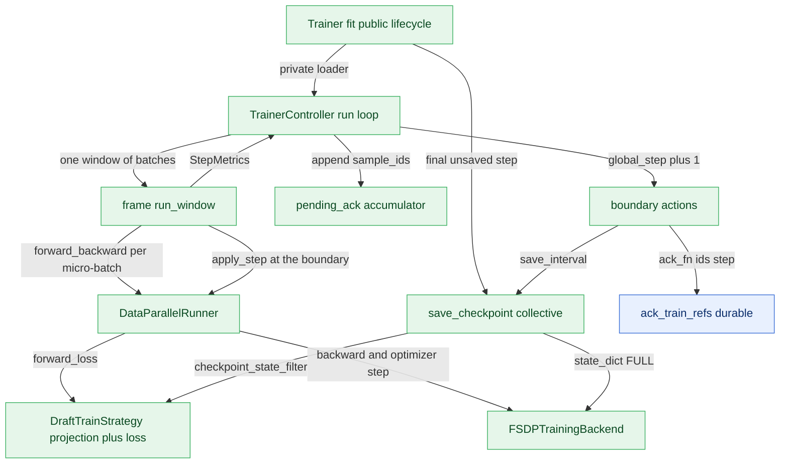

# Training Plane Design (`specforge.training`)

This is the design note for the **training**, scoped to this plane.
The cross-plane picture (whole-system map, endpoint reference, autonomy) lives in
[`../runtime/ARCHITECTURE.md`](../runtime/ARCHITECTURE.md); the shared records
every plane exchanges are in
[`../runtime/contracts.py`](../runtime/contracts.py).

## Responsibility

Owns the one caller-facing `Trainer` lifecycle that turns a normalized,
tensor-carrying `TrainBatch` stream into optimizer steps and checkpoints.
`Trainer.fit()` is the only package-level training call: it enters any
topology-owned stream context, invokes the internal `TrainerController` over its
private loader, exits the context, and writes the final checkpoint when the
last optimizer step was not already saved by the periodic checkpoint path.
For the disaggregated online consumer, that same lifecycle then publishes its
terminal done/failed signal and always stops the rank-0 ref distributor. Direct
Python builder callers therefore receive the same cleanup guarantees as the
CLI; there is no second wrapper-owned training lifecycle.

Below that boundary, `TrainerController` is the run loop: it owns the epochs,
the optimizer windows it cuts from the training stream, optimizer-step
counting, interval checkpoints, and durable acknowledgements. The step frame
(`frame.run_window`) walks one window and decides only the order in which the
runner sees its micro-batches. `DataParallelRunner` executes each micro-batch
and applies the update: it issues the step's collectives across samples (the
loss denominator, the window's metrics, the replay statistics), normalizes the
gradients and owns the RNG. One collective of a step is still issued elsewhere:
an objective with the `global_microbatch` reduction (DSpark) reduces each
term's denominator itself, inside the forward
(`algorithms.objectives.base.microbatch_mean`). `DraftTrainStrategy` owns model-specific
validation, forward/loss, target projection, and checkpoint filtering;
`FSDPTrainingBackend` owns wrapping, backward, optimizer steps, distributed
gradient norms, and full training state. What the frame and a runner exchange
is declared in `contracts.py` (`StepRunner`, `PendingStep`, `StepMetrics`).
Checkpoint rotation and the latest pointer live in
`specforge.training.checkpoint`. Resume restores each rank's optimizer/RNG
state and repositions fixed offline refs through `FeatureDataLoader.seek()`.

## Internal mechanics

The training plane is the only tensor-carrying side besides the data plane; it
consumes `TrainBatch.tensors`. One optimizer update consumes one window: at
most `accumulation_steps` micro-batches, cut from the stream across epoch
boundaries and handed to the runner one at a time, so no window is held in
memory. `DataParallelRunner.forward_backward` divides each loss numerator by
`accumulation_steps` and uses `no_sync()` only for non-boundary micro-batches;
its boundary call returns the `PendingStep` that `apply_step` consumes, so an
update cannot be applied twice or without its backward. The update's objective
is `sum(numerator) / sum(denominator)` over the window and the ranks.
For DDP, the backend accumulation context encloses both forward and backward;
wrapping backward alone does not disable DDP gradient synchronization. FSDP
retains its backward-only deferral.
`TrainerController` increments `global_step` only when a window's update has
been applied, commits the pending sample acknowledgements, emits metrics, and
performs configured interval saves. The outer `Trainer` owns topology cleanup and the guarded final
save, so CLI, builders, and Python callers cannot select a second loader-based
training entry. All saves delegate to `CheckpointManager`; the shared draft
state is written by rank 0 while every rank writes its own optimizer/RNG state.

DSpine declares a replay statistic: its alignment CE is normalized over the
whole optimizer window and every rank. For such a window the frame first calls
`runner.prepass` for each micro-batch (training mode, no gradients) and keeps a
host copy of its inputs, pools the statistic's sums once with
`runner.reduce_sum`, then calls `forward_backward` for each kept micro-batch
with the pooled sums in `StepContext.replay_values`. The runner restores, for
each replayed forward, the RNG state its prepass started from. Replay adds a
forward pass without retaining the window's activations. Each replayed
forward/backward pair uses the backend accumulation context; only the last
synchronizes DDP gradients. Evaluation does not replay.

Evaluation goes through the same runner. `Evaluator.run` calls
`runner.evaluate` for each batch (evaluation mode, no gradients, the mode it
found restored afterwards) and pools the pass once at the end through
`runner.reduce_sum` and `runner.reduce_max`, on a schedule that is the same on
every rank. Nothing is reduced inside `evaluate`, so a rank may hold fewer
evaluation batches than another, or none, unless the wrapped forward is itself
a collective (FSDP). An objective that normalizes each rank's micro-batch over
all ranks in training (DSpark) is normalized on its own rank in evaluation; the
evaluator pools numerators and denominators of the whole pass instead.

Natural end-of-stream is accepted only at an optimizer boundary. If the stream
ends inside a window the frame raises `IncompleteWindow` and `fit` fails
instead of stepping unreduced gradients or reporting a checkpoint as
successful. Queue-mode loaders
terminally settle and clean a short `drop_last` batch without emitting it;
fixed offline refs keep normal `drop_last` semantics.

## Consumer dispatch

`runtime.consumer_dispatch` controls sample assignment to consumer ranks:

- `round_robin` (default): assign samples in source order.
- `cost_balanced`: balance estimated anchor/context costs within each optimizer window.
- `two_window_bucketed`: sort samples across two windows, then balance each window.
- `two_window_joint_balanced`: balance two windows jointly, falling back to independent
  balancing unless the estimated total critical-path cost decreases.

Two-window policies require both high and low ref watermarks to cover two global
optimizer windows and can change optimizer-step sample membership and the training trajectory.
Producer byte accounting follows the acknowledged refs, including reordered windows;
resume rebuilds release totals from the durable ledger and publication stream.
All policies preserve sample coverage, per-rank accumulation counts, deduplication,
durable acknowledgements, and incomplete-tail handling. Cost estimates are heuristics,
not guarantees of throughput improvement.

## Endpoints

### What this plane calls into

| From | Endpoint | Plane |
|---|---|---|
| `TrainerController` | `FeatureDataLoader.__iter__` | compute |
| `TrainerController` | `frame.run_window` | compute |
| `frame.run_window` | `DataParallelRunner.forward_backward` / `apply_step` | compute |
| `TrainerController` | `Evaluator.run` | compute |
| `Evaluator` | `DataParallelRunner.evaluate` / `reduce_sum` / `reduce_max` | compute |
| `TrainerController` | `DataFlowController.ack_train_refs` | control |
| `DataParallelRunner` | `CanonicalTrainStrategy.forward_loss` | compute |
| `DataParallelRunner` | `FSDPTrainingBackend.backward` | compute |
| `DataParallelRunner` | `FSDPTrainingBackend.step` | compute |
